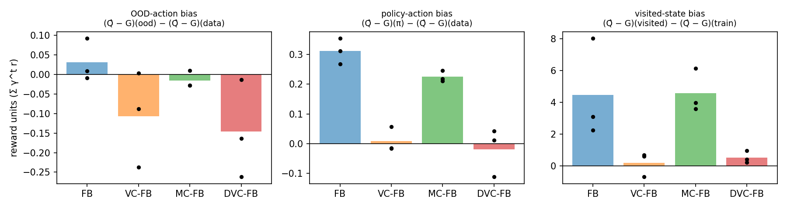

# T04: is MC-FB more pessimistic than VC-FB?

## Question

On the 100k ExORL datasets, VC-FB outperforms MC-FB. Jeen et al. (2024, arXiv 2309.15178,
Sec. 5) explain this by task coverage: VC-FB penalises OOD actions at $z \sim \mathcal{Z}$,
MC-FB at $B(s^+)$, and $B(s^+)$ covers fewer tasks when $|\mathcal{D}|$ is small. They support it
with DVC-FB, which uses only $z = B(s_g)$, and report DVC-FB < MC-FB < VC-FB aggregated over
all 100k datasets (their Table 2).

The alternative tested here is that MC-FB is simply more pessimistic, in particular on OOD
actions, so its policies are pushed too close to the data. If so, MC-FB's critic should
value uniform actions further below their true value than VC-FB's does.

## Setup

- ExORL `walker` / `rnd`, 100k transitions, tasks `stand`, `walk`, `run`, `flip`.
- FB, VC-FB, MC-FB and DVC-FB, seeds 0 to 2, 1M steps, paper hyperparameters.
- DVC-FB follows eq. 19 of the paper's appendix B.1.6. $z = B(s_g)$ is used without gradient
  into $B$ (an implementation choice, see limitations).
- Eval: IQM return per task every 20k steps, as logged by `main_exorl.py`. "Final" is the
  1M-step model and "best" the step with the highest mean over the four tasks.
- Probe on each final model: for 1000 training states (the same for all 12 models), compare
  the critic's value $\hat Q(s,a)$, rescaled to reward units, with a Monte Carlo return $G(s,a)$
  from the simulator. The return follows the model's own actor at the task's $z_r$.

The metrics difference out the model's constant value offset, which FB does not identify:

| Metric | Definition | Reading |
|---|---|---|
| d_ood | $\overline{(\hat Q - G)(s,a_\text{unif})} - \overline{(\hat Q - G)(s,a_\text{data})}$ | < 0: OOD actions under-valued relative to data actions (pessimism) |
| d_policy | same with $a = \pi(s,z_r)$ in place of $a_\text{unif}$ | > 0: the policy's own action over-valued |
| d_visited | $\overline{(\hat Q - G)}$ on states the eval policy visits minus on training states, $a = \pi$ | > 0: over-valuation off the data |
| action gap | $Q(s,a_\text{data}) - Q(s,a_\text{unif})$ for $z$ from the prior, $B(s)$ and $z_r$ | > 0: the critic prefers data actions |

## Results

### Returns

| Algorithm | Final (1M) | Best during training | Best step per seed |
|---|---|---|---|
| FB | 283 ± 113 | 444 ± 37 | 800k, 680k, 200k |
| VC-FB | 324 ± 14 | 411 ± 9 | 440k, 420k, 500k |
| MC-FB | 152 ± 49 | 453 ± 15 | 920k, 180k, 400k |
| DVC-FB | 309 ± 6 | 453 ± 69 | 220k, 440k, 560k |

Mean IQM over the four tasks, mean ± std over 3 seeds. Final per task:

| Algorithm | stand | walk | run | flip |
|---|---|---|---|---|
| FB | 435 | 323 | 98 | 276 |
| VC-FB | 484 | 364 | 139 | 308 |
| MC-FB | 272 | 177 | 44 | 115 |
| DVC-FB | 466 | 323 | 119 | 328 |

At 1M steps MC-FB is the worst method and VC-FB and DVC-FB the best and most stable. The best
checkpoints are within noise of each other: MC-FB reaches the same peak as the others but
does not keep it.

### Calibration

Reward units ($\sum_t \gamma^t r$, $\gamma = 0.98$), tasks averaged, mean ± std over 3 seeds.
For scale, $G$ on data actions has a mean of 12 to 16 and a standard deviation of 5 to 6 over
states.

| Metric | FB | VC-FB | MC-FB | DVC-FB |
|---|---|---|---|---|
| d_ood | +0.03 ± 0.04 | −0.11 ± 0.10 | −0.02 ± 0.02 | −0.15 ± 0.10 |
| d_policy | +0.31 ± 0.03 | +0.01 ± 0.03 | +0.23 ± 0.01 | −0.02 ± 0.07 |
| d_visited | +4.45 ± 2.54 | +0.19 ± 0.63 | +4.57 ± 1.13 | +0.51 ± 0.31 |
| Spearman($\hat Q$, $G$), data actions | 0.52 ± 0.04 | 0.52 ± 0.02 | 0.51 ± 0.03 | 0.54 ± 0.02 |
| true OOD deficit $\overline{G(\text{unif}) - G(\text{data})}$ | −0.05 ± 0.05 | −0.03 ± 0.04 | −0.02 ± 0.03 | −0.03 ± 0.06 |
| predicted OOD deficit $\overline{\hat Q(\text{unif}) - \hat Q(\text{data})}$ | −0.02 ± 0.02 | −0.14 ± 0.07 | −0.03 ± 0.02 | −0.18 ± 0.05 |

d_ood per task:

| Task | FB | VC-FB | MC-FB | DVC-FB |
|---|---|---|---|---|
| stand | +0.00 ± 0.17 | −0.11 ± 0.18 | −0.13 ± 0.13 | −0.14 ± 0.13 |
| walk | +0.02 ± 0.16 | −0.26 ± 0.15 | +0.06 ± 0.16 | −0.44 ± 0.19 |
| run | +0.07 ± 0.06 | −0.11 ± 0.07 | −0.00 ± 0.03 | −0.04 ± 0.03 |
| flip | +0.03 ± 0.14 | +0.04 ± 0.01 | +0.01 ± 0.16 | +0.03 ± 0.23 |

### Action gap

Critic value of the data action minus a uniform action. Raw $F^\top z$ units / in units of the
std of $Q(s,a_\text{data})$ / fraction of states where the data action is valued higher.

| z | FB | VC-FB | MC-FB | DVC-FB |
|---|---|---|---|---|
| prior | −0.8 / −0.00 / 0.48 | +8.2 / +0.03 / 0.65 | −2.8 / −0.00 / 0.48 | +5.3 / +0.02 / 0.60 |
| $B(s)$ | −0.9 / −0.00 / 0.49 | +9.3 / +0.05 / 0.67 | −3.3 / −0.00 / 0.48 | +10.8 / +0.04 / 0.69 |
| $z_r$ (eval tasks) | +0.3 / +0.00 / 0.51 | +3.3 / +0.07 / 0.64 | +0.4 / +0.01 / 0.52 | +4.3 / +0.09 / 0.67 |

Median distance to the nearest training state (standardised observations): 1.88 for the
probe's training states, and for states the final policies visit FB 1.56, VC-FB 1.84,
MC-FB 1.49, DVC-FB 1.86.

## Findings

1. **MC-FB is not more pessimistic than VC-FB.** Its d_ood (−0.02) is closer to zero than
   VC-FB's (−0.11), and its critic does not separate data from uniform actions at any $z$
   (48 to 52%, the same as FB). The value-conservative methods are the ones that under-value
   uniform actions, by about 0.1 to 0.2 reward units more than the true deficit.
2. **MC-FB's critic behaves like unregularised FB.** On d_policy, d_visited and the action
   gap MC-FB is within seed noise of FB, while VC-FB and DVC-FB are near zero. FB and MC-FB
   over-value the policy's action by 0.2 to 0.3 and the states their policy visits by about
   4.5 reward units, roughly one standard deviation of $G$. This happens although their
   policies stay closer to the data (median distance 1.5 against 1.85).
3. **DVC-FB matches VC-FB here.** Penalising only at $z = B(s_g)$ gives the same final return
   (309 against 324), the same calibration and the same action gap as penalising at
   $z \sim \mathcal{Z}$. On this dataset the prediction DVC-FB < MC-FB from the coverage
   hypothesis does not hold. What separates the methods is the form of the penalty (on
   $F^\top z$ against $F^\top B(s^+)$), not which zs it uses.
4. Ranked by calibration and by final return, the methods split into the same two groups:
   {VC-FB, DVC-FB} and {FB, MC-FB}. Best-checkpoint returns do not separate them.

## Limitations

- Three seeds per method and one dataset. The paper's ordering is aggregated over all 100k
  ExORL datasets, so finding 3 does not contradict it in general.
- Final returns vary strongly between checkpoints (FB seed 2 drops from 397 at 200k to 148
  at 1M). The probe uses only the final model.
- The critic's value is identified only up to an offset (the "level" in `summarize.py`
  ranges from −12 for FB to −39 for MC-FB), so only offset-free differences are interpreted.
- The rescaling $c_r$ from $F^\top z_r$ to reward units relies on the inferred $z_r$ and is one
  constant per task, so it scales but does not change the sign of each metric.
- $G$ follows each model's own actor with training noise, so it is the return of that policy,
  not of the optimal one.
- The d_ood effects are small: about 1% of the mean return and 3% of its spread over states.
  The d_visited difference is the large one.
- DVC-FB passes no gradient into $B$ through the penalty. The paper does not say whether its
  implementation does.
- Runs used different hardware (local RTX GPUs and A100s) and three commits whose training
  code differs only by the DVC-FB addition.
