# T05：固定 standard FB 下的 reward 修正比較

本表呈現 Q1 的 latent 幾何結果及 Q2「不重訓 FB，換 latent 能否改變表現與行為？」的配對 rollout 結果。Walker 任務未定義二元成功條件，因此不列成功率，以 return、行為指標與影片比較。

任務指標補跑的結果另列於文末「任務指標補跑」一節，包含站立高度、行走速度誤差、跑步速度與翻轉圈數。下方主表與 Q2 表格保留歷史評估值，不與新軌跡混合。

## 主比較表顯示固定 FB 下的 latent、return 與速度差異

比較涵蓋 3 個訓練隨機種子與 Walker 站立、行走、跑步、翻轉四個任務。FB representation 與 policy 參數固定。每個修正 reward 選取相對原始 reward latent 的**目標夾角為 10 度**的結果，每列彙整 12 組模型與任務比較。角度和相似度先在同一模型、同一任務內計算，再等權平均，不跨模型平均 latent 座標。Return 與行為指標先平均每個模型的 20 episodes，再等權平均 3 個訓練 seeds。Return 括號內為相對原始 reward latent 的配對差，四個任務不合併成單一分數。

| Reward 類型 | Bias strength：實際修正係數範圍 | Return | Latent similarity：與原始 reward 的平均 cosine／平均夾角 | 主要行為特徵 |
|---|---|---|---|---|
| 原始任務 reward（基準） | 0 | 站 634.4；走 558.6；跑 209.3；翻 285.6 | 1.000000／0.000 度（自身比較） | 平均水平速度：站 0.571；走 1.717；跑 1.674；翻 0.593 |
| CQL 價值偏好動作分布修正 | 0.1751–0.8055 | 站 588.0（-46.4）；走 559.5（+0.9）；跑 177.0（-32.3）；翻 264.7（-20.9） | 0.984793／10.005 度 | Δ 平均水平速度：站 -0.135；走 -0.068；跑 -0.306；翻 -0.060 |
| ReBRAC 動作偏離懲罰 | 0.002519–0.01195 | 站 560.4（-74.0）；走 537.0（-21.5）；跑 210.6（+1.3）；翻 313.5（+27.9） | 0.984842／9.989 度 | Δ 平均水平速度：站 -0.149；走 -0.080；跑 -0.004；翻 +0.116 |
| ReBRAC 動作偏離懲罰＋長度配平的正常數 reward | 0.02244–0.1129 | 站 580.0（-54.4）；走 501.8（-56.8）；跑 180.5（-28.7）；翻 287.1（+1.5） | 0.984791／10.005 度 | Δ 平均水平速度：站 -0.014；走 -0.075；跑 -0.085；翻 +0.116 |
| 正常數 reward | 0.03763–0.1988 | 站 562.7（-71.7）；走 566.7（+8.1）；跑 166.3（-43.0）；翻 240.5（-45.0） | 0.984807／10.000 度 | Δ 平均水平速度：站 -0.015；走 +0.063；跑 -0.317；翻 -0.085 |
| 確定性 policy 下一狀態 bonus（bilevel E2E-style） | 0.03323–0.1705 | 站 526.3（-108.1）；走 554.0（-4.6）；跑 172.6（-36.7）；翻 249.2（-36.4） | 0.984821／9.996 度 | Δ 平均水平速度：站 -0.098；走 +0.001；跑 -0.250；翻 -0.071 |

Bias strength 是為達到指定角度而逐模型、逐任務搜尋的實際係數，表中呈現最小至最大值。10 度是比較條件，不是修正係數，不同 reward 修正的係數尺度也不能直接比較。

CQL 修正依價值偏好的動作分布與資料動作分布之差計算。ReBRAC 懲罰 policy 動作與資料中下一個動作的平方距離。組合修正加入正常數 reward，兩項在原始 reward latent 處的偏移向量長度配平。下一狀態 bonus 則模擬確定性 policy 動作，平均其下一狀態的 backward 特徵以修正 latent，不直接估計密度比。這些名稱描述 reward 投影規則，不代表重新訓練或重現原始演算法的 policy。

## Q1：相同偏移幅度下，reward 修正產生不同但未必獨立的方向

移除各 latent 沿原始 reward latent 的分量，再將剩餘偏移方向正規化後比較 cosine。接近 1 表示同向，接近 −1 表示反向，接近 0 表示近乎垂直。下表同樣使用目標 10 度的結果，每組比較包含 3 個訓練隨機種子與 4 個任務。範圍為觀察到的最小與最大值，不是信賴區間。

| Reward 修正比較 | 偏移方向 cosine：平均［最小，最大］ | 兩個完整 latent 的平均夾角 |
|---|---|---|
| CQL 價值偏好動作分布修正 vs ReBRAC 動作偏離懲罰 | 0.158［0.039，0.283］ | 12.923 度 |
| CQL 價值偏好動作分布修正 vs ReBRAC 動作偏離懲罰＋長度配平的正常數 reward | -0.121［-0.311，0.023］ | 14.927 度 |
| CQL 價值偏好動作分布修正 vs 正常數 reward | -0.174［-0.324，-0.042］ | 15.281 度 |
| CQL 價值偏好動作分布修正 vs 確定性 policy 下一狀態 bonus（bilevel E2E-style） | -0.304［-0.422，-0.164］ | 16.109 度 |
| ReBRAC 動作偏離懲罰 vs ReBRAC 動作偏離懲罰＋長度配平的正常數 reward | -0.057［-0.379，0.149］ | 14.473 度 |
| ReBRAC 動作偏離懲罰 vs 正常數 reward | -0.992［-0.995，-0.990］ | 19.950 度 |
| ReBRAC 動作偏離懲罰 vs 確定性 policy 下一狀態 bonus（bilevel E2E-style） | -0.937［-0.954，-0.918］ | 19.664 度 |
| ReBRAC 動作偏離懲罰＋長度配平的正常數 reward vs 正常數 reward | 0.176［-0.020，0.477］ | 12.758 度 |
| ReBRAC 動作偏離懲罰＋長度配平的正常數 reward vs 確定性 policy 下一狀態 bonus（bilevel E2E-style） | 0.213［0.043，0.457］ | 12.478 度 |
| 正常數 reward vs 確定性 policy 下一狀態 bonus（bilevel E2E-style） | 0.951［0.934，0.964］ | 3.104 度 |

五個互不重疊推論子集各自重算原始 reward latent，與完整資料估計比較，共 60 個子集估計的平均夾角為 2.542 度，範圍為 1.839–3.291 度。子集估計使用的資料量較少且與完整估計共用資料，僅作有限樣本敏感度參考，並未估計 reward 修正方向本身的抽樣誤差。

**Q1 結論：固定 standard FB 下，不同 reward 修正可產生不同的 latent 偏移方向。** ReBRAC 懲罰與正常數 reward 的方向幾乎相反，CQL 與 ReBRAC 則接近垂直。但正常數 reward 與確定性 policy 下一狀態 bonus 高度同向，不能將每種 reward 修正都解讀為獨立方向。偏移角度本來就是搜尋條件，因此目前結果不構成方法間差異的顯著性檢定，也不回答共同悲觀—樂觀軸或行為控制是否成立。

## Q2：不重訓即可改變行為，但沒有跨任務一致改善

以下均為既有 rollout：每個模型與任務共用 episode 0–19 的環境初始化種子，actor 使用裁切後的確定性平均動作，每段評估 1000 steps。配對差是同一模型、同一任務、同一 episode 下，修正 reward latent 減去原始 reward latent 的結果。控制的是初始狀態，並非後續軌跡逐時間點相同。所有 return 都累加原始任務 reward，不把 implicit reward 加入評分。

原始 reward latent 的行為基準如下。水平速度單位為 m/s，直立程度為軀幹朝上方向的分量，越接近 1 越直立。低高度比例是軀幹高度低於 0.6 m 的時間比例。動作飽和比例是絕對值大於 0.99 的動作分量比例。

| 任務 | Return | 水平速度 | 直立程度 | 低軀幹高度時間比例（%） | 動作飽和比例（%） | 最近訓練樣本距離 |
|---|---|---|---|---|---|---|
| 站 | 634.4 | 0.571 | 0.539 | 20.44 | 78.16 | 2.742 |
| 走 | 558.6 | 1.717 | 0.573 | 17.14 | 84.67 | 2.794 |
| 跑 | 209.3 | 1.674 | 0.524 | 18.51 | 81.29 | 2.770 |
| 翻 | 285.6 | 0.593 | 0.007 | 44.74 | 82.62 | 2.739 |

下表使用相同的目標 10 度切片，正負號表示相對基準的變化，不表示好壞。Return 範圍來自 3 個訓練 seeds 各自的 20-episode 配對平均，不是 60 個獨立訓練結果，也不是信賴區間。

| 任務 | Reward 類型 | Δ return：平均［seed 最小，最大］ | Δ 水平速度 | Δ 直立程度 | Δ 低軀幹高度時間比例（百分點） | Δ 動作飽和比例（百分點） | Δ 最近訓練樣本距離 |
|---|---|---|---|---|---|---|---|
| 站 | CQL 價值偏好動作分布修正 | -46.4［-74.9，+2.6］ | -0.135 | -0.134 | +7.11 | +2.12 | +0.008 |
| 站 | ReBRAC 動作偏離懲罰 | -74.0［-237.4，+10.8］ | -0.149 | -0.173 | +12.59 | +1.88 | -0.024 |
| 站 | ReBRAC 動作偏離懲罰＋長度配平的正常數 reward | -54.4［-105.1，+21.3］ | -0.014 | -0.078 | +7.36 | -0.84 | +0.025 |
| 站 | 正常數 reward | -71.7［-178.9，-5.7］ | -0.015 | -0.045 | +3.45 | -3.53 | +0.030 |
| 站 | 確定性 policy 下一狀態 bonus（bilevel E2E-style） | -108.1［-152.7，-37.0］ | -0.098 | -0.101 | +8.81 | -3.18 | +0.036 |
| 走 | CQL 價值偏好動作分布修正 | +0.9［-30.1，+48.9］ | -0.068 | -0.053 | +2.59 | -0.14 | -0.022 |
| 走 | ReBRAC 動作偏離懲罰 | -21.5［-36.4，+3.8］ | -0.080 | -0.037 | +3.68 | +0.70 | -0.008 |
| 走 | ReBRAC 動作偏離懲罰＋長度配平的正常數 reward | -56.8［-94.5，-16.0］ | -0.075 | -0.090 | +6.97 | -1.38 | +0.003 |
| 走 | 正常數 reward | +8.1［-14.4，+29.8］ | +0.063 | +0.023 | -1.64 | -2.51 | -0.012 |
| 走 | 確定性 policy 下一狀態 bonus（bilevel E2E-style） | -4.6［-18.9，+21.4］ | +0.001 | +0.013 | -0.47 | -1.76 | -0.015 |
| 跑 | CQL 價值偏好動作分布修正 | -32.3［-37.2，-28.3］ | -0.306 | -0.182 | +8.41 | +0.35 | -0.017 |
| 跑 | ReBRAC 動作偏離懲罰 | +1.3［-14.7，+10.5］ | -0.004 | +0.026 | -0.11 | +1.91 | +0.017 |
| 跑 | ReBRAC 動作偏離懲罰＋長度配平的正常數 reward | -28.7［-72.8，+1.5］ | -0.085 | -0.158 | +8.63 | -0.62 | -0.005 |
| 跑 | 正常數 reward | -43.0［-67.8，-18.1］ | -0.317 | -0.143 | +7.90 | -2.91 | -0.015 |
| 跑 | 確定性 policy 下一狀態 bonus（bilevel E2E-style） | -36.7［-48.7，-17.0］ | -0.250 | -0.106 | +7.27 | -2.49 | -0.024 |
| 翻 | CQL 價值偏好動作分布修正 | -20.9［-42.4，-6.3］ | -0.060 | -0.084 | +5.94 | +1.64 | +0.015 |
| 翻 | ReBRAC 動作偏離懲罰 | +27.9［+3.5，+40.4］ | +0.116 | +0.140 | -7.35 | +1.17 | +0.040 |
| 翻 | ReBRAC 動作偏離懲罰＋長度配平的正常數 reward | +1.5［-35.4，+23.9］ | +0.116 | -0.043 | +1.33 | -0.32 | +0.006 |
| 翻 | 正常數 reward | -45.0［-71.4，-1.4］ | -0.085 | -0.084 | +7.87 | -1.82 | -0.008 |
| 翻 | 確定性 policy 下一狀態 bonus（bilevel E2E-style） | -36.4［-66.9，+10.6］ | -0.071 | -0.070 | +6.60 | -2.08 | -0.022 |

代表案例的逐 seed 配對平均與標準誤如下，SE 是同一模型內 20 個初始狀態配對差的樣本標準差除以 20 的平方根，不涵蓋模型訓練的不確定性。所有方法與任務的 SE 另保留於數據表。這是描述性分析，沒有對多方法、多任務比較做顯著性檢定或多重比較校正。

| 任務 | Reward 修正 | 訓練 seed | Δ return：平均 ± SE | Δ 水平速度：平均 ± SE | Δ 直立程度：平均 ± SE |
|---|---|---|---|---|---|
| 跑 | CQL 價值偏好動作分布修正 | 0 | -28.3 ± 12.6 | -0.181 ± 0.085 | -0.123 ± 0.064 |
| 翻 | ReBRAC 動作偏離懲罰 | 0 | +39.9 ± 27.2 | +0.148 ± 0.063 | +0.145 ± 0.055 |
| 跑 | CQL 價值偏好動作分布修正 | 1 | -31.3 ± 12.2 | -0.405 ± 0.103 | -0.228 ± 0.052 |
| 翻 | ReBRAC 動作偏離懲罰 | 1 | +3.5 ± 8.8 | +0.021 ± 0.031 | +0.023 ± 0.024 |
| 跑 | CQL 價值偏好動作分布修正 | 2 | -37.2 ± 4.8 | -0.332 ± 0.061 | -0.196 ± 0.018 |
| 翻 | ReBRAC 動作偏離懲罰 | 2 | +40.4 ± 30.0 | +0.181 ± 0.111 | +0.252 ± 0.053 |

**F1：跑步 CQL 的 return 與行為指標在三個 seeds 都朝同方向改變。** 跑步任務的 CQL 修正在三個訓練 seeds 都降低 return，平均差為 −32.3，伴隨平均速度下降 0.306 m/s、直立程度下降 0.182。這支持固定網路參數下的行為差異，但不代表有意義的悲觀—樂觀排序。

**F2：改善依賴任務，且平均值可能掩蓋 seed 差異。** ReBRAC 懲罰在翻轉任務的 return 配對平均提高 27.9，三個 seeds 的平均差都為正，但 episode 間變動大，尚不能稱為可靠改善；在站立任務則平均降低 74.0，且 seed 範圍跨越零。正常數 reward 在行走任務平均提高 8.1，但 seed 範圍也跨越零，不能稱為穩定改善。

**F3：指標不足以定義保守程度或成功率。** 最近訓練樣本距離將狀態與動作按資料集每維標準差縮放，再取最近鄰歐氏距離，預設每 10 steps 量測一次。它同時反映狀態與動作，不能直接當作風險、行為機率或保守程度。尤其翻轉任務中，低軀幹高度與較低直立程度可能是任務動作的一部分，不等同失敗。

既有影片的抽樣影格提供有限的姿態例證：訓練 seed 0、初始化種子 0 的跑步原始 reward、CQL 修正與正常數 reward，在多個時間點呈現不同的腿部配置與軀幹高度；翻轉任務的原始 reward 與 ReBRAC 懲罰也呈現不同姿態序列。這些觀察不代表已驗證完整翻轉次數或全部 episodes 的運動型態。已補齊原先缺少的 64 支 ReBRAC＋常數 reward 組合影片，原始 reward 與五種修正 reward 的所有已存 latent 均有影片，涵蓋三個模型與四個任務。影片以固定 latent 與確定性 actor 重新渲染，只作行為展示。相同 checkpoint、latent 與初始化種子的本機重播未完全重現原評估 return，因此不能將影片視為表格中 episode 0 軌跡的精確重現，也不以影片重播覆寫原評估數據。

三個模型採用各 seed 的既有選定模型，訓練步數分別為 800000、680000、200000。因此這裡的 seed 差異同時包含模型訓練進度差異，不能解讀為固定訓練步數下的純 seed 變異。

**Q2 結論：已有不重訓、只換 latent 就改變表現與行為的具體案例：跑步 CQL 修正在三個模型都降低 return、速度與直立程度。** 其餘表格提供描述性差異，不保證每一格都超出 episode 抽樣變動，也不支持某種 reward 修正在所有任務普遍改善。這些結果尚未建立保守程度排序。

## Q3：第一方向只涵蓋部分偏移，尚未建立共同悲觀—樂觀軸

**五種 reward 修正並非近乎共線，目前尚未建立共同悲觀—樂觀軸。** 在同一模型、同一任務內，將五個單位偏移方向排成矩陣，不扣除方法平均，以奇異值平方占總和的比例衡量共同軸集中程度。目標 10 度時，第一方向平均只占 61.1%；移除常數 reward 方向並重新單位化後，剩餘四種方法為 53.0%。5 度結果相近，這是所選方法的描述性幾何診斷，不是統計檢定。

| 方向矩陣 | 目標角度 | 第一奇異方向能量占比：平均［最小，最大］ |
|---|---|---|
| 移除原始 reward 方向，五種方法 | 5 度 | 0.616［0.593，0.653］ |
| 再移除常數 reward 方向，四種方法 | 5 度 | 0.535［0.498，0.596］ |
| 移除原始 reward 方向，五種方法 | 10 度 | 0.611［0.591，0.646］ |
| 再移除常數 reward 方向，四種方法 | 10 度 | 0.530［0.493，0.589］ |

| Reward 修正 | 移除常數方向後保留的偏移能量：平均［最小，最大］ |
|---|---|
| CQL | 96.16%［89.53%，99.83%］ |
| ReBRAC | 1.55%［1.00%，2.00%］ |
| ReBRAC+E2E | 95.25%［77.26%，99.99%］ |
| E2E | 0.00%［0.00%，0.00%］ |
| E2E-bi | 9.58%［7.06%，12.76%］ |

完整單位 latent 的前兩主成分在各面板保留 84.8%–90.4% 變異（目標 10 度）。

常數控制由已存的平均 backward 特徵向量取得，先移除原始 reward 方向，再投影掉各單位偏移沿此控制的分量。E2E 被完全移除，故不為它定義剩餘方向。ReBRAC 與 E2E-bi 的偏移大部分也沿此方向，重新單位化會放大小殘差，殘差 cosine 必須搭配上表能量解讀。ReBRAC＋常數 reward 和 ReBRAC 共享懲罰形式，因此兩者不是獨立證據。

### PCA 與熱圖顯示局部結構，不建立保守程度排序

以下每圖均為三個模型乘四個任務的獨立面板，不混合 latent 座標。PCA 先扣除各面板的點平均，座標正負沒有悲觀或樂觀語意。原始 latent PCA 用原始 reward 與五種修正的單位向量擬合，子集控制只投影、不參與擬合。二維距離不等於完整空間距離，子集點的投影也不是誤差區間。

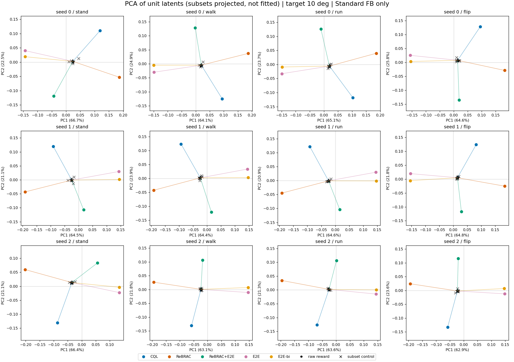

完整 latent 的 cosine 與歐氏距離熱圖保留球面上的接近程度。所有方法都被搜尋到原始 reward 附近約 10 度，因此完整 cosine 偏高不等於共享偏移方向。

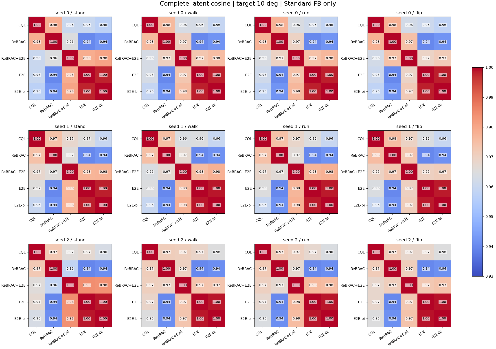

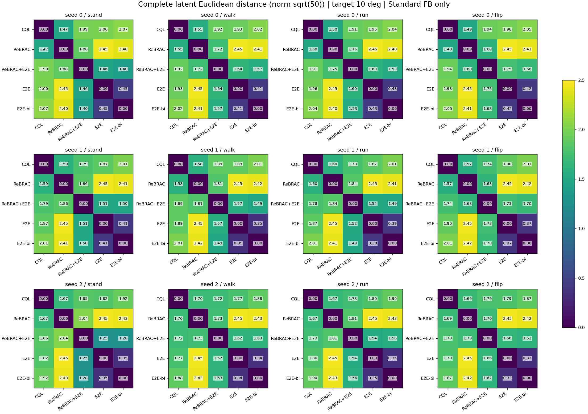

移除原始 reward 方向後，ReBRAC 與正常數 reward 幾乎相反，CQL 卻不沿相同直線，與 Q1 的兩兩比較一致。

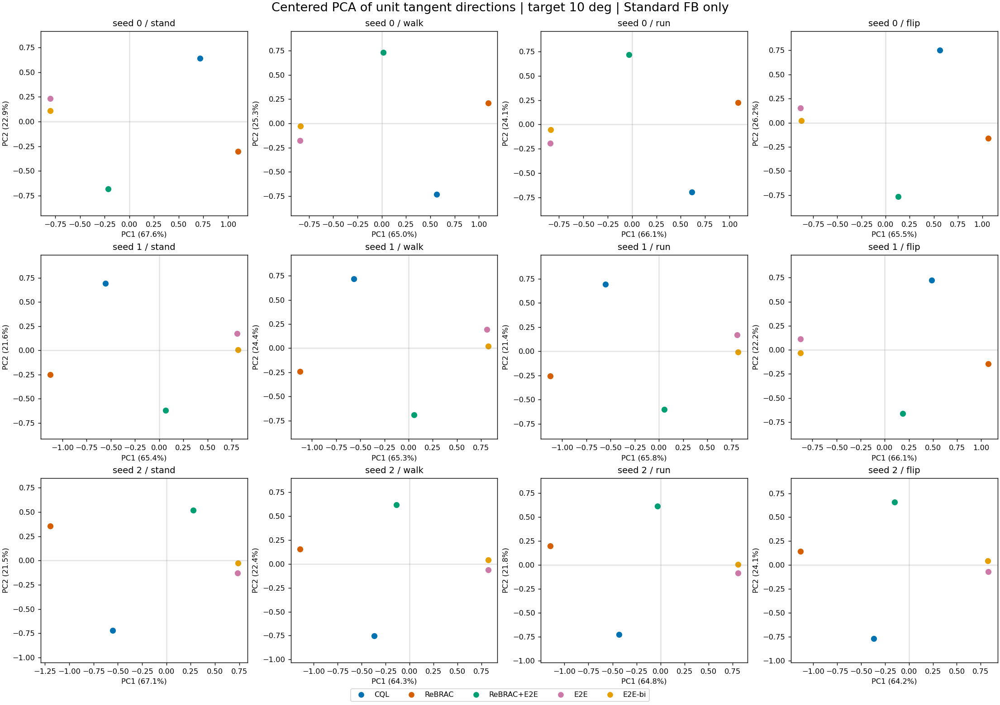

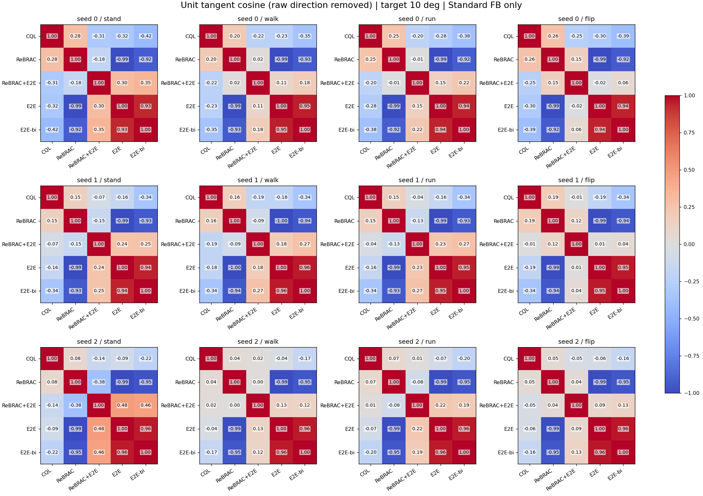

未中心化的奇異值分析顯示，移除常數方向後仍有單一方向無法涵蓋的結構。下方 PCA 只對四個重新單位化的非零殘差擬合，呈現的是扣除方法平均後的排列，不是上述共同軸能量。第一奇異方向的正負不定義保守程度。本次未加入隨機方向對照，不判斷集中程度是否高於隨機，也不將未建立共同軸解讀為完全沒有共享結構。

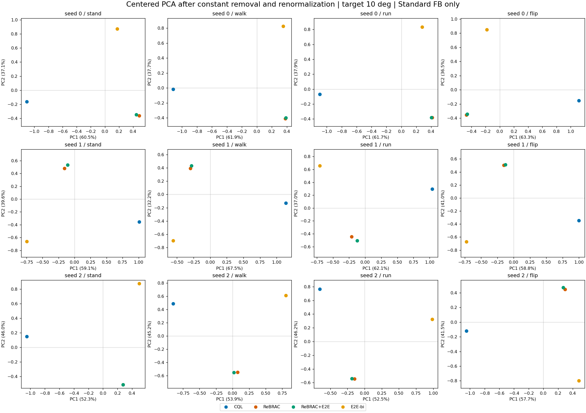

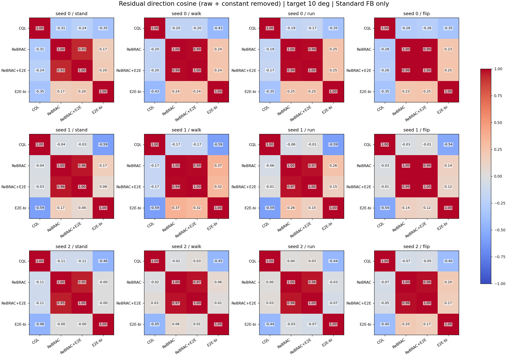

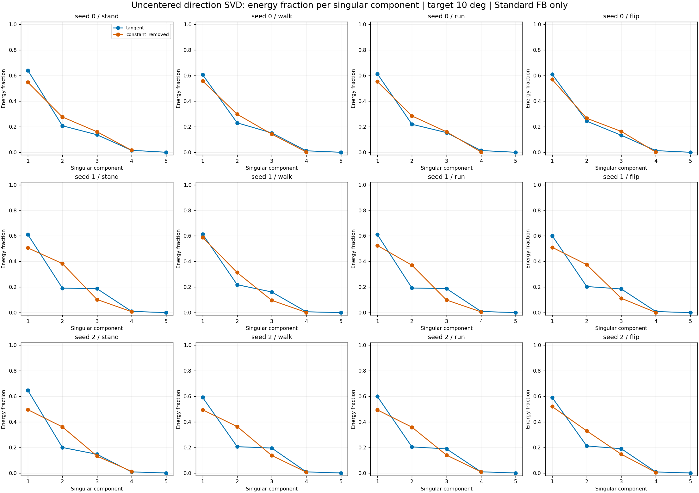

此結果限於三個選定模型、四個任務與共有的 5／10 度條件，未估計 implicit reward 偏移方向的抽樣不確定性，也未檢驗所有係數下的連續性或沿軸行為排序。

## Q4：已存係數下的方向變化因方法而異，離散取樣不能證明全域平滑

本節只重算既有 standard FB latent，不新增推論或 rollout。原搜尋只使用正號修正係數，沒有檢查負號係數的分支。逐模型、逐任務、逐方法按實際係數排序，比較完整 latent 的夾角及移除原始 reward 方向後的單位偏移轉角。後者描述方向是否改變，不是偏離原始 reward 的幅度。

共 360 個方法／模型／任務／目標角度組合，保存 279 個；收斂網格未括住目標 79 個，二分搜尋求解未收斂 2 個。

| Reward 修正 | 已保存／目標組合 | 各模型任務的最大已存目標角度範圍 | 相鄰偏移方向轉角：平均［最小，最大］ | 5→10 度偏移方向轉角：平均［最小，最大］ |
|---|---|---|---|---|
| CQL | 72/72 | 70–70 度 | 2.338［0.225，7.736］度 | 0.521［0.225，0.832］度 |
| ReBRAC | 72/72 | 70–70 度 | 0.685［0.138，1.429］度 | 0.416［0.138，0.888］度 |
| ReBRAC+E2E | 64/72 | 20–70 度 | 11.290［3.271，35.326］度 | 5.372［3.271，9.642］度 |
| E2E | 47/72 | 20–35 度 | 0.000［0.000，0.000］度 | 0.000［0.000，0.000］度 |
| E2E-bi | 24/72 | 10–10 度 | 1.279［0.786，1.836］度 | 1.279［0.786，1.836］度 |

各方法的全範圍取樣不一致，不能直接用相鄰轉角平均排名平滑程度；最後一欄才是共有的角度區間。組合修正的方向轉動較大，但稀疏、非等距係數不足以判定存在跳變。正常數 reward 的偏移方向在顯示精度內不變，也不代表完整 latent 不變。係數是為達到指定角度而搜尋，角度隨係數增加並非獨立的平滑證據。

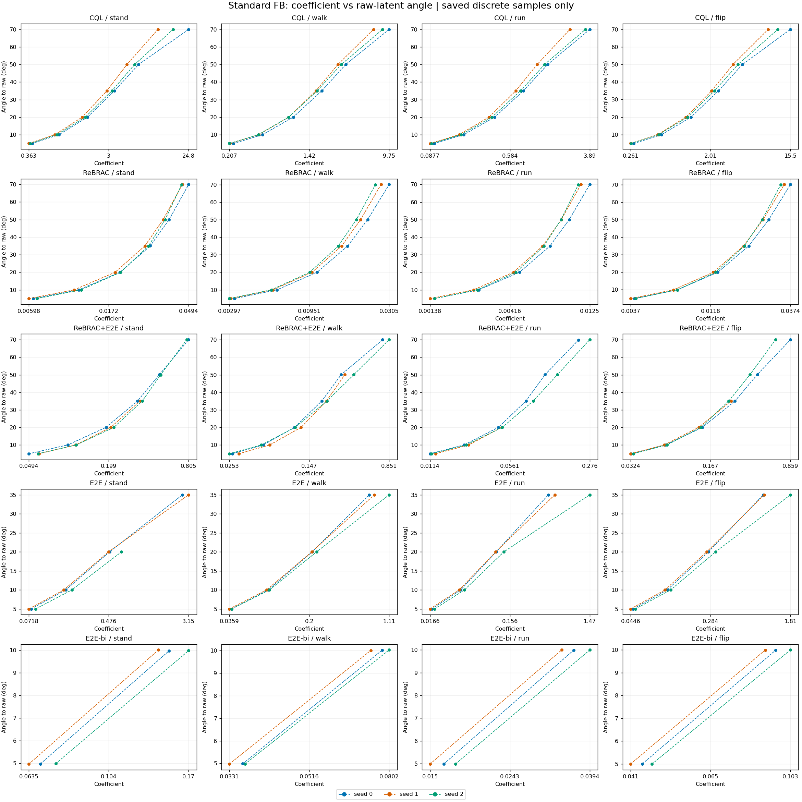

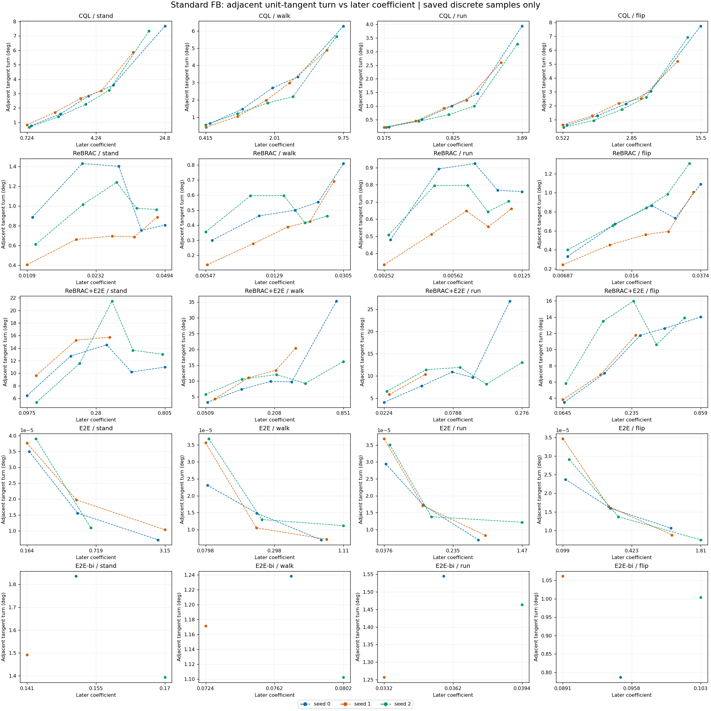

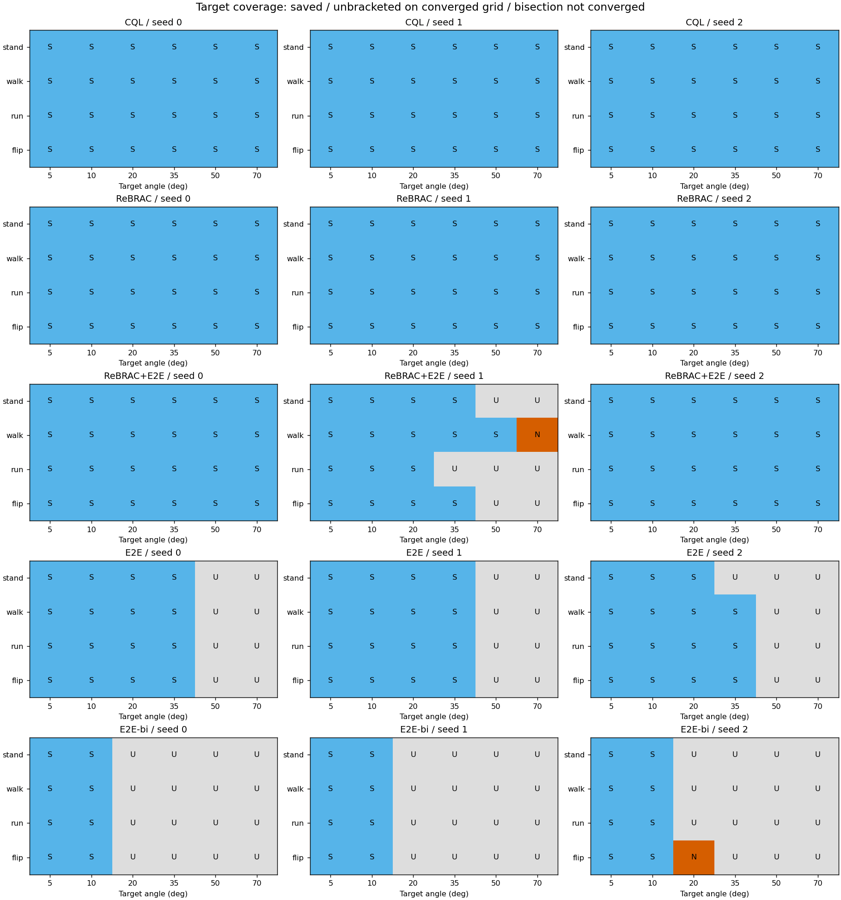

覆蓋圖 S 表示保存，U 表示已收斂搜尋網格未括住目標，N 表示二分搜尋中固定點迭代未收斂。U 不證明幾何上不可達，N 不證明固定點不存在；搜尋可能在失敗處截斷。未保存的中間係數不足以重建精確失敗區間，因此只標示缺少的目標條件。連線僅協助閱讀，不保證點間連續。

## Q5／Q6：候選 AX 軸改變行為，但未形成一致的保守程度排序

AX 在每個模型與任務內，由目標 10 度的 E2E-bi 偏移方向減去 CQL、ReBRAC 偏移方向平均後正規化，再以原始 reward latent 為中心朝正負角度旋轉。正方向只是這個構造的定義，不等於樂觀；這不是悲觀與樂觀端點的直接插值。沿用既有八個非零角度及零度基準，共九點，每點 20 個初始化種子，與 Q2 使用同一批歷史評估，不混入後述補跑。

下表在每個模型、每個任務內，以 episode 平均值判定角度遞增時的單調性，再計數 12 條曲線。僅忽略數值精度內的差值，不設定實務等價門檻。Spearman 是描述性排名相關，不作顯著性檢定。端點比較為正 50 度減負 50 度。

| 行為指標 | 非遞減曲線數 | 非遞增曲線數 | 有升有降曲線數 | Spearman 相關範圍 | 正端點高於／低於負端點的曲線數 |
|---|---|---|---|---|---|
| 原始任務 return | 0 | 0 | 12 | -0.967–0.350 | 1／11 |
| 水平速度 | 0 | 0 | 12 | -0.950–0.700 | 2／10 |
| 直立程度 | 0 | 0 | 12 | -0.817–0.817 | 3／9 |
| 低軀幹高度時間比例 | 0 | 0 | 12 | -0.933–0.967 | 9／3 |
| 動作飽和比例 | 0 | 3 | 9 | -1.000–-0.583 | 0／12 |
| 最近訓練樣本距離 | 0 | 0 | 12 | -0.867–0.767 | 5／7 |
| 動作絕對值平均 | 0 | 2 | 10 | -1.000–-0.667 | 0／12 |

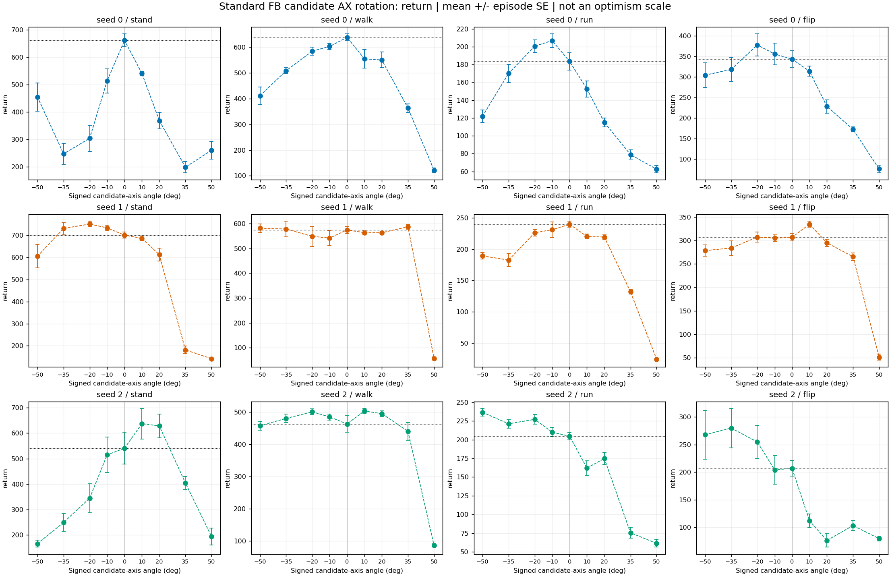

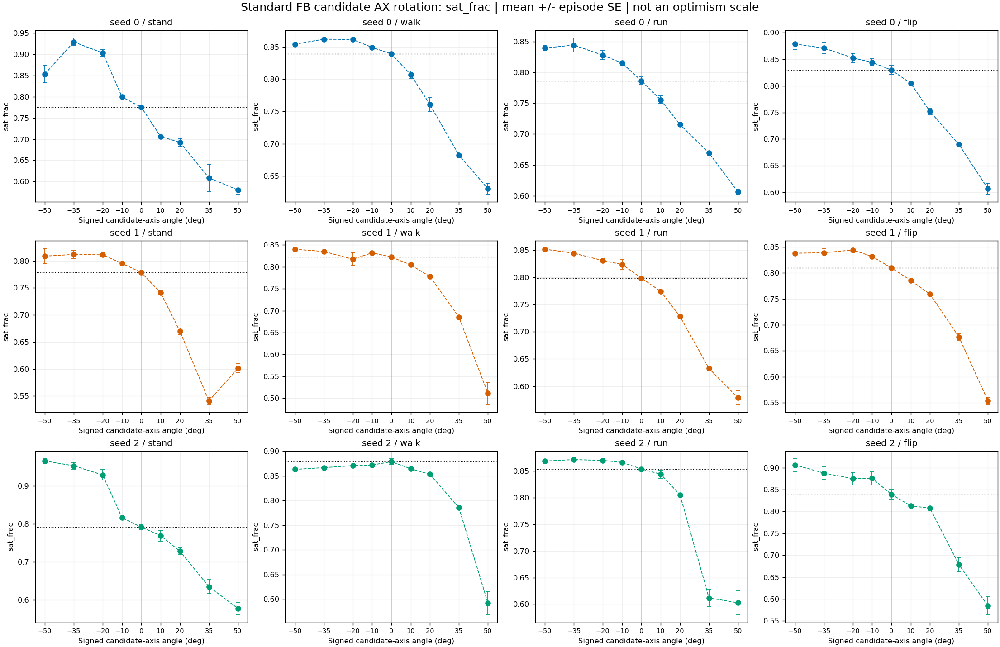

其他行為曲線：[水平速度](figures/axis_fb_speed.png)、[直立程度](figures/axis_fb_upright.png)、[低高度時間比例](figures/axis_fb_fall_frac.png)、[最近訓練樣本距離](figures/axis_fb_knn_dist.png)、[動作絕對值](figures/axis_fb_abs_action.png)。各圖逐模型、逐任務呈現，誤差棒是固定模型內 20 episodes 的平均值標準誤，不涵蓋模型訓練變異。相鄰角度的初始化種子配對差及其標準誤另保留於數據表，圖中連線不代表連續性。

**候選軸未提供跨任務一致、單調的行為控制。** Return、速度等平均曲線均有升有降；return 在 12 條曲線中有 11 條的正端點低於負端點，顯示端點方向性，但不等於整段單調。反轉幅度不同，不能一概視為微小波動，也不能僅憑正負判斷統計或實務意義，須搭配配對差與標準誤。動作飽和比例及動作絕對值在所有模型任務的正端點較低，仍非普遍單調，也不能直接等同較保守或較安全。結合 Q3，目前未建立共同悲觀—樂觀軸或可選擇保守程度的單一 scalar；九點掃描也不能證明行為全域平滑。真正端點插值仍缺乏已驗證共同軸的前提，不以 AX 旋轉代替完成該項驗證。

## 任務指標補跑：相同 latent 能改變旋轉圈數，但圈數不等於任務得分

本次補跑仍固定同三個 standard FB 模型與已存 latent，只評估原始 reward 及目標 10 度的五種修正。每條件使用相同初始化種子 0–19，確定性 actor 的 batch size 為 20，每個 episode 執行 1000 steps、共 25 秒模擬時間，總計 1440 個 episodes。新 return 與指標來自同次執行，不覆寫前文歷史數據，也不宣稱重現既有影片。新評估的原始 reward 基準 return 與歷史表不完全一致，差異原因尚未確認，兩者絕對值不應互換。以下配對差僅使用本次評估的基準。表中先平均每個模型的 20 episodes，再等權平均三個模型；括號為同模型、同初始化種子相對原始 reward 的配對差。

| 任務 | Reward 修正 | Return（Δ） | 主要行為指標（Δ） | 補充指標 |
|---|---|---:|---|---|
| 站 | 原始 reward | 629.1（+0.0） | 高度 0.888（+0.000） m | 直立 0.529（+0.000） |
| 站 | CQL 價值偏好動作分布修正 | 608.1（-21.1） | 高度 0.883（-0.005） m | 直立 0.422（-0.107） |
| 站 | ReBRAC 動作偏離懲罰 | 586.3（-42.8） | 高度 0.828（-0.060） m | 直立 0.402（-0.127） |
| 站 | ReBRAC 動作偏離懲罰＋長度配平的正常數 reward | 568.2（-60.9） | 高度 0.846（-0.041） m | 直立 0.494（-0.035） |
| 站 | 正常數 reward | 545.5（-83.6） | 高度 0.814（-0.074） m | 直立 0.506（-0.023） |
| 站 | 確定性 policy 下一狀態 bonus（bilevel E2E-style） | 537.6（-91.5） | 高度 0.794（-0.094） m | 直立 0.458（-0.071） |
| 走 | 原始 reward | 539.5（+0.0） | 距離／速度 41.59（+0.00） m ／ 1.663（+0.000） m/s | 距 1 m/s 的逐步 MAE 0.923（+0.000） m/s |
| 走 | CQL 價值偏好動作分布修正 | 563.0（+23.5） | 距離／速度 41.62（+0.03） m ／ 1.665（+0.001） m/s | 距 1 m/s 的逐步 MAE 0.945（+0.022） m/s |
| 走 | ReBRAC 動作偏離懲罰 | 537.7（-1.8） | 距離／速度 40.97（-0.61） m ／ 1.639（-0.024） m/s | 距 1 m/s 的逐步 MAE 0.905（-0.018） m/s |
| 走 | ReBRAC 動作偏離懲罰＋長度配平的正常數 reward | 508.8（-30.6） | 距離／速度 40.91（-0.68） m ／ 1.636（-0.027） m/s | 距 1 m/s 的逐步 MAE 0.905（-0.017） m/s |
| 走 | 正常數 reward | 544.4（+5.0） | 距離／速度 42.19（+0.61） m ／ 1.688（+0.024） m/s | 距 1 m/s 的逐步 MAE 0.905（-0.018） m/s |
| 走 | 確定性 policy 下一狀態 bonus（bilevel E2E-style） | 545.6（+6.1） | 距離／速度 42.38（+0.80） m ／ 1.695（+0.032） m/s | 距 1 m/s 的逐步 MAE 0.926（+0.004） m/s |
| 跑 | 原始 reward | 207.0（+0.0） | 距離／速度 41.02（+0.00） m ／ 1.641（+0.000） m/s | 直立 0.522（+0.000） |
| 跑 | CQL 價值偏好動作分布修正 | 173.9（-33.1） | 距離／速度 33.71（-7.31） m ／ 1.348（-0.293） m/s | 直立 0.331（-0.191） |
| 跑 | ReBRAC 動作偏離懲罰 | 207.5（+0.5） | 距離／速度 40.49（-0.52） m ／ 1.620（-0.021） m/s | 直立 0.539（+0.017） |
| 跑 | ReBRAC 動作偏離懲罰＋長度配平的正常數 reward | 173.0（-34.0） | 距離／速度 37.77（-3.25） m ／ 1.511（-0.130） m/s | 直立 0.341（-0.180） |
| 跑 | 正常數 reward | 168.1（-38.9） | 距離／速度 34.59（-6.43） m ／ 1.384（-0.257） m/s | 直立 0.405（-0.117） |
| 跑 | 確定性 policy 下一狀態 bonus（bilevel E2E-style） | 175.5（-31.6） | 距離／速度 35.66（-5.36） m ／ 1.426（-0.214） m/s | 直立 0.444（-0.078） |
| 翻 | 原始 reward | 269.8（+0.0） | 正向完整圈數 2.82（+0.00）；反向 0.00（+0.00） | 淨旋轉 3.14（+0.00） 圈；角動量 5.02（+0.00） |
| 翻 | CQL 價值偏好動作分布修正 | 245.0（-24.8） | 正向完整圈數 3.40（+0.58）；反向 0.00（+0.00） | 淨旋轉 3.68（+0.54） 圈；角動量 5.31（+0.29） |
| 翻 | ReBRAC 動作偏離懲罰 | 302.7（+33.0） | 正向完整圈數 2.27（-0.55）；反向 0.00（+0.00） | 淨旋轉 2.56（-0.58） 圈；角動量 4.69（-0.34） |
| 翻 | ReBRAC 動作偏離懲罰＋長度配平的正常數 reward | 274.0（+4.2） | 正向完整圈數 4.60（+1.78）；反向 0.00（+0.00） | 淨旋轉 4.96（+1.82） 圈；角動量 7.02（+2.00） |
| 翻 | 正常數 reward | 243.5（-26.3） | 正向完整圈數 3.47（+0.65）；反向 0.00（+0.00） | 淨旋轉 3.69（+0.55） 圈；角動量 5.28（+0.26） |
| 翻 | 確定性 policy 下一狀態 bonus（bilevel E2E-style） | 251.8（-18.0） | 正向完整圈數 3.68（+0.87）；反向 0.00（+0.00） | 淨旋轉 4.01（+0.87） 圈；角動量 5.74（+0.72） |

站立的高度與直立程度分別描述身體位置及姿態。行走與跑步以「距離／速度」並列，單位為 m／m/s；距離是每個控制步結束時的水平速度乘以 0.025 秒後加總的有方向淨位移估計，不是直接量測終點減起點位置，也不是總路程。因所有 episodes 固定為 25 秒，距離等於平均速度乘以 25 秒，兩欄不是獨立證據。行走的速度誤差取每步速度距 1 m/s 的絕對差再平均，但原任務 reward 只設速度下限，誤差不替代任務評分。跑步速度也須搭配直立程度解讀，滑行或翻滾同樣可能產生位移，不能單憑距離確認正常步態。

完整旋轉圈數追蹤軀幹連續角度，以 reset 角度為錨點，朝正／負方向每完成一圈分別計數，未完成的反向運動抵消進度，不累加角度絕對值。淨旋轉另保留不足一圈的進度。正向為世界 +Y 方向，與 flip reward 獎勵的正角動量同向，但軀幹角度與身體子樹角動量不是同一量。圈數不要求騰空、落地或恢復直立，地面滾動也會被計入，不稱為成功 flip 次數。

**跑步的 CQL 修正再次呈現速度、直立程度及 return 同降。** 新評估的平均速度由 1.641 降至 1.348 m/s，直立程度由 0.522 降至 0.331，return 降低 33.1。三個模型的速度與 return 配對平均均下降，支持換 latent 的行為效應，不表示重現真正 CQL 的 policy。

**翻轉圈數與 return 可以朝不同方向改變。** ReBRAC 修正的正向完整圈數由平均 2.82 降至 2.27，但 return 平均提高 33.0；三個模型的圈數配對差分別為 −0.15、−0.20、−1.30 圈，return 差則為 +56.3、−2.0、+44.6。ReBRAC＋常數 reward 組合的圈數提高至 4.60，三個模型的平均增量均為正，分別為 +1.25、+1.35、+2.75 圈。原 flip reward 同時依賴角動量、高度與直立姿態，因此「多轉幾圈」不能直接解讀為 return 更高。

這些是三個選定模型的描述性結果，episode 間仍有變動。圈數、姿態及速度能更直接說明行為，尚不足以建立跨任務一致的悲觀—樂觀排序，也不能證明任一修正在所有任務穩定改善。逐模型配對差與標準誤保留於資料表，未做顯著性檢定。
