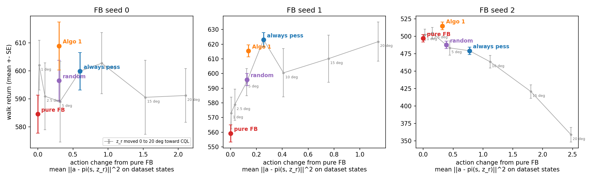

### Algo Q-guided per-step switching

- Comparing with other above methods, I would using Q-guided switching as first version.
- Using FB and $r_{CQL}$ only →for quick experiment trying
- Using `Walk` as target task

Algo:

1. Pretraining FB
2. During Inference
    1. While not done
        1. generate $a_{opt}=\pi(s, z_r)$ and $a_{pess}=\pi(s, z_{cql})$ from Prep 3.2
        2. Calculate $Q(a)=\frac{1}{5}\sum_{k}F_k(s,a,z_r)^\top z_r$ (ensemble F)
        3. take $a_{pess}$ if $Q(a_{opt}) < Q(a_{pess})$  else $a_{opt}$ 

result:

- Original FB is far better on this exploration based dataset. Original CQL and ReBRAC don’t do a good job on this dataset
- The standard error from Q-guided per-step switching ranges from 4~9, but algo - random ranges from 12~27, so Q actually selected the right action.
- About 45% action comes from $a_{pessi}$ but it still out performs p=0.5

| Condition | **seed 0** | **seed 1** | **seed 2** | Average |
| --- | --- | --- | --- | --- |
| always $a_{opt}$ (Pure FB) | 585 | 559 | 497 | 547 |
| always aₚₑₛₛ | 600 | 623 | 479 | 567 |
| random p=0.5 | 597 | 596 | 487 | 560 |
| algo  | 609 | 615 | 515  | **580** |
| algo − random | +12 | +20 | +27 | +20 |
| CQL (original) | 92 | 196 | 252 | 180 |
| ReBRAC (original) | 163 | 213 | 248 | 208 |

This picture is about return deviation vs action deviation between different algo. Gray line is latent rotation with different degree
