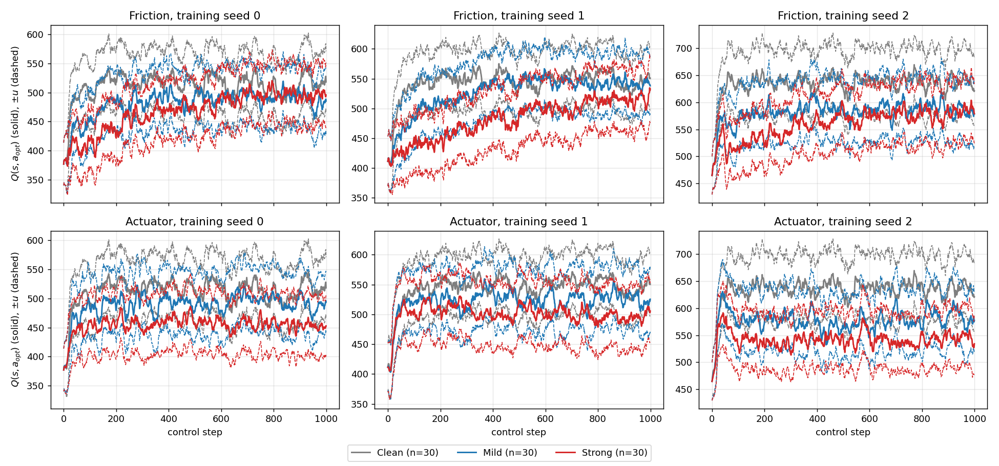

# T3.2 結果：optimistic、pessimistic、random 與 Q-guided 在動力學偏移下的 return

| 條件 | Optimistic | Pessimistic | Random | Q-guided | Q-guided − 較好的固定策略（標準誤差） |
|---|---|---|---|---|---|
| Clean | 552.1 ± 91.0 | 570.5 ± 117.3 | 566.9 ± 117.1 | 579.4 ± 125.8 | +9.0 (11.8) |
| Friction — Mild | 475.8 ± 138.6 | 481.6 ± 159.1 | 487.7 ± 153.9 | 500.1 ± 148.1 | +18.5 (13.8) |
| Friction — Strong | 371.1 ± 120.4 | 360.7 ± 142.1 | 365.9 ± 127.3 | 376.6 ± 135.3 | +5.6 (11.4) |
| Actuator — Mild | 435.5 ± 149.5 | 457.4 ± 145.3 | 435.4 ± 161.4 | 480.3 ± 136.8 | +22.9 (13.1) |
| Actuator — Strong | 317.4 ± 160.1 | 340.8 ± 152.7 | 325.9 ± 160.1 | 357.5 ± 154.9 | +16.7 (13.0) |

每格為 3 個訓練 seed × 50 個 episode（共 150 個配對 episode）的 return 平均 ± 標準差；Q-guided 的平均 return 在五個條件都最高，但與較好的固定策略的差值都在 1.4 個標準誤差內，只有 actuator 兩個條件勝過 random 達 2 個標準誤差以上（+44.9、+31.5，標準誤差 14.6、13.3），所以目前不能宣稱 Q-guided 優於固定策略。

## Q-guided 的選擇比例，以及 ensemble 的 Q 與 uncertainty

| 條件 | Q-guided 取 pess 的比例 | 相對 Clean 的差（標準誤差） | Q（$a_{opt}$） | 相對 Clean 的差（標準誤差） | Uncertainty $u$ | 相對 Clean 的差（標準誤差） |
|---|---|---|---|---|---|---|
| Clean | 0.463 ± 0.069 | — | 562.9 | — | 54.71 | — |
| Friction — Mild | 0.460 ± 0.100 | -0.004 (0.006) | 529.9 | -33.0 (5.4) | 53.70 | -1.01 (0.39) |
| Friction — Strong | 0.448 ± 0.126 | -0.015 (0.010) | 502.9 | -60.0 (4.6) | 52.69 | -2.03 (0.45) |
| Actuator — Mild | 0.445 ± 0.089 | -0.018 (0.008) | 529.3 | -33.6 (5.4) | 54.88 | +0.17 (0.42) |
| Actuator — Strong | 0.471 ± 0.157 | +0.008 (0.013) | 498.8 | -64.1 (6.5) | 53.49 | -1.23 (0.66) |

取 pess 的比例為 Q-guided（$\kappa=0$）在每個 episode 取 pess 動作的步數比例，平均 ± 標準差取自 3 個訓練 seed × 50 個 episode。$Q$ 與 $u$ 為 always-opt 軌跡上 ensemble 對 $a_{opt}$ 的 Q 平均與標準差（單位為 $|\hat z_r|$），取自 3 個訓練 seed × 30 個 episode。所有差值都是與 Clean 在相同訓練 seed 與起始狀態下的配對差。

圖中每一欄是一個訓練 seed，實線為各步 $Q(s,a_{opt})$ 的 episode 平均，虛線為 $Q\pm u$。

- **Q 在偏移下降低，且隨強度排序。** 6 組（3 個訓練 seed × 2 種偏移）的 $Q$ 平均都是 Clean > Mild > Strong。相對 Clean，Mild 降約 33，Strong 降 60（friction）與 64（actuator），約為 $u$ 的 0.6 到 1.2 倍。
- **Uncertainty 沒有隨偏移升高。** 圖中三種條件的虛線與實線的距離相近。$u$ 在 friction 反而下降（−1.0、−2.0），actuator 沒有可靠變化（+0.2、−1.2）。
- **選擇比例沒有改變。** 偏移下取 pess 的比例都在 0.445 到 0.471，與 Clean 的差最大為 −0.018。
- **可能的原因（未驗證）。** Q 只輸入 $(s,a)$，並以 clean 資料訓練，不含動力學資訊，所以偏移只能透過機器人走到的較差狀態影響 $Q$，而不是被 ensemble 直接偵測到。

限制：圖與 $Q$、$u$ 的數字來自 always-opt 的軌跡，不是 Q-guided 實際走過的軌跡；episode 平均會抹平單一 episode 的跌倒事件。
