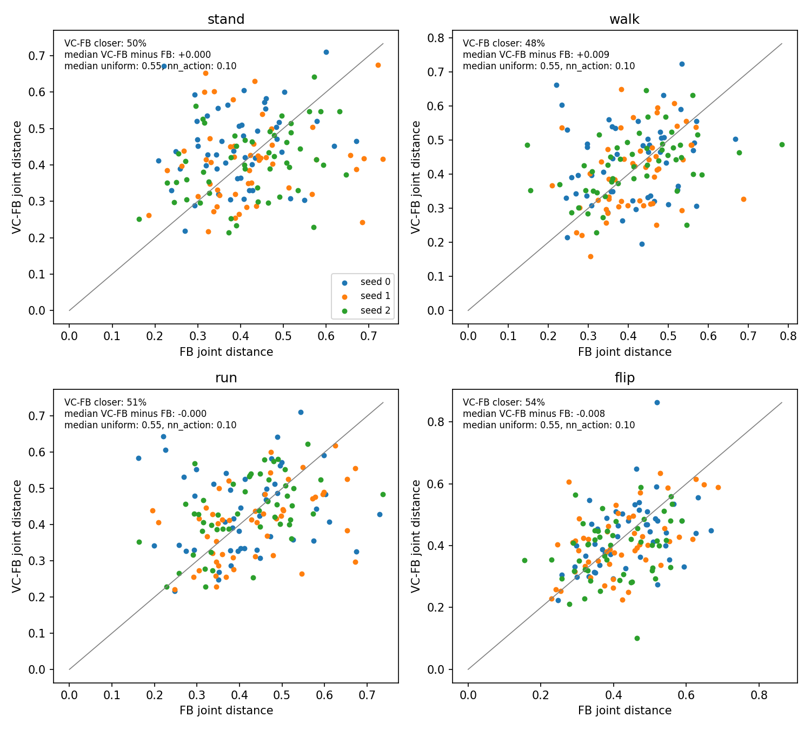
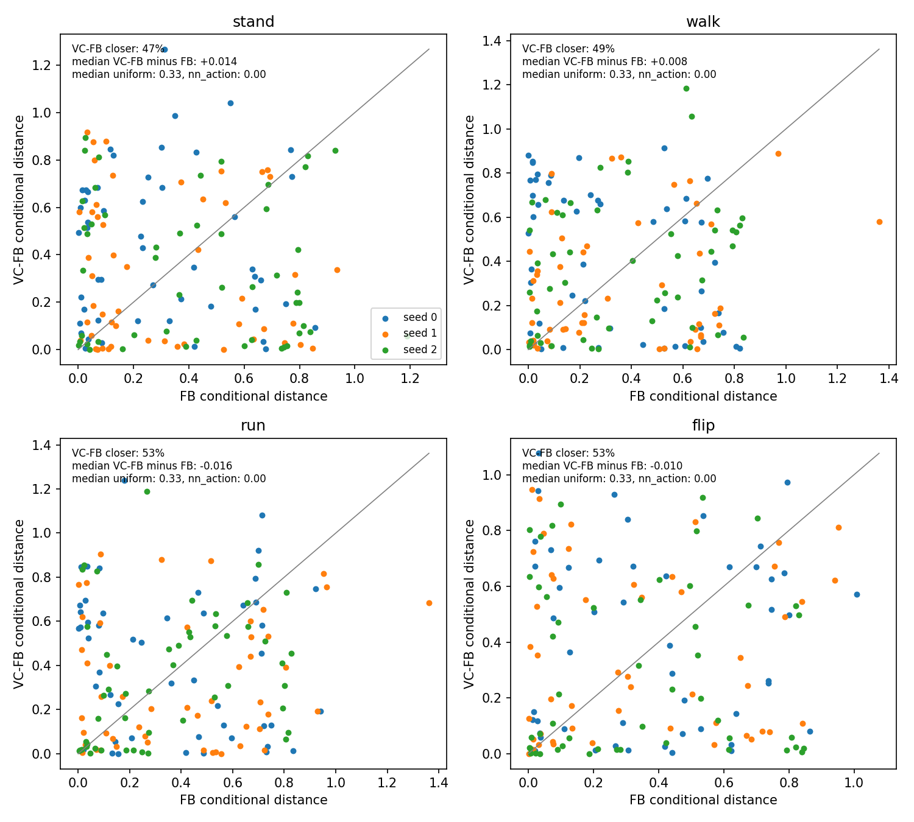
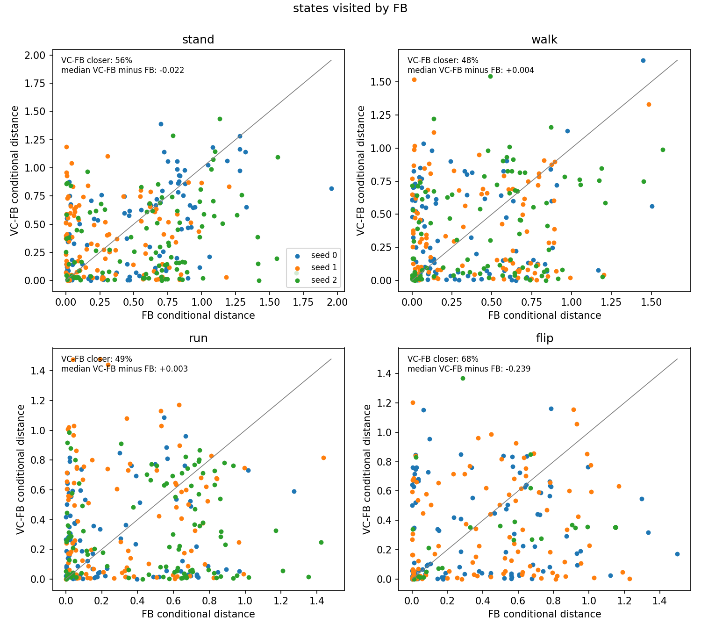
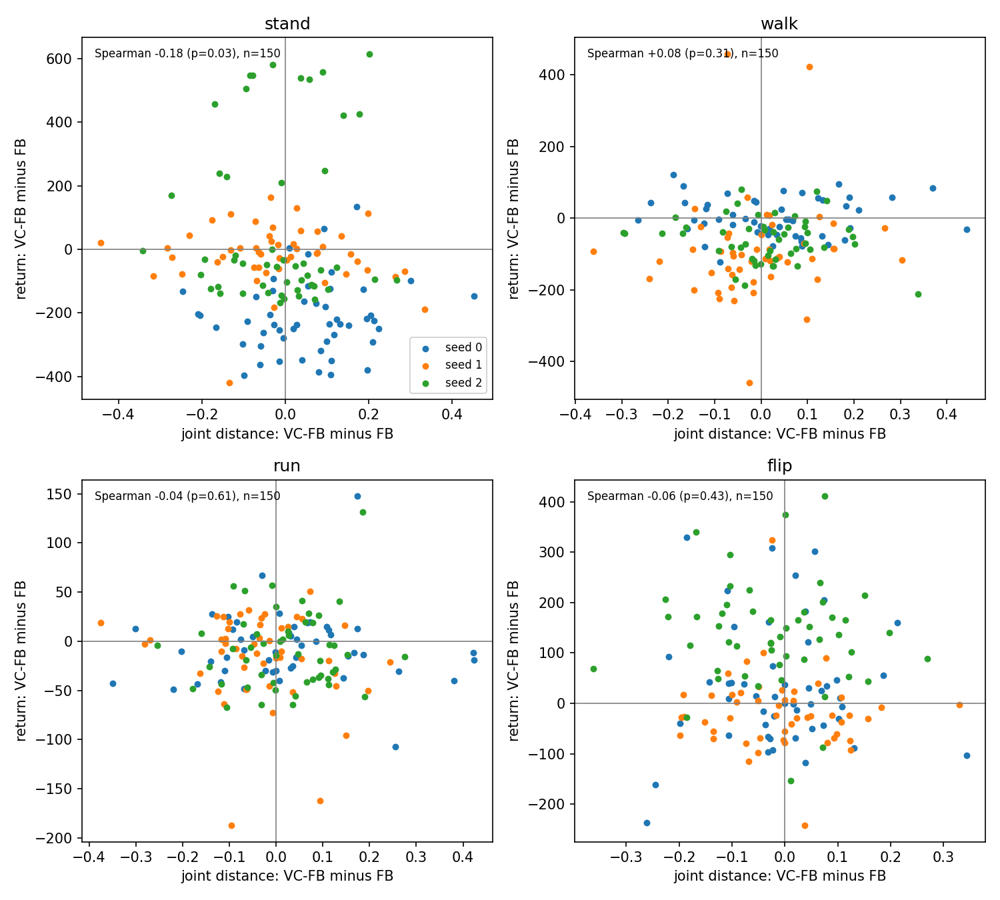
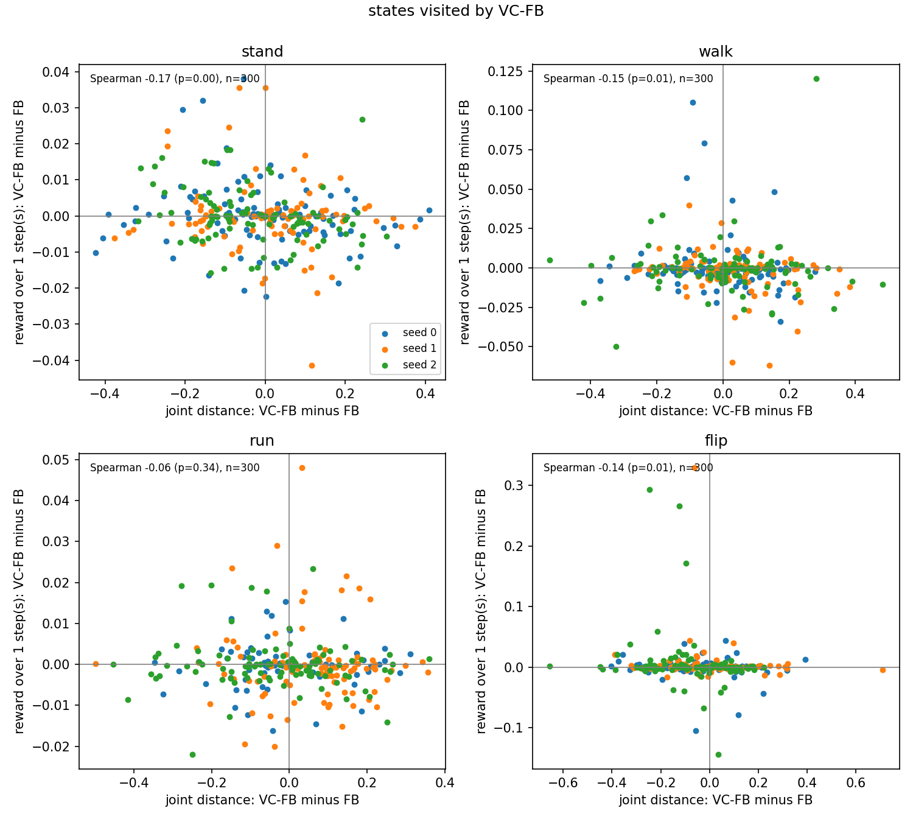
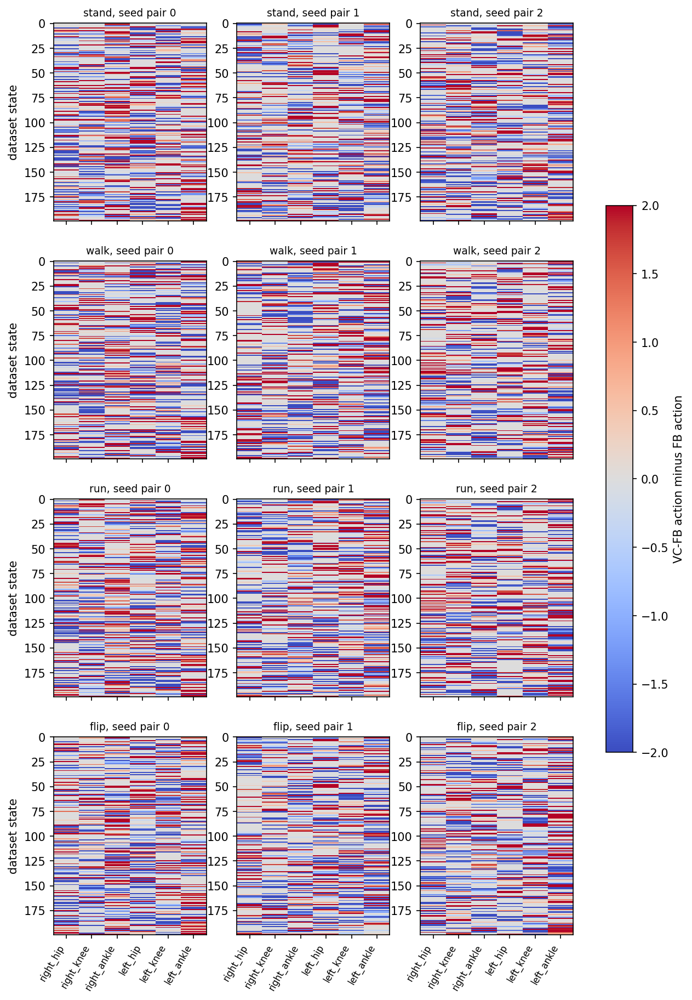

# T3.3.1 結果：VC-FB 的動作沒有比 FB 更接近資料中的行為，距離差也預測不了 return

比較對象是 T04 中 FB 與 VC-FB 各 3 個訓練 seed 的最佳 checkpoint（Walker，RND 100k）。FB seed k 與 VC-FB seed k 配成一對，兩者各用自己從同一批資料推出的 task latent $z$，動作一律取 actor 的確定性輸出（clip 後的平均）。

動作 $a$ 在狀態 $s$ 與資料集行為 $\{(s_i, a_i)\}$ 的距離有兩種，每個座標先除以資料集的標準差，平方距離再除以維度數：

$$D_{joint}(s,a) = \min_i \left[ \tfrac{1}{d_s}\lVert s - s_i \rVert^2 + \lambda \tfrac{1}{d_a}\lVert a - a_i \rVert^2 \right], \quad \lambda = 1$$

$$D_{cond}(s,a) = \min_{i \in N_k(s)} \tfrac{1}{d_a}\lVert a - a_i \rVert^2, \quad k = 50$$

其中 $N_k(s)$ 是離 $s$ 最近的 $k$ 個資料集狀態。兩個參考動作：$[-1,1]$ 內均勻抽樣的隨機動作，以及最近資料集狀態上的動作（nn_action）。

## 起始狀態：兩者距離相同，都接近隨機動作

| Task | $D_{joint}$ FB | $D_{joint}$ VC-FB | $D_{cond}$ FB | $D_{cond}$ VC-FB | VC-FB 較近的比例（joint / cond） |
|---|---|---|---|---|---|
| stand | 0.409 | 0.418 | 0.279 | 0.310 | 0.50 / 0.47 |
| walk | 0.415 | 0.426 | 0.266 | 0.308 | 0.48 / 0.49 |
| run | 0.423 | 0.428 | 0.303 | 0.309 | 0.51 / 0.53 |
| flip | 0.411 | 0.407 | 0.298 | 0.283 | 0.54 / 0.53 |

數值為 env seed 0 到 49 的 50 個 reset 狀態上的中位數。較近的比例按 (env seed, seed pair) 配對計算，共 150 對。參考動作的中位數：$D_{joint}$ 隨機 0.554、nn_action 0.097；$D_{cond}$ 隨機 0.333、nn_action 0。

- **VC-FB 沒有比較接近資料。** 四個 task 中 VC-FB 較近的比例都在 0.47 到 0.54 之間，中位數差最多 0.042。
- **兩者都遠離資料。** 兩者的 $D_{cond}$ 是隨機動作的 0.80 到 0.93 倍，$D_{joint}$ 約是隨機動作的 0.75 倍、nn_action 的 4 倍。

每張圖一格一個 task，一個點是一個 reset 狀態，x 為 FB seed k、y 為 VC-FB seed k 的距離，點在對角線下方表示 VC-FB 較近。

## Episode 中的狀態：只有 flip 的 VC-FB 較近

| Task | $D_{joint}$ FB | $D_{joint}$ VC-FB | $D_{cond}$ FB | $D_{cond}$ VC-FB | 在 FB 狀態上 VC-FB 較近（joint / cond） | 在 VC-FB 狀態上 VC-FB 較近（joint / cond） |
|---|---|---|---|---|---|---|
| stand | 0.381 | 0.380 | 0.481 | 0.275 | 0.51 / 0.56 | 0.53 / 0.56 |
| walk | 0.389 | 0.393 | 0.379 | 0.306 | 0.49 / 0.48 | 0.48 / 0.55 |
| run | 0.386 | 0.399 | 0.360 | 0.334 | 0.47 / 0.49 | 0.46 / 0.53 |
| flip | 0.425 | 0.380 | 0.598 | 0.279 | 0.67 / 0.68 | 0.62 / 0.62 |

每個 checkpoint 在每個 task 跑一個從 env seed 0 開始、1000 步的 episode，每 10 步保留一個狀態。前四欄是各 checkpoint 在自己走過的狀態上的平均距離。後兩欄讓配對的兩個 checkpoint 在同一批狀態上出動作，數值為 VC-FB 較近的比例（3 對 × 100 個狀態）。

- **在相同狀態上，只有 flip 有差別。** VC-FB 在 flip 較近的比例為 0.62 到 0.68，其他三個 task 在 0.46 到 0.56。
- **在各自走過的狀態上，VC-FB 的 $D_{cond}$ 較低，$D_{joint}$ 則幾乎相同。** 但在相同狀態上的比較顯示，除了 flip，這個差異來自兩者走到不同的狀態，不是動作本身比較接近資料。

另外三張圖（`rollout_FB_states_joint.png`、`rollout_VC-FB_states_joint.png`、`rollout_VC-FB_states_conditional.png`）格式相同，結論相同。

## 距離差預測不了 return，與單步 reward 只有弱相關

| Task | Return FB | Return VC-FB | VC-FB − FB（seed pair 0 / 1 / 2） |
|---|---|---|---|
| stand | 620.5 | 567.7 | −214.0 / −19.8 / +75.3 |
| walk | 538.7 | 489.2 | +1.7 / −91.2 / −58.8 |
| run | 188.5 | 177.6 | −7.3 / −16.1 / −9.1 |
| flip | 265.3 | 315.1 | +31.4 / −17.7 / +135.6 |

Return 為 50 個 reset 狀態出發的 episode 平均，再對 3 個 seed pair 取平均。除了 run，三個 seed pair 的差值正負不一致。

- **起始狀態的距離差與 episode return 差無關。** 每個 task 150 個點的 Spearman 相關係數為 −0.18 到 +0.08。只有 stand 的 joint 距離達 p < 0.05（−0.18，p = 0.031），在 8 個檢定中這個結果可能只是偶然。
- **距離差與單步 reward 差有一致但很弱的負相關。** 在 episode 狀態上執行動作一步後的 reward 差，與距離差的 Spearman 相關係數在 16 個組合（2 種狀態來源 × 2 種距離 × 4 個 task）中都是負的，範圍 −0.17 到 −0.02，其中 9 個 p < 0.05。負號表示較接近資料的動作得到略高的 reward，但距離最多只解釋約 3% 的 rank 變異。

其餘同類圖（`return_vs_distance_conditional.png` 與另外三張 `reward_h1_*`）格式相同。

## 兩者在資料集狀態上的動作差異很大，FB 更常用到動作邊界

| | FB | VC-FB |
|---|---|---|
| $\lvert a \rvert > 0.99$ 的比例 | 0.83 | 0.71 |
| 各 seed pair（0 / 1 / 2） | 0.83 / 0.82 / 0.85 | 0.69 / 0.71 / 0.73 |

在 200 個資料集狀態上，每個 actuator 的動作差 $\lvert a_{VC} - a_{FB} \rvert$ 平均為 0.84 到 0.87（動作範圍寬度為 2），43% 的動作兩者正負號相反。三個 seed pair 中，FB 碰到動作邊界的比例都比 VC-FB 高 0.12 到 0.14。

每一列是一個 task、每一欄是一個 seed pair，格內為 VC-FB 減 FB 的動作，紅色為正。在每個 (task, seed pair, actuator) 中，動作差同號的狀態最多只佔 56%，所以差異不是固定的偏移。

`figures/first_action.png` 是單一 reset 狀態上的動作，結論與此相同：FB 的 72 個動作值中有 93% 的 $\lvert a \rvert > 0.99$，VC-FB 為 64%。

## 限制

- 只有 3 個訓練 seed，每個 seed 一個 checkpoint，而且是依 return 挑出的最佳 checkpoint。
- Episode 狀態的分析每個 checkpoint 和 task 只用一個 episode（env seed 0）。單步 reward 的分析所有 episode 共用同一個環境，所以只有第一個 episode 從 env seed 0 的 reset 狀態出發。
- 距離只用一組設定（$\lambda = 1$、$k = 50$），而且是在 100k 筆訓練子樣本上算的。
- 單步 reward 只看一步（horizon 1），沒有檢驗更長的 horizon。
