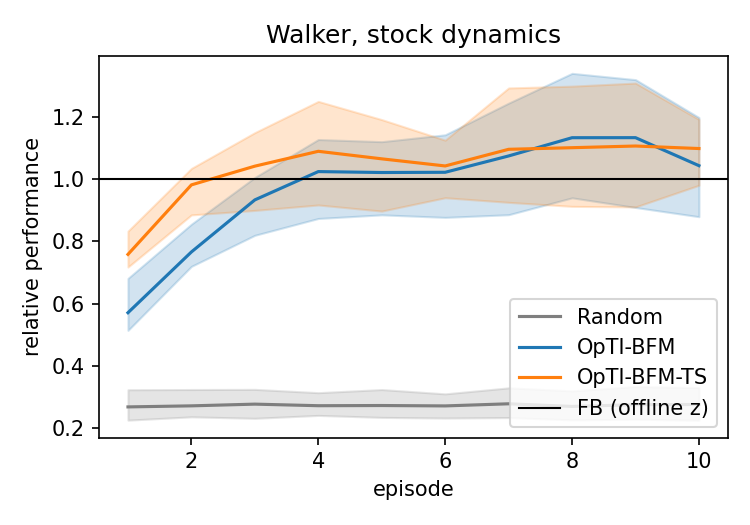
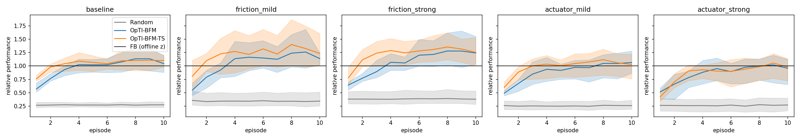

# T4.1 結果：OpTI-BFM 在本 repo 的 FB 上 2 到 3 個 episode 追上 FB（離線 z），改變動力學後仍然收斂

在 T04 的 3 個標準 FB seed（Walker、RND 100k）上重現 Rupf et al. (2025)（arXiv 2510.20264）。
FB（離線 z）用離線推論的 $z_r$，Random 每步隨機抽 latent，OpTI-BFM（UCB，β = 0.001）與 OpTI-BFM-TS（σ = 0.1）只靠線上 reward 推論。
每個 task 10 個 run、每個 run 連續 10 個 episode，表中數值為 3 個 seed 的平均，IQM 依 `analysis.table6_aggregate`。

## 1. 重現表

論文只在圖中給數字，下表比較論文文字中的結論，我沒有從圖上讀數值。

| 論文的結論 | 本任務 | 是否重現 |
|---|---|---|
| 5 個 episode 內追上 FB（離線 z） | OpTI-BFM 第 3 個、OpTI-BFM-TS 第 2 個 episode 達到 FB（離線 z）的 0.9 倍 | 是 |
| UCB 與 TS 只在 Cheetah 有明顯差距 | Walker 上 TS 只在前 3 個 episode 較快 | 是 |
| OpTI-BFM 與 TS 的資料比 RND 更省資料 | 只有 TS 與 RND 相當，OpTI-BFM 在 n ≤ 2000 最差 | 否 |
| -EP 變體較慢，最後相同 | 前 3 個 episode 較慢，第 5 到 10 個 episode 追上 | 是 |
| 對超參數穩健 | TS 差距 6% 以內，UCB 的 β 差 24% | TS 是，UCB 否 |
| 計算成本約 5 倍 | 沒有測量 | 未測 |

### 主實驗

| Episode | FB（離線 z） | Random | OpTI-BFM | OpTI-BFM-TS |
|---|---|---|---|---|
| 1 | 409 | 91 | 209 | 320 |
| 2 | 385 | 94 | 323 | 415 |
| 3 | 427 | 95 | 386 | 421 |
| 5 | 404 | 95 | 410 | 435 |
| 10 | 382 | 92 | 407 | 439 |

數值為 all-task IQM，TS 第 2 個 episode 就追上 FB（離線 z），OpTI-BFM 要到第 3 到 4 個。

| Task | FB（離線 z） | OpTI-BFM | OpTI-BFM-TS |
|---|---|---|---|
| stand | 628 | 653 | 660 |
| walk | 551 | 550 | 560 |
| run | 201 | 189 | 201 |
| flip | 251 | 317 | 306 |

Episode 6 到 10 的平均 return，stand、walk、run 與 FB（離線 z） 相差 6% 以內，flip 高出 22% 到 26%。

| 方法 | 參數 | 10 個 episode 的累積 return |
|---|---|---|
| OpTI-BFM | β = 1 / 0.1 / 0.001 | 2962 / 3689 / 3895 |
| OpTI-BFM-TS | σ = 0.1 / 0.01 / 0.001 / 0.0001 | 4148 / 3933 / 4091 / 3966 |

UCB 選到 β = 0.001，信賴橢球半徑只有 0.002，所以幾乎是 greedy。

### Episodic 變體

| Episode | 1 | 2 | 3 | 5 | 10 | 20 | 50 |
|---|---|---|---|---|---|---|---|
| OpTI-BFM | 209 | 323 | 386 | 410 | 407 | | |
| OpTI-BFM-EP | 57 | 88 | 144 | 369 | 405 | 359 | 440 |
| OpTI-BFM-TS | 320 | 415 | 421 | 435 | 439 | | |
| OpTI-BFM-TS-EP | 73 | 121 | 208 | 374 | 426 | 416 | 459 |

數值為 all-task IQM，每個 episode 只換一次 latent 前 3 個 episode 慢很多，第 5 到 10 個 episode 追上。

### 推論資料的品質

| 來源 | n = 100 | 200 | 500 | 1000 | 2000 | 5000 | 10000 |
|---|---|---|---|---|---|---|---|
| OpTI-BFM | 0.29 | 0.40 | 0.51 | 0.63 | 0.82 | 1.00 | 1.07 |
| OpTI-BFM-TS | 0.38 | 0.56 | 0.88 | 0.95 | 0.98 | 1.08 | 1.06 |
| RND | 0.45 | 0.53 | 0.83 | 0.93 | 0.97 | 0.97 | 0.98 |
| Random | 0.33 | 0.49 | 0.63 | 0.77 | 0.86 | 0.94 | 0.93 |

數值為前 n 筆 transition 推出的固定 $z$ 的相對表現，TS 與 RND 相當，OpTI-BFM 在 n ≤ 2000 時最差，原因尚未驗證。

## 2. OOD 比較

Mild 與 Strong 沿用 T3.2：friction 0.1 與 0.02（原始 0.7），actuator gear 76% 與 62%。reward 函數不變，FB（離線 z）的 $z_r$ 仍來自原始資料。

| 環境 | 方法 | stand | walk | run | flip | 平均 |
|---|---|---|---|---|---|---|
| Normal | FB（離線 z） | 628 | 551 | 201 | 251 | 408 |
| Normal | OpTI-BFM | 653 | 550 | 189 | 317 | 427 |
| Normal | OpTI-BFM-TS | 660 | 560 | 201 | 306 | 432 |
| Normal | Random | 203 | 88 | 43 | 95 | 107 |
| friction Mild | FB（離線 z） | 474 | 483 | 148 | 217 | 330 |
| friction Mild | OpTI-BFM | 477 | 546 | 168 | 269 | 365 |
| friction Mild | OpTI-BFM-TS | 550 | 536 | 164 | 332 | 396 |
| friction Mild | Random | 203 | 63 | 38 | 95 | 99 |
| friction Strong | FB（離線 z） | 475 | 367 | 103 | 203 | 287 |
| friction Strong | OpTI-BFM | 489 | 329 | 126 | 329 | 318 |
| friction Strong | OpTI-BFM-TS | 517 | 358 | 136 | 337 | 337 |
| friction Strong | Random | 207 | 56 | 38 | 99 | 100 |
| actuator Mild | FB（離線 z） | 467 | 440 | 154 | 205 | 317 |
| actuator Mild | OpTI-BFM | 460 | 457 | 135 | 211 | 316 |
| actuator Mild | OpTI-BFM-TS | 493 | 467 | 135 | 229 | 331 |
| actuator Mild | Random | 154 | 56 | 30 | 65 | 76 |
| actuator Strong | FB（離線 z） | 372 | 342 | 112 | 169 | 249 |
| actuator Strong | OpTI-BFM | 382 | 310 | 94 | 140 | 231 |
| actuator Strong | OpTI-BFM-TS | 388 | 334 | 86 | 139 | 237 |
| actuator Strong | Random | 121 | 40 | 22 | 47 | 58 |

Episode 6 到 10 的平均 return，除了 actuator Strong 之外，兩種線上方法都不低於 FB（離線 z）。

| 環境 | OpTI-BFM | OpTI-BFM-TS |
|---|---|---|
| Normal | 1.08 | 1.08 |
| friction Mild | 1.08 | 1.25 |
| friction Strong | 1.15 | 1.22 |
| actuator Mild | 1.03 | 1.08 |
| actuator Strong | 0.88 | 0.92 |

數值為 episode 6 到 10 的 all-task IQM 除以 FB（離線 z），只有 actuator Strong 低於 FB（離線 z）。

| 環境 | OpTI-BFM（seed 0 / 1 / 2） | OpTI-BFM-TS（seed 0 / 1 / 2） |
|---|---|---|
| Normal | 1.10 / 0.90 / 1.25 | 1.10 / 0.93 / 1.23 |
| friction Mild | 1.11 / 0.96 / 1.47 | 1.21 / 1.00 / 1.70 |
| friction Strong | 1.17 / 1.00 / 1.56 | 1.30 / 1.07 / 1.54 |
| actuator Mild | 1.10 / 0.77 / 1.19 | 1.24 / 0.80 / 1.16 |
| actuator Strong | 1.11 / 0.68 / 1.12 | 1.12 / 0.70 / 1.10 |

數值為 episode 6 到 10 的相對表現，actuator 下 seed 1 明顯低於 FB（離線 z），其他兩個 seed 高於 FB（離線 z）。

| 環境 | 方法 | 達到 FB（離線 z） 0.9 倍的 episode | cosine：episode 1 | 3 | 10 |
|---|---|---|---|---|---|
| Normal | OpTI-BFM | 3 | 0.49 | 0.72 | 0.79 |
| Normal | OpTI-BFM-TS | 2 | 0.76 | 0.81 | 0.82 |
| friction Mild | OpTI-BFM | 3 | 0.45 | 0.72 | 0.79 |
| friction Mild | OpTI-BFM-TS | 2 | 0.79 | 0.83 | 0.84 |
| friction Strong | OpTI-BFM | 4 | 0.47 | 0.76 | 0.84 |
| friction Strong | OpTI-BFM-TS | 2 | 0.79 | 0.85 | 0.86 |
| actuator Mild | OpTI-BFM | 4 | 0.42 | 0.73 | 0.82 |
| actuator Mild | OpTI-BFM-TS | 3 | 0.74 | 0.82 | 0.83 |
| actuator Strong | OpTI-BFM | 5 | 0.41 | 0.70 | 0.83 |
| actuator Strong | OpTI-BFM-TS | 3 | 0.65 | 0.81 | 0.85 |

cosine 是 $\hat z$ 與 $z_r$ 的夾角，在所有環境下相近，動力學改變使收斂多花 0 到 2 個 episode。

## 3. 預測誤差分析

每個 task、每個 run 取 32 個固定候選 latent，各自 rollout 得到實際折扣 return，再與 $\psi(s_0,w)^\top c$ 的預測比較。
offline 用乾淨資料推出的 reward 係數（誤差只來自 $\psi$ 與動力學），OpTI-BFM 與 OpTI-BFM-TS 用該 run 在第 1、3、10 個 episode 結束時的 belief。實驗進行中，以下表格尚無數據。

| 環境 | offline | OpTI-BFM ep 1 | OpTI-BFM ep 3 | OpTI-BFM ep 10 | OpTI-BFM-TS ep 1 | OpTI-BFM-TS ep 3 | OpTI-BFM-TS ep 10 |
|---|---|---|---|---|---|---|---|
| Normal | | | | | | | |
| friction Mild | | | | | | | |
| friction Strong | | | | | | | |
| actuator Mild | | | | | | | |
| actuator Strong | | | | | | | |

預測與實際折扣 return 的 Spearman（latent policy 排序是否一致）。

| 環境 | offline | OpTI-BFM ep 1 | OpTI-BFM ep 3 | OpTI-BFM ep 10 | OpTI-BFM-TS ep 1 | OpTI-BFM-TS ep 3 | OpTI-BFM-TS ep 10 |
|---|---|---|---|---|---|---|---|
| Normal | | | | | | | |
| friction Mild | | | | | | | |
| friction Strong | | | | | | | |
| actuator Mild | | | | | | | |
| actuator Strong | | | | | | | |

預測 return 除以實際 return 的中位數（校準，1 表示無偏）。

| 環境 | offline | OpTI-BFM ep 10 | OpTI-BFM-TS ep 10 |
|---|---|---|---|
| Normal | | | |
| friction Mild | | | |
| friction Strong | | | |
| actuator Mild | | | |
| actuator Strong | | | |

| 環境 | offline | OpTI-BFM ep 10 | OpTI-BFM-TS ep 10 |
|---|---|---|---|
| Normal | | | |
| friction Mild | | | |
| friction Strong | | | |
| actuator Mild | | | |
| actuator Strong | | | |

預測排名第一的候選，其實際 return 除以 32 個候選中最佳的實際 return。

## 4. 結論

| 不確定性的來源 | 證據 | 狀態 |
|---|---|---|
| reward 係數 $z$ | 5 種環境都在 2 到 5 個 episode 內達到 FB（離線 z）的 0.9 倍，cosine 不受動力學改變影響 | 已由第 2 節支持 |
| $\psi$ 與動力學的誤差 | 只有 actuator Strong 低於 FB（離線 z），而且只有 seed 1 明顯低 | 待第 3 節驗證 |
| FB checkpoint 的品質 | seed 間的比值差距大於方法間的差距 | 已由第 2 節支持 |

對 adaptive FB policy selection，目前資料支持 task 推論不是瓶頸，$\psi$ 的誤差是否為主要來源要等第 3 節的數據。

## 限制

| 項目 | 說明 |
|---|---|
| 範圍 | 只有 Walker 與 3 個 FB seed，seed 間範圍很寬 |
| 超參數 | 在報告結果的同一批 run 上選，UCB 的 β = 0.001 使探索效果沒有被測到 |
| FB（離線 z） | $z_r$ 用本 repo 的離線推論（10k 筆），不是論文的 50k 筆最小平方，flip 上線上方法高於 FB（離線 z） 與此有關 |
| 取樣 | 依論文的 $V^{-1}$ 實作，與作者程式不同（見 README） |
| 未測 | warm-start、D-gap thresholding、LoLA、non-stationary reward、計算成本 |
