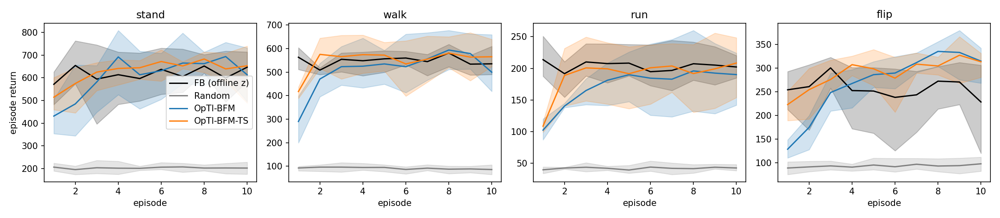
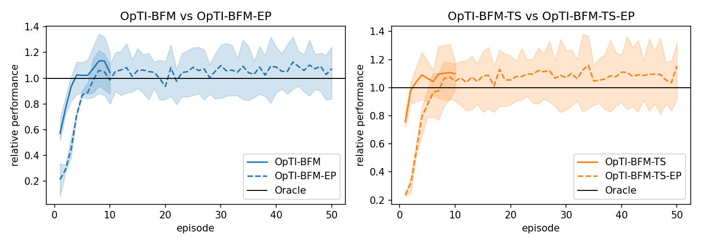
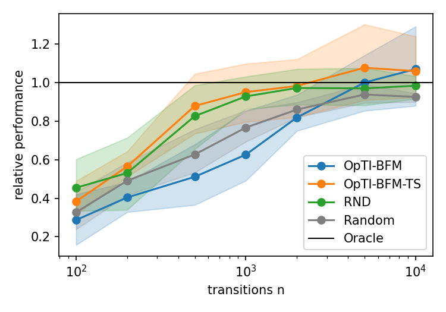

# T4.1 結果：OpTI-BFM 能在改變動力學的環境中只靠 reward 重新推論 task，但本任務沒有量到預測 return 與 latent 排序

本任務在本 repo 的 FB 上重現 Rupf et al. (2025), "Optimistic Task Inference for Behavior Foundation Models"（arXiv 2510.20264），並把它放到 T3.2 的動力學改變環境中。
評估對象是 T04 中標準 FB 的 3 個訓練 seed（Walker，RND 100k），四個 task 為 stand、walk、run、flip。

方法：

- **Oracle**：使用離線推論的 $z_r$，即本 repo 的標準做法，用 10k 筆有 reward 的資料推出，在每個環境中都用同一個 $z_r$。
- **Random**：每一步從球面均勻抽一個 latent。
- **OpTI-BFM**：UCB 規則，每一步選使 $\psi(s,w)^\top \hat z + \beta\lVert\psi(s,w)\rVert_{V^{-1}}$ 最大的 latent。
- **OpTI-BFM-TS**：Thompson sampling 規則，每一步從 $\mathcal N(\hat z, V^{-1})$ 抽 latent。

其中 $\hat z$ 是線上累積的 reward 係數最小平方估計，$V$ 是它的精度矩陣。

設定：

- 每個 task 跑 10 個 run，每個 run 連續 10 個 1000 步的 episode。
- run 內的估計在 episode 之間保留，換 task 時重設。
- 同一個 run 在各方法下的初始狀態相同。
- 超參數依論文附錄 F，在原始環境選出 β = 0.001、σ = 0.1，之後所有環境都用這兩個值。

指標：

- 表中的 return 是 10 個 run 的平均，再對 3 個 seed 平均。all-task 分數是四個 task 平均值的 IQM，依 `analysis.table6_aggregate`。
- 相對表現是方法的 return 除以同一 seed、同一 task、同一環境下 Oracle 的平均 return。

本任務要求的四項中，第 1、2、4 項有資料支持。**第 3 項的「預測 return 與 latent policy 排序」沒有量到**（見該節）。

## 1. 重現表：論文只在圖中給數字，結論全部重現

論文第 5 節與附錄 C 的結果只以圖呈現，沒有表格。我沒有從圖上讀數值，所以下表比較的是論文文字中的結論。
論文的 FB 在完整的 RND 資料上訓練 2M 步，本 repo 的 FB 只用 100k 筆、1M 步，return 的絕對值不可比。

| 論文的結論 | 本任務 | 是否重現 |
|---|---|---|
| OpTI-BFM 在 5 個 episode 內於所有 task 追上 Oracle（第 5.1 節） | 相對表現第一次達到 Oracle 的 0.9 倍：OpTI-BFM 在第 3 個 episode，OpTI-BFM-TS 在第 2 個 | 是 |
| UCB 與 TS 只在 Cheetah 有明顯差距 | Walker 上 TS 前 3 個 episode 較快（第 1 個 episode 的 IQM 為 320 對 209），之後相同 | 與論文在 Walker 上的觀察一致 |
| OpTI-BFM 與 TS 收集的資料比 RND 與 Random 更省資料（第 5.2 節） | 只有 TS 與 RND 相當。β = 0.001 的 OpTI-BFM 在 n ≤ 2000 時最差，低於 Random | **否**（只有 TS 重現「不比 RND 差」） |
| 每個 episode 只換一次 latent（-EP）較慢，最後達到相同水準（第 5.3 節） | 第 1 個 episode 為 57 對 209（UCB）、73 對 320（TS）；第 5 到 10 個 episode 追上 | 是 |
| 對超參數穩健（附錄 F） | TS 四個 σ 的累積 return 差距在 6% 以內；UCB 的 β 從 0.001 到 1 差 24% | TS 是，UCB 否 |
| 計算成本：OpTI-BFM 約為執行 policy 的 5 倍時間（附錄 B.1） | 沒有測量 | 未測 |

### 主實驗

Episode 1、2、3、5、10 的 all-task IQM：

| Episode | Oracle | Random | OpTI-BFM | OpTI-BFM-TS |
|---|---|---|---|---|
| 1 | 409 | 91 | 209 | 320 |
| 2 | 385 | 94 | 323 | 415 |
| 3 | 427 | 95 | 386 | 421 |
| 5 | 404 | 95 | 410 | 435 |
| 10 | 382 | 92 | 407 | 439 |

各 task 的 return（episode 6 到 10 的平均）：

| Task | Oracle | OpTI-BFM | OpTI-BFM-TS |
|---|---|---|---|
| stand | 628 | 653 | 660 |
| walk | 551 | 550 | 560 |
| run | 201 | 189 | 201 |
| flip | 251 | 317 | 306 |

- **stand、walk、run 與 Oracle 相差 6% 以內，flip 高出 22% 到 26%。** 這表示離線資料推出的 $z_r$ 對 flip 不是這個 FB 的最佳 latent。
- **線上推出的方向與 $z_r$ 不同。** 第 10 個 episode 結束時，$\hat z$ 與 $z_r$ 的 cosine 在 stand 為 0.90 到 0.92，在 flip 為 0.64 到 0.72。
- **超參數。** UCB 選到 β = 0.001，信賴橢球半徑只有 0.002，所以 UCB 實際上接近 greedy。

| 方法 | 參數 | 10 個 episode 的累積 return |
|---|---|---|
| OpTI-BFM | β = 1 / 0.1 / 0.001 | 2962 / 3689 / 3895 |
| OpTI-BFM-TS | σ = 0.1 / 0.01 / 0.001 / 0.0001 | 4148 / 3933 / 4091 / 3966 |

### Episodic 變體

| Episode | 1 | 2 | 3 | 5 | 10 | 20 | 50 |
|---|---|---|---|---|---|---|---|
| OpTI-BFM | 209 | 323 | 386 | 410 | 407 | | |
| OpTI-BFM-EP | 57 | 88 | 144 | 369 | 405 | 359 | 440 |
| OpTI-BFM-TS | 320 | 415 | 421 | 435 | 439 | | |
| OpTI-BFM-TS-EP | 73 | 121 | 208 | 374 | 426 | 416 | 459 |

數值為 all-task IQM。第 10 到 50 個 episode，OpTI-BFM-EP 的相對表現在 0.94 到 1.13 之間，OpTI-BFM-TS-EP 在 1.01 到 1.16 之間。

### 推論資料的品質

取前 n 筆 transition，以無正則化的最小平方推一個固定的 $z$，評估它的 policy，數值是相對表現（每個 n 跑 20 個 episode）。

| 來源 | n = 100 | 200 | 500 | 1000 | 2000 | 5000 | 10000 |
|---|---|---|---|---|---|---|---|
| OpTI-BFM | 0.29 | 0.40 | 0.51 | 0.63 | 0.82 | 1.00 | 1.07 |
| OpTI-BFM-TS | 0.38 | 0.56 | 0.88 | 0.95 | 0.98 | 1.08 | 1.06 |
| RND | 0.45 | 0.53 | 0.83 | 0.93 | 0.97 | 0.97 | 0.98 |
| Random | 0.33 | 0.49 | 0.63 | 0.77 | 0.86 | 0.94 | 0.93 |

與論文不同的原因尚未驗證。一個可能是 β = 0.001 使 UCB 幾乎不探索，前幾個 episode 的資料集中在少數行為上，對 50 維的無正則化最小平方不夠多樣。

## 2. OOD 比較：改變動力學後，線上推論仍然收斂，actuator gear 降到 62% 時才低於 Oracle

Normal 是原始環境。Mild 與 Strong 沿用 T3.2 的設定，reward 函數不變：

| 條件 | Mild | Strong |
|---|---|---|
| friction | 滑動摩擦 0.1（原始 0.7） | 0.02 |
| actuator | gear 76% | gear 62% |

Oracle 的 $z_r$ 仍從原始資料推出，在改變後的環境中執行。OpTI-BFM 與 OpTI-BFM-TS 在改變後的環境中只靠 reward 重新推論。

### 原始 return

Episode 6 到 10 的平均（每格為 10 個 run 與 3 個 seed 的平均，最後一欄是四個 task 的算術平均）：

| 環境 | 方法 | stand | walk | run | flip | 平均 |
|---|---|---|---|---|---|---|
| Normal | Oracle | 628 | 551 | 201 | 251 | 408 |
| Normal | OpTI-BFM | 653 | 550 | 189 | 317 | 427 |
| Normal | OpTI-BFM-TS | 660 | 560 | 201 | 306 | 432 |
| Normal | Random | 203 | 88 | 43 | 95 | 107 |
| friction Mild | Oracle | 474 | 483 | 148 | 217 | 330 |
| friction Mild | OpTI-BFM | 477 | 546 | 168 | 269 | 365 |
| friction Mild | OpTI-BFM-TS | 550 | 536 | 164 | 332 | 396 |
| friction Mild | Random | 203 | 63 | 38 | 95 | 99 |
| friction Strong | Oracle | 475 | 367 | 103 | 203 | 287 |
| friction Strong | OpTI-BFM | 489 | 329 | 126 | 329 | 318 |
| friction Strong | OpTI-BFM-TS | 517 | 358 | 136 | 337 | 337 |
| friction Strong | Random | 207 | 56 | 38 | 99 | 100 |
| actuator Mild | Oracle | 467 | 440 | 154 | 205 | 317 |
| actuator Mild | OpTI-BFM | 460 | 457 | 135 | 211 | 316 |
| actuator Mild | OpTI-BFM-TS | 493 | 467 | 135 | 229 | 331 |
| actuator Mild | Random | 154 | 56 | 30 | 65 | 76 |
| actuator Strong | Oracle | 372 | 342 | 112 | 169 | 249 |
| actuator Strong | OpTI-BFM | 382 | 310 | 94 | 140 | 231 |
| actuator Strong | OpTI-BFM-TS | 388 | 334 | 86 | 139 | 237 |
| actuator Strong | Random | 121 | 40 | 22 | 47 | 58 |

### 相對於 Oracle 的表現

| 環境 | OpTI-BFM | OpTI-BFM-TS |
|---|---|---|
| Normal | 1.08 | 1.08 |
| friction Mild | 1.08 | 1.25 |
| friction Strong | 1.15 | 1.22 |
| actuator Mild | 1.03 | 1.08 |
| actuator Strong | 0.88 | 0.92 |

數值為 episode 6 到 10 平均 return 的 all-task IQM 除以 Oracle 的同一指標。

- **Oracle 在這些環境中確實變差。** 四個 task 的平均 return 從 408（Normal）降到 287（friction Strong）與 249（actuator Strong）。
- **friction 改變時，三個 seed 都不低於 Oracle。** actuator 改變時 seed 間分歧：

  | 環境 | OpTI-BFM（seed 0 / 1 / 2） | OpTI-BFM-TS（seed 0 / 1 / 2） |
  |---|---|---|
  | Normal | 1.10 / 0.90 / 1.25 | 1.10 / 0.93 / 1.23 |
  | friction Mild | 1.11 / 0.96 / 1.47 | 1.21 / 1.00 / 1.70 |
  | friction Strong | 1.17 / 1.00 / 1.56 | 1.30 / 1.07 / 1.54 |
  | actuator Mild | 1.10 / 0.77 / 1.19 | 1.24 / 0.80 / 1.16 |
  | actuator Strong | 1.11 / 0.68 / 1.12 | 1.12 / 0.70 / 1.10 |

  數值為 episode 6 到 10 的相對表現（四個 task 平均）。actuator Strong 的 IQM 比值（0.88、0.92）主要反映 seed 1，它比 Oracle 低 30% 以上。
- **Mild 與 Strong 的順序在 actuator 上單調，在 friction 上不單調。** friction Strong 的 OpTI-BFM 比 Mild 高（1.15 對 1.08），actuator Strong 比 Mild 低（0.88 對 1.03）。

### Task inference 指標

| 環境 | 方法 | 第一次達到 Oracle 的 0.9 倍 | $\hat z$ 與 $z_r$ 的 cosine：episode 1 | 3 | 10 |
|---|---|---|---|---|---|
| Normal | OpTI-BFM | 3 | 0.49 | 0.72 | 0.79 |
| Normal | OpTI-BFM-TS | 2 | 0.76 | 0.81 | 0.82 |
| friction Mild | OpTI-BFM | 3 | 0.45 | 0.72 | 0.79 |
| friction Mild | OpTI-BFM-TS | 2 | 0.79 | 0.83 | 0.84 |
| friction Strong | OpTI-BFM | 4 | 0.47 | 0.76 | 0.84 |
| friction Strong | OpTI-BFM-TS | 2 | 0.79 | 0.85 | 0.86 |
| actuator Mild | OpTI-BFM | 4 | 0.42 | 0.73 | 0.82 |
| actuator Mild | OpTI-BFM-TS | 3 | 0.74 | 0.82 | 0.83 |
| actuator Strong | OpTI-BFM | 5 | 0.41 | 0.70 | 0.83 |
| actuator Strong | OpTI-BFM-TS | 3 | 0.65 | 0.81 | 0.85 |

cosine 是四個 task 與三個 seed 的平均，在每個 episode 結束時計算。

- **收斂所需的 episode 數在動力學改變後增加 0 到 2 個。** actuator Strong 最慢：OpTI-BFM 需要 5 個 episode，OpTI-BFM-TS 需要 3 個，Normal 分別是 3 個和 2 個。
- **$\hat z$ 與 $z_r$ 的 cosine 在所有環境下相近**（第 10 個 episode 為 0.79 到 0.86），沒有隨動力學改變而變差。cosine 只有 0.8 左右，但 return 追上甚至超過 Oracle，表示 $z_r$ 方向本身不是最佳 latent，或兩個方向的 policy 在這個 FB 上差異有限。
- **friction 下的增益來源不確定。** cosine 沒有改變，所以看不出來自「為新動力學找到不同的 latent」，還是延續 Normal 環境中 flip 已有的優勢：flip 在 Normal 就高出 Oracle 22% 到 26%，friction 下 OpTI-BFM-TS 高出 53% 到 66%（OpTI-BFM 為 24% 到 62%）。

## 3. 預測誤差分析：沒有量到

這項要求的「預測 return 與實際 return」「latent policy 的排序」，本任務的資料無法回答。原因是 `zero_shot_rl.eval.online_inference` 沒有記錄每一步選中 latent 的預測 return（$\psi(s,w)^\top\hat z$），也沒有記錄候選 latent 的分數排序。補上需要重跑實驗，我沒有重跑。

目前有的最接近的資料：

- **推論誤差**：上一節的 $\hat z$ 與 $z_r$ 的 cosine。
- **Oracle 與線上方法的實際 return 差距**：上一節的相對表現。這是結果層面的差距，不是預測誤差。

要回答這項，需要補的測量：

1. 每步記錄選中 latent 的預測 return $\psi(s,w)^\top\hat z$ 與 UCB 分數，並與該 episode 實際的折扣 return 比較。
2. 在每個環境、每個 task 上，對固定的一組候選 latent（例如 128 個）各自 rollout，得到實際 return 排序，與 $\hat z$ 下預測的排序比較（Spearman）。

## 4. 結論：對 adaptive FB policy selection 最相關的不確定性

下面的結論只依據第 2 節的資料，其中第 2 點是推論，沒有直接測試。

1. **reward 係數 $z$ 的不確定性可以在 2 到 5 個 episode 內由 reward 回饋消除，動力學改變不影響這一點。** 這項不確定性是 OpTI-BFM 直接建模的對象。5 種環境下相對表現都在 5 個 episode 內達到 Oracle 的 0.9 倍，$\hat z$ 與 $z_r$ 的 cosine 也沒有因動力學改變而變差。所以在本實驗的 shift 下，task 推論本身不是瓶頸。
2. **剩下的不確定性很可能是 $\psi$ 在新動力學下的誤差。** 唯一低於 Oracle 的環境是 actuator Strong，而且只有 seed 1 明顯低（0.68 與 0.70），另兩個 seed 高於 Oracle。OpTI-BFM 假設 $\psi(s,w)$ 是 $w$ 下 policy 的真實 successor features（論文假設 A1）。gear 降到 62% 後，訓練時學到的 $\psi$ 與實際動力學的落差最大，這是對 seed 1 表現的一個解釋，但我沒有量 $\psi$ 的誤差，所以只能當作待驗證的假設。
3. **本實驗無法分辨「選到更好的 latent」與「Oracle 的 $z_r$ 本來就不是最佳」。** flip 在 Normal 環境就超過 Oracle，所以 friction 下的相對表現增益不能全部歸因於適應動力學。
4. **seed 間的變異大於方法間的差距。** 例如 actuator Mild 下 OpTI-BFM-TS 在三個 seed 的比值為 1.24、0.80、1.16。對 adaptive selection 來說，哪個 FB checkpoint（模型本身的品質）比選擇規則的影響更大。

要確認第 2 點，需要第 3 節的測量：比較 $\psi$ 預測的 return 與實際 return 在各環境下的誤差。

## 限制

- 只有 Walker 一個 domain，也只有 3 個 FB seed，seed 間的範圍很寬。
- 超參數在報告結果的同一批 run 上選，與論文做法相同；UCB 選到的 β = 0.001 使它接近 greedy，探索的效果沒有被測到。
- Oracle 的 $z_r$ 用本 repo 的離線推論（10k 筆、$\mathbb E[B r]$），不是論文的 50k 筆最小平方。
- 取樣依論文的 $V^{-1}$ 實作，與作者程式不同（見 README）。
- 每個 task 開始時 belief 重設，每個 task 都要付前幾個 episode 的探索成本。沒有測試 warm-start、D-gap thresholding、LoLA、non-stationary reward 與計算成本。
- 沒有預測 return 與 latent 排序的資料（第 3 節）。
