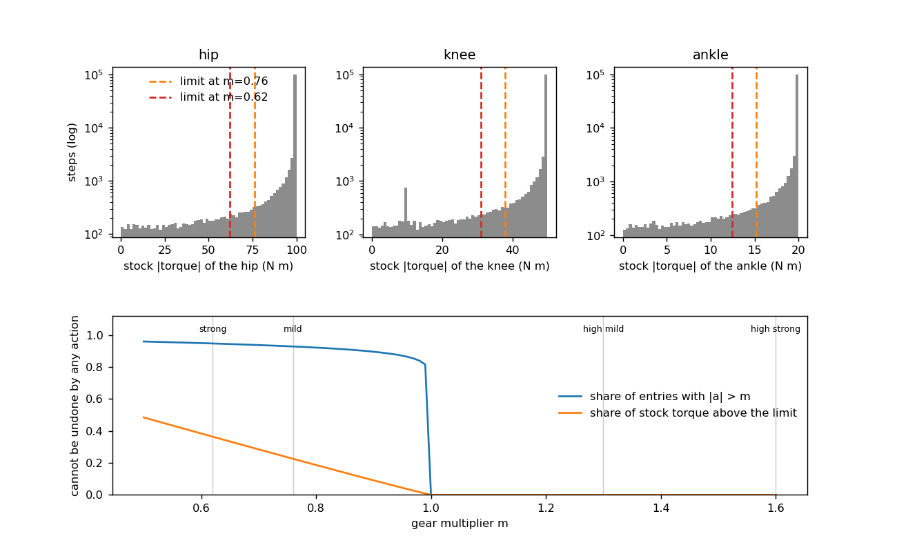
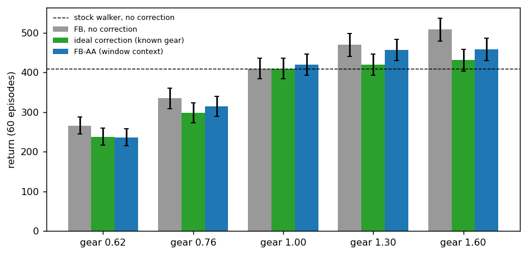

# T4.1.3.2 結果：動力學偏移偵測的診斷、序列 context encoder 與動作修正的邊界

## 名詞說明

- **原環境（baseline、stock）：** 沒有改任何參數的 walker。
- **偏移：** 改變環境的參數。friction 是地面摩擦，gear 是馬達輸出力矩的倍率。gear 為 1.0 是原本的馬達，小於 1 是馬達變弱（動力不足），大於 1 是馬達變強。mild 與 strong 是輕度與重度，「調高」是把參數調大。
- **轉移 $(s,a,s')$：** 一筆紀錄，在狀態 $s$ 做了動作 $a$，下一步走到狀態 $s'$。「單步」只看一筆轉移，「多步」看連續很多步。
- **episode 與 return：** episode 是從環境重置開始、連續跑 1000 步的一次完整執行。return 是這 1000 步的任務獎勵加總，越高越好。
- **重播原動作：** 把事先記錄好的動作依序送進環境，不管環境現在變成什麼樣子。
- **實際執行：** policy 每一步看著當下的狀態自己決定動作，動作會隨環境改變。報告正文的「實際執行」就是閉迴路，「重播原動作」就是開迴路。
- **配對：** 同一個起點、同一組動作，只換環境，所以兩者的差別只來自環境。
- **AUC：** 區分兩組資料的能力。0.5 等於亂猜，1.0 等於完全分得開。
- **$B_0(s')$：** 預訓練 FB 對狀態 $s'$ 的 50 維描述，用來比較兩個狀態「對任務而言」差多少。
- **context：** 從最近一段轉移估出的 16 維向量，描述現在環境的動力學。產生它的模型叫 context encoder。
- **window 與 oracle：** window 是只用最近 32 步估出的 context，上線時拿得到。oracle 是用偏移環境所有步驟的平均 context，上線時拿不到，只用來看上限。
- **飽和：** 動作已經是最大值（$\pm1$），沒辦法再加大。
- **混沌：** 很小的差異會在後續步驟被放大。
- **浮點誤差：** 電腦計算時的微小捨入誤差，$10^{-6}$ 左右。
- **標準誤差：** 平均值的不確定程度。兩組的差值小於約 2 個標準誤差時，不能說有可靠的差異。

**結論：**

- 單步轉移 $(s,a,s')$ 含有區分 friction 偏移的資訊，T4.1.2.1 偵測不到是分數設計的問題。直接訓練分類器區分 baseline 與偏移的 $s'$，friction strong 的 AUC 從 0.515 升到 0.751，actuator strong 從 0.697 升到 0.961。Friction 只在約 55% 的步驟改變 $s'$，只看這些步驟時分類器的 AUC 為 0.83 到 0.88。
- Friction 造成的狀態差異約 5 步就與 actuator mild 的單步差異同量級，但 walker 是混沌的：只差浮點誤差的兩條軌跡約 30 到 50 步後也完全分開，所以偏移的資訊集中在前 5 到 20 步。動力學模型的多步預測誤差放大得和偏移差異一樣快，多步預測的 AUC 最高只有約 0.58。
- 用多組隨機動力學訓練的序列 context encoder，不看任何測試設定的資料，就能從 32 步的實際執行片段偵測偏移：Transformer 版本在調低的四個設定 AUC 為 0.972 到 0.988，friction 也偵測得到。調高的 friction mild（1.5）仍只有 0.590。同一個 context 讓 $B_0(s')$ 的預測在偏移環境中誤差降低 5% 到 16%，在 baseline 不變差。
- 預訓練 FB 的 $B_0(s')$ 保留了 friction 造成的 $s'$ 差異，相對大小與原始狀態相近或更大。Friction 改變的是 $B_0(s')$ 的落點，不是單步移動的距離，所以只看大小的分數抓不到 friction，要比較預測與實際的 $B_0(s')$ 向量。
- 動作修正在 gear 調低時有物理上限。walker 的 motor 力矩為 $m\cdot\text{gear}_i\cdot\text{clip}(a_i,-1,1)$，FB actor 的動作大多已在 $\pm1$，gear 調低後 93% 到 95% 的動作維度無法補償，stock 力矩的 23%（$m=0.76$）與 36%（$m=0.62$）在偏移環境中產生不出來。$[-1,1]$ 內的最佳動作 $\mathrm{clip}(a/m)$ 只能補回單步差距的 3% 到 4%，透過 $B_0$ 預測器學到的修正為 $-3\%$ 到 $-0.5\%$。Gear 調高時最佳動作能完全補回，學習到的修正補回 39% 到 50%。
- 讓 policy 實際跑完整個 episode 的 return 上，動作修正在調低 gear 時沒有回補：不修正、理想修正 $a^*$、FB-AA 在 gear 0.76 為 335.0、298.3、314.7，在 0.62 為 266.0、238.3、236.8，兩種修正都不高於不修正。Gear 調高時不修正的 return 高於 stock（+60、+98），$a^*$ 把它拉回 stock 附近（+10、+22），FB-AA 只拉回一半（+47、+48）。

## 單步：設定

資料是 T4.1.2 的配對單步資料：3 個 FB 訓練 seed 的 walk $z_r$ policy 在 baseline 環境各跑 20 個 episode，每一步的物理狀態與動作放進 baseline 與各偏移環境只走一步。所以每對樣本的 $(s,a)$ 相同，只有 $s'$ 來自不同動力學。偏移設定同 T4.1.2：T3.2 的 friction 與 actuator 的 mild、strong（調低），以及 T4.1.2 `configs/` 的四個調高設定。

- **舊方法：** T4.1.2.1 的動力學模型誤差 $\lVert e\rVert_2$，$e=\Delta s-f(s,a)$，$f$ 只用 baseline 轉移訓練。
- **新方法：** 每個偏移設定各訓練一個分類器，輸入 $(s,a,s'-s)$，標籤為 baseline 或偏移。MLP 為 3 層、寬度 512 的 ReLU，Adam（學習率 $10^{-3}$）、batch 1024、60 epoch。60 個 episode 中隨機 45 個訓練、15 個測試（種子 0）。

兩者都在同樣 15 個測試 episode（14,985 對）上評估。分類器訓練時看過偏移資料，偵測器上線時沒有，所以分類器的結果是單步資訊量的參考，不是可部署的偵測器。

AUC 為隨機一筆偏移樣本的分數高於隨機一筆 baseline 樣本的機率，0.5 為無法區分。正確率以 logit > 0 判為偏移，為偏移被判對與 baseline 被判對的比例平均。

## 單步：分類效果

| 環境 | 舊方法 AUC | 新方法 AUC | 新方法正確率 |
|---|---|---|---|
| Friction Mild | 0.509 | 0.712 | 62.7% |
| Friction Strong | 0.515 | 0.751 | 65.4% |
| Actuator Mild | 0.610 | 0.914 | 82.1% |
| Actuator Strong | 0.697 | 0.961 | 88.8% |

調高的四個設定：

| 環境 | 舊方法 AUC | 新方法 AUC | 新方法正確率 |
|---|---|---|---|
| Friction Mild（調高） | 0.506 | 0.513 | 50.9% |
| Friction Strong（調高） | 0.532 | 0.734 | 64.2% |
| Actuator Mild（調高） | 0.669 | 0.932 | 84.5% |
| Actuator Strong（調高） | 0.798 | 0.976 | 91.7% |

- 除了 friction 調高 mild，分類器的 AUC 比舊方法高 0.18 到 0.31。
- Friction 調高 mild 的 $s'$ 差異是所有設定中最小的（中位數 0.17），分類器的訓練 AUC 到第 60 epoch 只有 0.518 且仍在上升，無法判斷是訓練不足還是單步真的無法區分。

## 單步：Friction 只在部分步驟起作用

Actuator 偏移在每一步都改變 $s'$。Friction 偏移在 55% 到 56% 的步驟改變 $s'$，其餘步驟的 $s'$ 與 baseline 完全相同（差異小於 $10^{-6}$）。這些步驟推測是腳不在地上的步驟，資料中沒有接觸資訊，未直接驗證。差異也集中在少數步驟：$\lVert s'_{\text{shift}}-s'_{\text{base}}\rVert^2$ 最大的 10% 步驟，在 friction 占總量的 75% 到 90%，在 actuator 只占 34% 到 35%。

只看 friction 有改變 $s'$ 的步驟（約 8,200 對）：

| 環境 | 舊方法 AUC | 新方法 AUC | 新方法正確率 | 偏移被判對 | baseline 被誤判 |
|---|---|---|---|---|---|
| Friction Mild | 0.517 | 0.833 | 73.2% | 76.8% | 30.4% |
| Friction Strong | 0.528 | 0.881 | 78.1% | 80.6% | 24.4% |
| Friction Strong（調高） | 0.557 | 0.851 | 75.4% | 80.6% | 29.8% |

- 分類器在這些步驟的 AUC 比全部步驟高 0.12 到 0.13。不起作用的步驟兩邊輸入相同，只能猜。
- 舊方法限制在這些步驟也幾乎沒有提升（0.517 到 0.557）。偏移後的誤差為 $e+\delta$，$\delta=s'_{\text{shift}}-s'_{\text{base}}$：

$$\lVert e+\delta\rVert^2=\lVert e\rVert^2+2e^\top\delta+\lVert\delta\rVert^2$$

$e$ 與 $\delta$ 的方向無關時，分數只多了 $\lVert\delta\rVert^2$。在偏移有改變 $s'$ 的步驟上，$\lVert\delta\rVert/\lVert e\rVert$ 的中位數在 friction 為 0.16 到 0.61，actuator 為 0.78 到 1.83，所以 friction 造成的分數變化小於 baseline 本身的變異。MuJoCo 是確定性的，$e$ 完全來自模型的近似誤差。

## 多步：偏移差異的累積

從 baseline rollout（3 個 seed × 20 個 episode）的第 0、50、…、850 步取物理狀態，在 baseline 與各偏移環境各跑 100 步。重播原動作是照 baseline 記錄的動作執行，實際執行是各環境中的 FB actor 看著當時的狀態自己決定動作。表為重播原動作的 $\lVert s_k^{\text{shift}}-s_k^{\text{base}}\rVert$ 中位數（1,080 條軌跡）。最後一列為實際執行的 baseline 與原 rollout 的差異，兩者只差 actor 單筆與批次計算的浮點誤差。

| 環境 | $k=1$ | $k=5$ | $k=10$ | $k=20$ | $k=50$ | $k=100$ |
|---|---|---|---|---|---|---|
| Friction Mild | 0.03 | 3.1 | 7.3 | 16.4 | 25.3 | 25.3 |
| Friction Strong | 0.09 | 4.1 | 9.4 | 18.5 | 26.1 | 26.2 |
| Actuator Mild | 3.7 | 8.5 | 12.6 | 17.9 | 23.0 | 23.5 |
| Actuator Strong | 5.6 | 12.7 | 17.0 | 21.7 | 23.2 | 23.3 |
| 浮點誤差 | 0 | 0 | 0.0001 | 0.002 | 15.5 | 34.8 |

- Friction 約 5 步達到 actuator mild 的單步差異（3.7）。調高的 friction strong 也是約 5 步（3.6），調高的 mild 要 10 到 20 步。
- 第 50 步時表中四個設定都在 23 到 26，與浮點誤差造成的分開（第 50 步 15.5、第 100 步 34.8）是同一個量級，差異的大小不再反映偏移的類型或強度。
- 實際執行的差異更大，第 10 步時 friction 為 17.6 與 19.1，重播原動作為 7.3 與 9.4。

## 多步：動力學模型的多步預測

用 T4.1.2.1 的動力學模型，從 $s_{t_0}$ 以實際執行軌跡中的動作預測 $k$ 步，分數為與實際狀態的距離。這不需要配對資料，與上線時的情況相同。另一個分數是前 $k$ 步單步誤差 $\lVert e\rVert_2$ 的平均。AUC 為 baseline 軌跡與偏移軌跡的比較。

| 環境 | 多步預測 $k=1$ | $k=5$ | $k=10$ | $k=30$ | 單步誤差平均 $k=5$ | $k=10$ | $k=30$ |
|---|---|---|---|---|---|---|---|
| Friction Mild | 0.512 | 0.555 | 0.568 | 0.539 | 0.532 | 0.555 | 0.589 |
| Friction Strong | 0.515 | 0.575 | 0.583 | 0.535 | 0.547 | 0.573 | 0.635 |
| Actuator Mild | 0.614 | 0.628 | 0.627 | 0.538 | 0.614 | 0.628 | 0.638 |
| Actuator Strong | 0.703 | 0.721 | 0.706 | 0.562 | 0.723 | 0.746 | 0.789 |

- 模型在 baseline 軌跡上的多步誤差中位數為 3.9（$k=1$）、11.4（$k=10$）、18.0（$k=20$），與上一節偏移造成的差異同速成長，所以多步預測的 AUC 在 $k=5$ 到 10 最高，之後下降。
- 單步誤差平均隨 $k$ 緩慢上升，第 30 步時 friction strong 為 0.635，仍低於單步分類器的 0.751。調高的設定：friction strong 0.642、mild 0.520，actuator 0.857 與 0.962。

## $B_0(s')$ 是否保留偏移造成的差異

$B_0$ 為各 seed 預訓練 FB 的 backward representation（50 維，範數 $\sqrt{50}$），用在該 seed 的配對單步資料上。只看偏移有改變 $s'$ 的步驟，比較差異在 $B_0$ 與原始狀態中的相對大小：

- **相對單步變化：** $\lVert x(s'_{\text{shift}})-x(s'_{\text{base}})\rVert/\lVert x(s'_{\text{base}})-x(s)\rVert$ 的中位數，$x$ 為原始狀態或 $B_0$。
- **保留倍率：** $B_0$ 的相對單步變化除以原始狀態的。另以隨機兩個 baseline $s'$ 的距離中位數當尺度算同樣的倍率。

| 環境 | 狀態 | $B_0$ | 保留倍率 | 保留倍率（狀態間距離尺度） |
|---|---|---|---|---|
| Friction Mild | 0.087 | 0.212 | 2.44 | 1.41 |
| Friction Strong | 0.110 | 0.278 | 2.52 | 1.46 |
| Actuator Mild | 0.198 | 0.193 | 0.98 | 0.51 |
| Actuator Strong | 0.307 | 0.301 | 0.98 | 0.51 |

調高的設定：friction mild 1.63 與 1.01，strong 1.57 與 0.90；actuator 約 0.97 與 0.51。Friction 的差異在 $B_0$ 中保留了 0.9 到 2.5 倍，actuator 為 0.5 到 1.0 倍。

單步在 $B_0$ 中移動的距離 $\lVert B_0(s')-B_0(s)\rVert$（全部步驟的中位數，AUC 為 $P(\text{shift}>\text{baseline})$）：

| 環境 | baseline | shift | AUC |
|---|---|---|---|
| Friction Mild | 2.176 | 2.162 | 0.495 |
| Friction Strong | 2.176 | 2.161 | 0.495 |
| Actuator Mild | 2.176 | 1.915 | 0.420 |
| Actuator Strong | 2.176 | 1.773 | 0.377 |

調高的設定：friction 2.181 與 2.146（AUC 0.502、0.490），actuator 2.513 與 2.854（AUC 0.595、0.676）。

- Actuator 改變每一步移動的距離：gear 調低時移動變少，AUC 低於 0.5；調高時相反。這與 T4.1.2 的 FB 殘差方向一致。
- Friction 幾乎不改變移動的距離，但改變落點：$B_0(s'_{\text{shift}})$ 與 $B_0(s'_{\text{base}})$ 的差異如上表保留下來。所以大小類的分數（$\lVert e\rVert$、Mahalanobis 距離、單步移動距離）都抓不到 friction，需要比較預測與實際的 $B_0(s')$ 向量。

## 序列 context encoder：設定

**訓練資料：** 300 組隨機動力學，各 6 個實際執行的 episode（1000 步），另加 T07 的 baseline 軌跡。前 100 組只改 friction，接著 100 組只改 gear，最後 100 組兩者都改。Friction 在 $[0.01,5]$ 內 log-uniform 抽樣，baseline 為 0.7；gear 倍率在 $[0.5,2]$ 內 log-uniform 抽樣。8 個測試設定的參數值前後 10% 範圍內不抽樣。Policy 為 3 個 FB 訓練 seed 的 stand、walk、run、flip $z_r$，在各組間輪流使用。

**模型：** encoder $E$ 讀取 $H$ 步的 $(s,a,s'-s)$，輸出 16 維單位向量 $c$。比較兩種 encoder：

- **Transformer：** 2 層、寬度 128、4 個 head，用 CLS token，不加位置編碼。
- **Mean：** 每步經過同一個 MLP 後取平均。

預測器 $g(s,a,c)$ 為寬度 512 的 3 層 MLP，目標是凍結的 $B_0(s')$（50 維）。$c$ 取自同一組動力學的另一個 episode。Loss 為

$$L=\lVert g(s,a,c)-B_0(s')\rVert^2+0.1\,\mathrm{InfoNCE}(c_1,c_2),$$

其中 $c_1,c_2$ 來自同組動力學的兩個不同 episode，batch 內其他組為負樣本，$\tau=0.1$。每步取 256 組動力學，$H$ 在 1 到 32 之間隨機。Adam（學習率 $3\times10^{-4}$）訓練 10 萬步，以驗證 loss 選最佳 checkpoint。每個 FB seed 用自己的 $B_0$ 各訓練一個模型，共 3 seed × 2 encoder = 6 個模型。

**驗證：** 組號除以 10 餘 9 的 30 組動力學，加上 baseline 環境 seed 40 到 49 的 episode，不參與訓練。

**測試：** baseline 與 8 個測試設定各跑 240 個實際執行的 episode（3 個 FB seed × 4 個任務 × 20 個）。每個 episode 從第 0、50、…、850 步各取一段長度 $H$ 的片段，分數為 $\lVert c-c_0\rVert$。$c_0$ 是 baseline 訓練 episode 同樣片段的 $c$ 平均後再正規化。AUC 把一個設定的所有片段與 baseline 的所有片段比較，下表列 3 個 FB seed 的平均，括號內為 seed 間的範圍。

## 序列 context encoder：偵測

驗證集上，從 31 組動力學中挑出正確一組的 InfoNCE 準確率（亂猜為 3.2%）：

| Encoder | $H=1$ | $H=4$ | $H=16$ | $H=32$ |
|---|---|---|---|---|
| Transformer | 5.8% 到 9.0% | 11.6% 到 12.9% | 28.4% 到 31.6% | 40.0% 到 43.2% |
| Mean | 2.6% 到 7.1% | 16.1% 到 16.8% | 20.6% 到 24.5% | 19.4% 到 27.7% |

測試設定的偵測 AUC，Transformer：

| 環境 | $H=1$ | $H=4$ | $H=16$ | $H=32$ |
|---|---|---|---|---|
| Friction Mild | 0.552 | 0.692 | 0.922 | 0.972（0.968 到 0.976） |
| Friction Strong | 0.602 | 0.789 | 0.966 | 0.986（0.986 到 0.988） |
| Actuator Mild | 0.729 | 0.909 | 0.980 | 0.987（0.985 到 0.989） |
| Actuator Strong | 0.879 | 0.971 | 0.986 | 0.988（0.987 到 0.990） |

調高的設定，$H=32$：friction mild 0.590、friction strong 0.952、actuator mild 0.996、actuator strong 0.994。

Mean encoder：

| 環境 | $H=1$ | $H=4$ | $H=16$ | $H=32$ |
|---|---|---|---|---|
| Friction Mild | 0.596 | 0.690 | 0.831 | 0.899（0.893 到 0.906） |
| Friction Strong | 0.670 | 0.775 | 0.903 | 0.957（0.952 到 0.961） |
| Actuator Mild | 0.663 | 0.818 | 0.941 | 0.968（0.965 到 0.970） |
| Actuator Strong | 0.794 | 0.926 | 0.983 | 0.991（0.989 到 0.995） |

調高的設定，$H=32$：friction mild 0.545、friction strong 0.798、actuator mild 0.981、actuator strong 0.994。

- **片段越長越容易偵測。** Friction 在 $H=1$ 時低於單步分類器（0.71、0.75），到 $H=16$ 才超過 0.9。
- **Transformer 在長片段較好**，friction 差異最大：$H=32$ 時 friction mild 0.972 比 0.899，調高的 friction strong 0.952 比 0.798。$H=1$ 時 friction 反而是 mean 較好。
- **調高的 friction mild 仍偵測不到。** 單步分類器在這個設定的 AUC 也只有 0.51。
- **只看 walk 的 episode 結果相近**：Transformer 在 $H=32$ 時調低的四個設定為 0.988 到 0.997。

上一節的單步分類器看過偏移資料，context encoder 沒有，但兩者的測試資料不同：分類器是配對單步轉移，這裡是從環境重置開始、實際執行的 episode。

## 序列 context encoder：偵測是否只靠狀態分布

實際執行的 episode 中，偏移會改變 walker 的姿勢分布，encoder 可能只是辨認姿勢。把片段按起點分開計算（Transformer，3 個 seed 平均）：

| 環境 | $H=8$，起點 0 | $H=8$，起點 50 | $H=32$，起點 0 | $H=32$，起點 50 |
|---|---|---|---|---|
| Friction Mild | 0.524 | 0.850 | 0.965 | 0.970 |
| Friction Strong | 0.542 | 0.918 | 0.991 | 0.989 |
| Actuator Mild | 0.907 | 0.954 | 0.988 | 0.989 |
| Actuator Strong | 0.983 | 0.982 | 0.993 | 0.992 |

起點 0 的片段從環境重置開始，baseline 與偏移的初始狀態分布相同，$H=32$ 的 friction 仍有 0.965 與 0.991。這支持 encoder 用到的是動力學。Friction 在 $H=8$ 起點 0 接近 0.5，但起點 50 時明顯較高，可能是重置後前幾步尚未接觸地面，friction 不起作用。實際執行時狀態與動力學同時改變，這個檢查無法完全分開兩者。

## 序列 context encoder：$B_0(s')$ 的預測

在每個片段之後的 100 步，比較 $g$ 用片段自己的 $c$ 與用 $c_0$ 時的誤差 $\lVert g-B_0(s')\rVert^2$。下表為 Transformer，3 個 seed 平均的改善比例 $1-\text{err}(c)/\text{err}(c_0)$：

| 環境 | $H=1$ | $H=32$ | $H=32$ 時 err($c$) / err($c_0$)（seed 0） |
|---|---|---|---|
| Baseline | −3.0% | −0.3% | 1.777 / 1.775 |
| Friction Mild | −0.4% | 12.0% | 1.604 / 1.856 |
| Friction Strong | 2.3% | 16.3% | 1.963 / 2.401 |
| Actuator Mild | 3.3% | 4.6% | 1.332 / 1.395 |
| Actuator Strong | 14.8% | 15.3% | 1.050 / 1.235 |

調高的設定在 $H=32$ 時：friction mild 0.0%、friction strong 6.7%、actuator mild 5.9%、actuator strong 16.5%。Mean encoder 在 $H=32$ 時調低的四個設定為 8.1%、11.4%、5.6%、17.0%。

- $g(s,a,c_1)$ 比 $g(s,a,c_0)$ 更接近偏移環境的 $B_0(s')$，即使該設定的參數不在訓練範圍內抽樣。
- 改善只有 5% 到 16%，剩下的誤差（約 1.0 到 2.0）比偏移造成的差異大，$g$ 本身的誤差仍是主要部分。
- 驗證集的預測 loss 在 $H=1$ 與 $H=32$ 幾乎相同（每維 0.034 到 0.038），因為驗證集是所有動力學的平均，大多數組與 baseline 差異不大，看不出 context 的作用。

## 動作修正的邊界：gear 調低時動力不足

**問題：** 偏移環境的 gear 為 stock 的 $m$ 倍時，把動作改成 $a'$ 能否讓單步結果回到 stock 的 $s'_0(a)$。walker 的 motor 力矩為 $m\cdot\text{gear}_i\cdot\text{clip}(a_i,-1,1)$，所以要重現 stock 力矩，每個維度的解為 $a'_i=a_i/m$，受限於動作範圍：

$$a^*_i=\mathrm{clip}(a_i/m,\,-1,\,1)$$

$m\ge1$ 時 $a^*_i/m$ 一定在範圍內，單步結果與 stock 完全相同。$m<1$ 時 $|a_i|>m$ 的維度飽和在 $\pm1$，缺少的力矩 $(|a_i|-m)\cdot\text{gear}_i$ 任何動作都補不回來，所以 $a^*$ 是這個偏移下任何方法的單步上限。

**設定：** 3 個 FB seed 的 stand、walk、run、flip policy 各 5 個 stock episode（環境種子 300000 到 300019，每個 seed 20 個 episode，共 60,000 步）。每一步的物理狀態與動作，放進原環境 與 4 個 gear 偏移環境各走一步，動作分別為 stock 的 $a$ 與 $a^*$。指標為 $\lVert B_0(s'_k(\cdot))-B_0(s'_0(a))\rVert$ 的中位數，$B_0$ 取自該 seed 的 FB。學習到的修正取自 `adapt_step` 的結果：以 context encoder（Transformer，32 步的片段）與預測器 $g$，從 $a'=a$ 出發對 $\lVert g(s,a',c_1)-g(s,a,c_0)\rVert^2$ 做 20 步 Adam（學習率 0.05），動作限制在 $[-1,1]$。$c_1$ 取自該步之前 32 步的轉移（window），或該偏移環境所有取樣步驟 context 的平均（oracle），$c_0$ 為 stock 環境的 oracle context。這個結果在每 8 步取一次、從第 32 步開始的 21,780 步上；其他欄位用全部 60,000 步。

**結果：**

| 環境 | gear $m$ | 無法補償的動作維度 | 無法產生的力矩 | $a^*$ 補回 | 學習法補回（window） | 學習法補回（oracle） |
|---|---|---|---|---|---|---|
| Actuator Mild | 0.76 | 92.8% | 22.6% | 3.6% | −2.8% | −2.1% |
| Actuator Strong | 0.62 | 94.7% | 36.4% | 2.7% | −1.1% | −0.5% |
| Actuator Mild（調高） | 1.3 | 0% | 0% | 100% | 39.2% | 41.8% |
| Actuator Strong（調高） | 1.6 | 0% | 0% | 100% | 47.5% | 50.3% |

- 「無法補償的動作維度」為 $|a_i|>m$ 的比例。「無法產生的力矩」為 stock 力矩中超過 $m\cdot\text{gear}_i$ 的部分占全部的比例，hip、knee、ankle 各以 gear 100、50、20 加權。
- 「補回」為 $1-$（修正後的 $B_0$ 距離中位數）$/$（不修正的距離中位數）。不修正的距離為 0.406、0.634、0.499、0.965。負值表示比不修正更差。
- 圖中第一列為 stock 力矩的分布：三種關節的力矩都集中在上限（$|a_i|=1$），虛線右邊的力矩在 $m=0.76$ 與 $0.62$ 的環境中無法產生。第二列為無法補償的比例與力矩缺口對 $m$ 的曲線。

- **調低 gear 時沒有修正空間。** FB actor 的動作大多飽和在上限，力矩分布集中在 $|a_i|=1$（圖）。偏移後的力矩上限低於 stock 的力矩，所以 $a^*$ 只能補回 3% 到 4%，學習到的修正沒有效果也是預期的結果，不能歸因於學習法。
- **調高 gear 時有解，學習法補回約一半。** $a^*$ 讓 $B_0$ 的距離降到浮點誤差（$10^{-6}$）。學習到的修正在 window 為 39% 與 48%，oracle 為 42% 與 50%，兩者相差 3 個百分點，所以 context 估計不是主要的限制，剩下的差距來自 $g$ 對動作的預測。
- 調低 gear 的動作已經用盡力矩，這個現象是由 FB policy 的動作分布造成的。若 policy 的動作較少飽和，修正的空間會變大，這個檢查沒有做。

## 動作修正：讓 policy 實際跑完整個 episode 的 return

**設定：** 3 個 FB seed 的 stand、walk、run、flip policy 各 5 個 episode（環境種子 300000 到 300019），共 60 個 episode，每個 1000 步。環境為 stock walker 與 4 個 gear 偏移（0.76、0.62、1.3、1.6）。每個環境、每個 episode 用三種動作各跑一次，環境種子相同，return 可以配對：

- **不修正：** FB actor 的動作 $a$。
- **理想修正：** $a^*=\mathrm{clip}(a/m,-1,1)$，需要已知 gear 倍率 $m$。
- **FB-AA：** 每一步用最近 32 步實際執行的轉移估 context $c_1$（第 32 步以前不修正），對 $\lVert g(s,a',c_1)-g(s,a,c_0)\rVert^2$ 做 20 步 Adam（學習率 0.05），動作限制在 $[-1,1]$。$c_0$ 為 stock 環境的 context，取自另外 5 個 stock episode（每個任務，環境種子 310000 起）的所有窗口平均。context 模型為單步一節的 Transformer encoder 與預測器。

Return 為任務 reward 的總和，四個任務合併平均。括號內為與不修正的配對差值的標準誤差。

| 環境 | gear $m$ | 不修正 | 理想修正 $a^*$ | FB-AA |
|---|---|---|---|---|
| Stock | 1.0 | 409.7 | 409.7 | 420.0（+10.3，17.4） |
| Actuator Mild | 0.76 | 335.0 | 298.3（−36.7，11.4） | 314.7（−20.2，12.4） |
| Actuator Strong | 0.62 | 266.0 | 238.3（−27.7，16.5） | 236.8（−29.1，14.3） |
| Actuator Mild（調高） | 1.3 | 469.5 | 420.1（−49.5，17.9） | 456.6（−13.0，13.1） |
| Actuator Strong（調高） | 1.6 | 508.1 | 431.3（−76.8，15.3） | 458.1（−50.0，9.2） |

圖中的誤差線為各組 60 個 episode 的平均的標準誤差，沒有配對，所以比表中的配對差值寬。各任務的結果在 `data/adapt_episode_task.csv`。

- **調低 gear 時沒有回補。** FB-AA 在 gear 0.76 與 0.62 的 return 比不修正低 20 與 29（約 1.6 與 2.0 個標準誤差）。理想修正也比不修正低 37 與 28。單步結果顯示 $a^*$ 在調低 gear 時只能補回單步差距的 3% 到 4%，但沒有預期它會讓 return 下降。原因沒有驗證，一個可能是 $a^*$ 只補回沒有飽和的關節，各關節力矩的比例與 policy 預期的不同，不修正時各關節的力矩等比例縮小，比例不變。
- **調高 gear 時理想修正回到 stock 的水準。** 不修正比 stock 高 59.9 與 98.4（標準誤差 18.5 與 18.2），因為馬達變強，$a^*$ 讓單步轉移與 stock 完全相同，return 回到 stock 附近（+10.4 與 +21.7，標準誤差 15.8 與 14.2）。
- **FB-AA 在調高 gear 時拉回約一半。** 與 stock 的差距為 +46.9 與 +48.4（不修正為 +59.9 與 +98.4），與單步補回 39% 到 48% 的結果一致。這個設定下修正的目標是讓動力學回到 stock，所以 return 降低代表更接近 stock，不是變差。
- **Stock 環境沒有副作用。** FB-AA 在 stock 的 return 為 420.0，比不修正高 10.3（標準誤差 17.4），沒有可靠的差異。動作平均改變 0.157，調高 gear 時為 0.42 到 0.64。

## 限制

- 分類器訓練時看過偏移資料，只能說明單步的資訊量，不代表只用 baseline 資料訓練的偵測器能達到同樣的效果。
- 「偏移有改變 $s'$ 的步驟」以 $s'$ 是否改變判定，上線時無法得知，除非能從狀態推得接觸。
- 只有一個分類器訓練種子與一種 episode 切分，AUC 沒有區間。
- 單步的評估是把 baseline rollout 的 $(s,a)$ 放進偏移環境走一步，不是讓 policy 在偏移環境中執行。多步預測一節使用實際執行的軌跡，但起點仍取自 baseline rollout。
- $B_0$ 的檢查只比較差異的大小，沒有測試用 $B_0(s')$ 能否區分偏移。
- 多步預測只用 T4.1.2.1 的一個模型。
- Context encoder 的 AUC 把同一個 episode 的 18 個片段都算進去，片段之間不獨立。
- Context encoder 只訓練一個 torch seed，seed 間的範圍只反映 FB seed（即 $B_0$）的差異。
- Context encoder 只用一組訓練範圍（friction $[0.01,5]$、gear $[0.5,2]$），測試設定都在範圍內，沒有測試範圍外的偏移。
- 動作修正只檢查 gear 偏移。學習法只列一組超參數（20 步、學習率 0.05），其他 5 組超參數在 `adapt_step` 的資料中，沒有分析。
- $B_0$ 距離為 3 個 FB seed 合併的中位數，沒有 seed 間的區間，也沒有以 episode 為單位的信賴區間。
- 完整 episode 的 return 只有 60 個 episode，配對差值的標準誤差為 9 到 18，FB-AA 與不修正的差距多為 1 到 2 個標準誤差。四個任務的 return 差異很大（run 約 100 到 260，stand 約 400 到 775），合併平均時 stand 與 walk 占的影響較大。
- 完整 episode 的評估只測 gear 偏移，FB-AA 只有一組超參數（20 步、學習率 0.05、窗口 32 步），沒有調參。理想修正 $a^*$ 在調低 gear 時 return 下降的原因沒有驗證。
