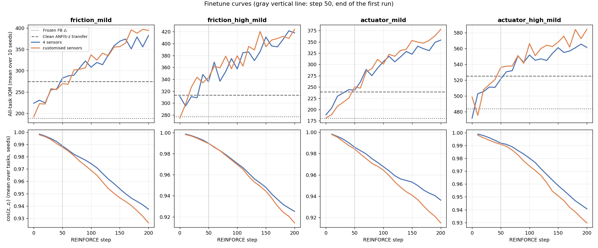

# T5.1-ood-fuzzy：在 Walker OOD 動力學中以 ANFIS 尋找更好的 FB latent $z$

固定預訓練好的 FB 模型（Walker RND 660k，1 個 checkpoint），在 4 種偏移動力學中比較四種取得 task latent $z$ 的方法。$z$ 一律由 $z = \sqrt{d}\,\operatorname{normalize}(\mathbb{E}[\tilde{r}_\theta(s) B(s)])$ 計算，差別只在狀態權重 $\tilde{r}_\theta(s)$ 的來源與訓練環境。

## 1. 實驗設定

**OOD 動力學（各調低、調高一次）**

| 名稱 | 偏移 | 原值 |
|---|---|---|
| `friction_mild` | 地板與身體 geom 摩擦調低為 0.1 | 0.7 |
| `friction_high_mild` | 摩擦調高為 1.5 | 0.7 |
| `actuator_mild` | 所有關節 gear 調低為 76% | 100% |
| `actuator_high_mild` | 所有關節 gear 調高為 130% | 100% |

**四種方法**

| 方法 | 說明 |
|---|---|
| Frozen FB $z_r$ | 以原始 reward 推論 $z_r$，直接在 OOD 環境評估 |
| Clean ANFIS-z 直接遷移 | 在原環境以 REINFORCE 訓練 50 步的 4 sensors ANFIS-z，不再調整，直接在 OOD 環境評估 |
| OOD finetune，4 sensors | 同一個 4 sensors ANFIS（`torso_height`、`torso_upright`、`horizontal_velocity`、`angmomentum`，36 rules），在各 OOD 環境重新 finetune 200 步 |
| OOD finetune，客製 sensors | 依偏移類型加入更多 sensors 後在各 OOD 環境 finetune 200 步。Friction：另加 `com_vz`、`qvel_right_ankle`、`qvel_left_ankle`（7 sensors，128 rules）。Actuator：另加 `qvel_right_hip`、`qvel_left_hip`、`qvel_right_knee`、`qvel_left_knee`（8 sensors，256 rules） |

**訓練與評估協定**

- Finetune：10 個 finetune seeds（`1000, 1010, ..., 1090`），每個 seed 使用互不重疊的訓練環境種子。每個任務每次迭代 16 個成對擾動的 $z$（$\sigma=0.5$），learning rate $10^{-3}$，先以真實 reward warm-start 500 步。
- 訓練分兩段：第一段為 step 1 到 50，第二段從第一段儲存的模型接續到 step 200，參數與訓練環境種子的順序不變。接續時 Adam 的動量沒有儲存而從零開始。接續時對 step 50 重新評估，10 個 seeds 的分數都與第一段一致。
- 評估：四個任務（`stand`、`walk`、`run`、`flip`）共用 20 個評估環境（種子 `5..24`），與 finetune 種子不重疊。每個任務分數為 20 個 episode 的 IQM，再對 10 個 finetune seeds 取平均。每 10 步評估一次。
- 依 Table 6 的做法，每個環境、每種方法各自取「十個 seeds 平均後 All-task IQM 最高」的 step 回報（「選定 step」欄）。挑選與回報用的是同一批評估環境，所以分數略偏樂觀。「第 50 步」與「第 200 步」兩欄為不挑選的分數。Clean ANFIS-z 直接遷移與 Frozen FB $z_r$ 沒有 finetune 迭代，不挑選。
- All-task IQM 為四個任務分數的 25% trimmed mean（Table 6 of Jeen et al. 2024，`analysis.table6_aggregate`）。「相對 $z_r$」為該列 All-task IQM 減去同一環境 Frozen FB $z_r$ 的 All-task IQM。
- Frozen FB $z_r$ 不含隨機訓練，10 個 finetune seeds 的分數相同。

## 2. 結果

四環境平均列的四個任務欄位為四個環境該任務分數的平均，All-task IQM 欄位為四個環境各自 All-task IQM 的平均。資料來源：`data/summary.csv`（同內容的表格在 `data/summary.md`）。

| OOD 環境 | 方法 | 選定 step | stand | walk | run | flip | All-task IQM | 相對 $z_r$ | 第 50 步 | 第 200 步 |
|---|---|---:|---:|---:|---:|---:|---:|---:|---:|---:|
| `friction_mild` | Frozen FB $z_r$ | - | 189.8 | 321.0 | 118.1 | 187.3 | 188.5 | +0.0 | - | - |
| `friction_mild` | Clean ANFIS-z 直接遷移 | - | 270.9 | 380.3 | 146.1 | 279.1 | 275.0 | +86.5 | - | - |
| `friction_mild` | OOD finetune，4 sensors | 200 | 394.0 | 510.1 | 171.3 | 371.0 | 382.5 | +194.0 | 282.6 | 382.5 |
| `friction_mild` | OOD finetune，客製 sensors | 190 | **421.6** | **540.6** | **178.6** | **372.7** | 397.1 | +208.6 | 269.8 | 394.6 |
| `friction_high_mild` | Frozen FB $z_r$ | - | 500.7 | 208.5 | 82.6 | 345.4 | 277.0 | +0.0 | - | - |
| `friction_high_mild` | Clean ANFIS-z 直接遷移 | - | 573.3 | 257.3 | 154.0 | 369.0 | 313.2 | +36.2 | - | - |
| `friction_high_mild` | OOD finetune，4 sensors | 190 | 648.2 | **441.5** | 210.5 | 401.5 | 421.5 | +144.6 | 335.9 | 418.0 |
| `friction_high_mild` | OOD finetune，客製 sensors | 200 | **663.1** | 441.3 | **215.5** | **406.6** | **424.0** | **+147.0** | 342.7 | 424.0 |
| `actuator_mild` | Frozen FB $z_r$ | - | 442.6 | 122.7 | 99.0 | 239.0 | 180.9 | +0.0 | - | - |
| `actuator_mild` | Clean ANFIS-z 直接遷移 | - | 444.4 | 173.9 | 116.3 | 304.4 | 239.2 | +58.3 | - | - |
| `actuator_mild` | OOD finetune，4 sensors | 200 | 551.6 | 369.0 | 175.8 | 338.7 | 353.8 | +173.0 | 242.9 | 353.8 |
| `actuator_mild` | OOD finetune，客製 sensors | 200 | 557.5 | **408.6** | **193.2** | **346.7** | **377.6** | **+196.8** | 250.2 | 377.6 |
| `actuator_high_mild` | Frozen FB $z_r$ | - | 681.9 | 617.2 | 251.0 | 350.3 | 483.8 | +0.0 | - | - |
| `actuator_high_mild` | Clean ANFIS-z 直接遷移 | - | 694.1 | 628.4 | 238.6 | 421.6 | 525.0 | +41.3 | - | - |
| `actuator_high_mild` | OOD finetune，4 sensors | 190 | 732.1 | 657.6 | 263.2 | 473.3 | 565.5 | +81.7 | 521.4 | 561.4 |
| `actuator_high_mild` | OOD finetune，客製 sensors | 200 | **737.5** | **662.3** | **268.6** | **506.2** | **584.3** | **+100.5** | 536.0 | 584.3 |
| 四環境平均 | Frozen FB $z_r$ | - | 453.7 | 317.4 | 137.7 | 280.5 | 282.5 | +0.0 | - | - |
| 四環境平均 | Clean ANFIS-z 直接遷移 | - | 495.7 | 360.0 | 163.7 | 343.5 | 338.1 | +55.6 | - | - |
| 四環境平均 | OOD finetune，4 sensors | - | 581.5 | 494.6 | 205.2 | 396.1 | 430.8 | +148.3 | 345.7 | 428.9 |
| 四環境平均 | OOD finetune，客製 sensors | - | **594.9** | **513.2** | **213.9** | 408.1 | **445.8** | **+163.2** | 349.7 | 445.1 |

粗體為同一環境、同一欄位中三種 ANFIS 方法的最高值（相對 $z_r$ 欄不含 $z_r$ 自身）。

原環境參考值（同一 checkpoint、同樣 20 個評估環境，`data/inputs/frozen_fb/clean/` 與 `data/inputs/clean/baseline/`）：Frozen FB $z_r$ 的 All-task IQM 為 363.5，原環境訓練 50 步的 4 sensors ANFIS-z 在選定 step（40）為 415.6。

### 訓練曲線

上排為十個 seeds 平均後的 All-task IQM，下排為 $z$ 與 $z_r$ 的 cosine（對任務與 seeds 平均）。資料來源：`data/curves.csv`。

## 3. 觀察

- **OOD finetune 在四個環境都明顯高於 $z_r$ 與直接遷移。** 四環境平均 All-task IQM：$z_r$ 為 282.5，直接遷移為 338.1，4 sensors finetune 為 430.8，客製 sensors finetune 為 445.8。相對 $z_r$ 的增益為 +148.3 與 +163.2。
- **客製 sensors 在四個環境都高於 4 sensors。** All-task IQM 差距為 `friction_mild` +14.7、`friction_high_mild` +2.5、`actuator_mild` +23.8、`actuator_high_mild` +18.8，四環境平均 +15.0。`friction_high_mild` 的差距很小。
- **訓練在 200 步時還沒有收斂。** 八條曲線中，step 150 到 200 的 All-task IQM 變化為 +0.4 到 +38.0，只有 `actuator_high_mild` 的 4 sensors 接近持平（+0.4），其餘都仍在上升。八個條件的選定 step 都落在 190 或 200。
- **$z$ 隨訓練持續遠離 $z_r$。** cosine 從 step 50 的 0.984 到 0.992，單調下降到 step 200 的 0.914 到 0.941，沒有趨緩。客製 sensors 的 cosine 在四個環境都低於 4 sensors，$z$ 移動得更多。
- **額外 sensors 在 200 步後才被明顯使用。** 以 `friction_mild` 客製 sensors（seed 1000）為例，`stand` 的權重隨 `com_vz` 從約 0.8 升到約 1.25，在 step 50 這條曲線的變動只有約 ±0.1（見 `figures/step50/` 與 `figures/step200/`）。其他環境的圖沒有逐張檢查。
- **第 50 步的結論與第 200 步不同。** 第 50 步時四環境平均為 4 sensors 345.7、客製 sensors 349.7，差距 4.0，且客製 sensors 在 `friction_mild` 低於 4 sensors。第 200 步時差距擴大為 15.0，且四個環境全部同向。

## 4. 限制

- **訓練尚未收斂。** 報告的數字是 200 步的結果，增益很可能被低估，方法之間的排序也可能隨訓練步數改變。
- **直接遷移與 OOD finetune 的訓練步數不同。** 直接遷移用的是原環境訓練 50 步的模型，OOD finetune 為 200 步，兩者的差距包含步數的影響，不能全部歸因於「在 OOD 環境訓練」。
- **接續訓練時 Adam 動量從零開始。** 這可能讓 step 50 附近的曲線有輕微的不連續，沒有單獨檢驗。
- 結果為單一 FB checkpoint，只有一種偏移強度（mild）與單一 REINFORCE 設定，沒有跨 FB seed 的結果。
- 表中沒有信賴區間。`friction_high_mild` 的 2.5 分差距等小差距可能落在 finetune seeds 之間的變異內，這份資料尚未檢定。選定 step 的做法也讓 finetune 方法略為有利。
- 客製 sensors 同時改變 sensor 數量與規則數（128 或 256 對 36），無法區分增益來自哪些 sensors 或來自較多規則。客製 sensors 依偏移類型各選一組，沒有與其他 sensor 組合比較。
- 所有 ANFIS 都以真實 reward warm-start，$z$ 從 $z_r$ 附近開始搜尋，沒有測試不做 warm-start 的起點。
- 只測 Walker 與 friction、actuator gear 兩類偏移。
