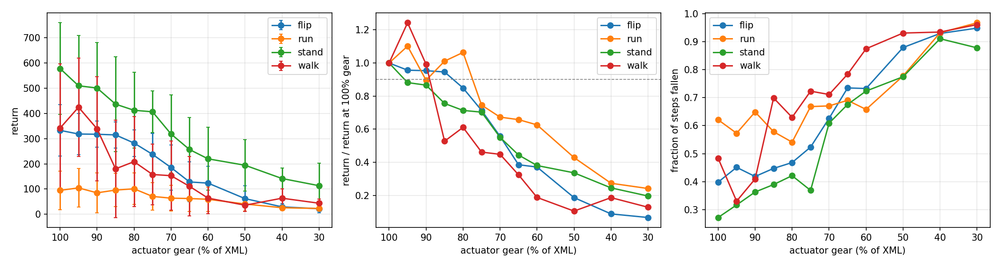

# T5.2：Action Saturation，actuator 功率上界測試

## 問題與結論

問題：把 walker 全部 actuator 的 gear 從 XML 原值逐步調低，標準 FB 在固定 $z_r$ 上的 return 降到什麼程度會崩跌。

結論：return 隨 gear 降低**漸進下滑**，沒有觀察到在某個功率比例突然崩跌。gear 降到 90% 到 80% 之間開始明顯下降，降到 50% 到 75% 之間掉到原本的一半。「80% 後崩跌」的預期在這份資料中不成立。此外，原始 gear（100%）下的表現本身就偏弱（見限制），所以這份結果不能單獨作為功率牆的證據。

## 設定

- Agent：標準 FB（T4.1.3.1 訓練的一個 seed，步數 660000），每個 task 使用由 walker rnd 資料集推得的 $z_r$，動作為 clipped mean action。
- gear：XML 原值（hip 100、knee 50、ankle 20）的 100、95、90、85、80、75、70、65、60、50、40、30 %，六個關節同比例縮放。設定見 `configs/gear_*.yaml`。
- Tasks：stand、walk、flip、run。
- 每個 task 與 gear 跑 20 個 episode，每個 1000 步，環境種子 0 到 19，所有 gear 共用，因此各 gear 的起始狀態相同。
- 紀錄：return、平均水平速度、torso 高度低於 0.6 的步數比例（fall_frac）。

## 結果

return 的平均值 ± 20 個 episode 的標準差：

| gear (%) | stand | walk | flip | run |
|---|---|---|---|---|
| 100 | 578 ± 181 | 342 ± 255 | 333 ± 102 | 95 ± 77 |
| 95 | 510 ± 200 | 424 ± 196 | 318 ± 82 | 104 ± 76 |
| 90 | 501 ± 180 | 339 ± 207 | 317 ± 52 | 85 ± 80 |
| 85 | 437 ± 189 | 180 ± 193 | 315 ± 52 | 96 ± 66 |
| 80 | 412 ± 150 | 209 ± 179 | 282 ± 53 | 101 ± 62 |
| 75 | 406 ± 82 | 158 ± 121 | 238 ± 83 | 71 ± 55 |
| 70 | 318 ± 155 | 153 ± 137 | 185 ± 90 | 64 ± 51 |
| 65 | 257 ± 128 | 111 ± 118 | 128 ± 79 | 62 ± 52 |
| 60 | 220 ± 125 | 64 ± 62 | 124 ± 67 | 59 ± 48 |
| 50 | 194 ± 102 | 36 ± 25 | 62 ± 50 | 41 ± 28 |
| 40 | 142 ± 41 | 64 ± 38 | 29 ± 14 | 26 ± 12 |
| 30 | 113 ± 89 | 44 ± 16 | 22 ± 16 | 23 ± 7 |

相對 100% gear 的 return 低於門檻的位置（`analyze/curve.py` 印出）：

| task | 相對 return < 0.9 | 相對 return < 0.5 |
|---|---|---|
| stand | gear ≤ 95% | gear ≤ 65% |
| walk | gear ≤ 85% | gear ≤ 75% |
| flip | gear ≤ 80% | gear ≤ 65% |
| run | gear ≤ 90% | gear ≤ 50% |

fall_frac（torso 高度低於 0.6 的步數比例）：

| gear (%) | stand | walk | flip | run |
|---|---|---|---|---|
| 100 | 0.27 | 0.48 | 0.40 | 0.62 |
| 95 | 0.32 | 0.33 | 0.45 | 0.57 |
| 90 | 0.36 | 0.41 | 0.42 | 0.65 |
| 85 | 0.39 | 0.70 | 0.45 | 0.58 |
| 80 | 0.42 | 0.63 | 0.47 | 0.54 |
| 75 | 0.37 | 0.72 | 0.52 | 0.67 |
| 70 | 0.61 | 0.71 | 0.63 | 0.67 |
| 65 | 0.68 | 0.78 | 0.73 | 0.69 |
| 60 | 0.72 | 0.87 | 0.73 | 0.66 |
| 50 | 0.77 | 0.93 | 0.88 | 0.78 |
| 40 | 0.91 | 0.93 | 0.93 | 0.93 |
| 30 | 0.88 | 0.96 | 0.95 | 0.97 |

- return 單調下降的趨勢在四個 task 都成立，fall_frac 同步上升：gear 70% 以下上升明顯，40% 以下接近每步都倒。
- flip 的折點最像功率牆：85% 到 70% 之間相對 return 由 0.95 降到 0.55，但這是逐步下降，不是斷崖。
- stand 在 gear 降低時下降最平順，30% gear 仍保有約 0.2 的相對 return。

## 限制

- 100% gear 的 baseline 偏弱：fall_frac 在原始環境已有 0.27 到 0.62，run 只有約 95 分。agent 在原始環境就常摔倒，功率不足造成的下降疊加在這個不穩定上，不容易分開。
- 變異大：標準差與相鄰 gear 的差距同量級。例如 walk 在 95% gear 的平均 return（424）高於 100%（342），run 在 95% 與 80% 也高於 100%。相鄰兩個 gear 的差異不能解讀為真實差異，只有整體趨勢可信。
- 只用一個 checkpoint（一個訓練 seed），沒有跨 seed 的結果。
- run 在 100% gear 的 return 本身很低（約 95），相對 return 的門檻對它的意義較小。
