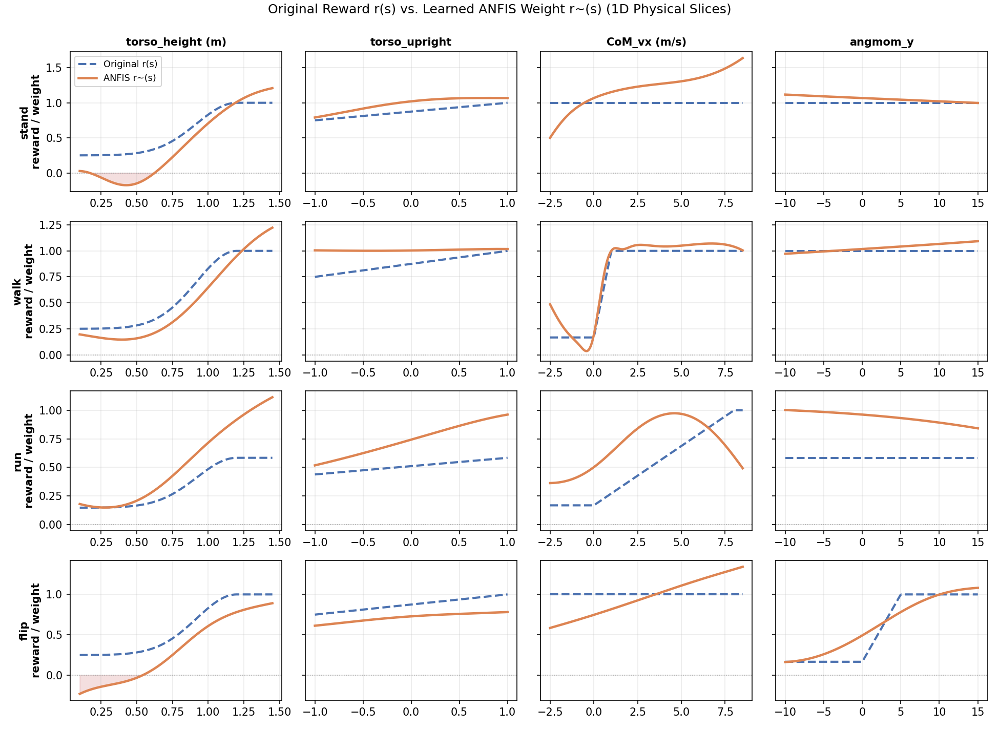
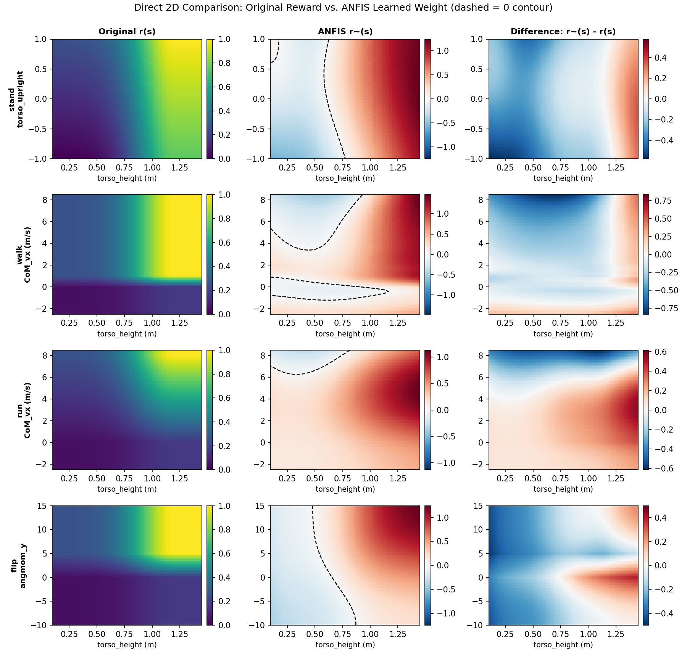

# T6-anfis：以 ANFIS 最佳化 FB Latent $z$（Clean Walker 初測）

固定預訓練好的 FB 模型（Walker RND 660k，1 個 seed），以 4 個 Walker 官方 reward 使用的物理特徵（`torso_height`、`torso_upright`、`CoM_vx`、`angmom_y`）作為 8 規則 Gaussian + first-order ANFIS 的輸入，輸出狀態權重 $\tilde{r}_\theta(s)$ 並透過 $z = \sqrt{d}\,\operatorname{normalize}(\mathbb{E}[\tilde{r}_\theta(s) B(s)])$ 計算 latent。先以真實 reward $r(s)$ warm-start（500 步），再用 episodic REINFORCE（50 iter，$K=16$ 成對擾動）依 clean 環境的實際 rollout return 更新 ANFIS 權重。

每個任務於固定 10 個測試 seed 計算 IQM，並以 `analysis.table6_aggregate` 彙整（selected step = 50）。

## 1. 原始 $z_r$ 與最佳化後分數比較

資料來源：`data/scores.csv`。

| 任務 | 原始 $z_r$ | ANFIS-z（最佳化後） | 差值 |
|---|---:|---:|---:|
| `stand` | 576.2 | **718.4** | +142.3 |
| `walk` | 318.2 | **520.8** | +202.6 |
| `run` | 174.9 | **181.9** | +7.0 |
| `flip` | 338.9 | **431.7** | +92.7 |
| **4-task mean** | 352.1 | **463.2** | +111.1 |
| **All-task IQM (Table 6)** | **328.6** | **476.2** | **+147.7** |

## 2. 原始 Reward Function $r(s)$ 與 ANFIS 學得權重 $\tilde{r}_\theta(s)$ 直接比較

典型物理姿態上的直接數值對照（格式為「原始 $r(s) \to$ ANFIS $\tilde{r}_\theta(s)$」，資料來源：`data/reward_probes.csv`）：

| 典型物理姿態 | `stand` | `walk` | `run` | `flip` |
|---|---:|---:|---:|---:|
| 跌倒 ($h=0.2, \text{up}=-0.5, v_x=0, \omega=0$) | 0.06 $\to$ **-0.36** | 0.01 $\to$ +0.01 | 0.01 $\to$ +0.02 | 0.01 $\to$ **-0.37** |
| 低蹲 ($h=0.7, \text{up}=0.5, v_x=0, \omega=0$) | 0.34 $\to$ +0.18 | 0.06 $\to$ -0.02 | 0.06 $\to$ +0.17 | 0.06 $\to$ +0.03 |
| 站立 ($h=1.25, \text{up}=1.0, v_x=0, \omega=0$) | 1.00 $\to$ +1.07 | 0.17 $\to$ +0.19 | 0.17 $\to$ **+0.50** | 0.17 $\to$ **+0.48** |
| 前走 ($h=1.25, \text{up}=1.0, v_x=1.5, \omega=0$) | 1.00 $\to$ +1.18 | 1.00 $\to$ +1.02 | 0.32 $\to$ **+0.71** | 0.17 $\to$ **+0.58** |
| 快跑 ($h=1.25, \text{up}=1.0, v_x=4.0, \omega=0$) | 1.00 $\to$ +1.28 | 1.00 $\to$ +1.04 | 0.58 $\to$ **+0.96** | 0.17 $\to$ **+0.75** |
| 後退 ($h=1.25, \text{up}=1.0, v_x=-1.5, \omega=0$) | 1.00 $\to$ +0.82 | 0.17 $\to$ +0.21 | 0.17 $\to$ +0.38 | 0.17 $\to$ +0.37 |
| 前空翻 ($h=1.0, \text{up}=0.0, v_x=0.5, \omega=5$) | 0.71 $\to$ +0.64 | 0.41 $\to$ +0.51 | 0.15 $\to$ +0.29 | 0.71 $\to$ +0.53 |
| 反向旋轉 ($h=1.0, \text{up}=0.0, v_x=0, \omega=-5$) | 0.71 $\to$ +0.66 | 0.12 $\to$ +0.17 | 0.12 $\to$ +0.27 | 0.12 $\to$ +0.17 |

### 從圖表直接看到的四個改寫模式
- **跌倒區變負權重（`stand`、`flip`）**：原始 reward 在 $h < 0.6\text{ m}$ 仍有正下界，ANFIS 在該區域壓成負值（熱圖虛線左側），在 $z \propto \sum \tilde{r}(s)B(s)$ 中主動推離跌倒態的 $B(s)$。
- **懲罰「低高度＋高前速」的撲倒區（`walk`）**：`walk` 保留了 $v_x \in [0, 1]$ 的階梯門檻，但把 $h < 0.8\text{ m}$ 且 $v_x > 4\text{ m/s}$ 的撲倒區改寫成負權重，同時把 $h > 1.2\text{ m}$ 的高度獎勵持續拉高（不再在 $1.0$ 飽和）。
- **把速度目標從不可達的 $8\text{ m/s}$ 下修到 $4.5\text{ m/s}$（`run`）**：原始 reward 隨 $v_x$ 線性拉到 $8\text{ m/s}$，ANFIS 改成在 $v_x \approx 4.5\text{ m/s}$ 達峰值並強化直立與高度獎勵。
- **補齊離地與起跳條件（`flip`）**：除了壓低跌倒態為負值，也拉高高姿態與前進速度權重，並把 `angmom_y` 在 $0$ 到 $5$ 之間的轉折平滑化。

## 3. 限制
- 本報告為單一 FB checkpoint seed 的初測，尚無跨 seed 信賴區間。
- 目前僅測 clean 環境，尚未在 OOD 動力學偏移環境上測試。
