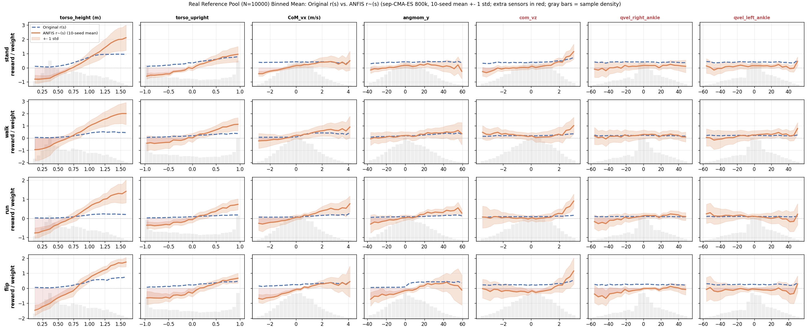
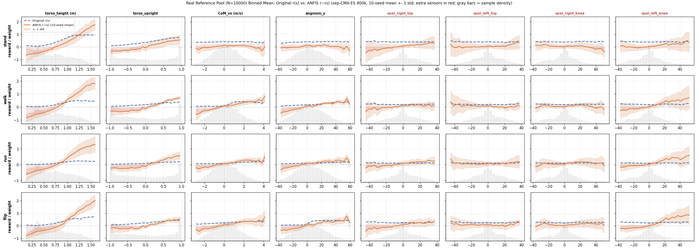

# T6.2-faster-update-algo：在 Walker OOD 動力學中比較快速潛向量適應演算法

固定預訓練好的 FB 模型（Walker RND 660k），在與 T6.1 相同的四種偏移動力學環境中，於統一的 **800,000 環境步數預算**下比較五類適應演算法（REINFORCE、LoLA、ReLA、CEM、CMA-ES）與三種搜尋空間：自由潛向量 $z \in \mathbb{R}^{50}$、4-sensor ANFIS、以及依偏移類型擴增的客製 sensor ANFIS。

## 1. 實驗設定

**OOD 動力學（與 T6.1 相同）**

- `friction_mild`：摩擦係數 `0.1`（原值 `0.7`）
- `friction_high_mild`：摩擦係數 `1.5`（原值 `0.7`）
- `actuator_mild`：關節 gear `76%`（原值 `100%`）
- `actuator_high_mild`：關節 gear `130%`（原值 `100%`）

**搜尋空間**

- `z`：直接優化半徑 $\sqrt{d_z}$ 球面上的自由向量 $z$，由 zero-shot $z_r$ 初始化。
- `anfis (4 sensors)`：4 個基礎物理感測器（`torso_height`、`torso_upright`、`horizontal_velocity`、`angmomentum`，36 rules，200 參數），先以真實 reward warm-start 500 步。
- `anfis (custom sensors)`：沿用 T6.1 客製擴增感測器——Friction 組 7 sensors（128 rules，1,052 參數）、Actuator 組 8 sensors（256 rules，2,336 參數），先 warm-start 500 步。

**演算法與統一協定**

- **預算與評估**：除 T6.1 參考列（3.2M 步為 200 次 REINFORCE 迭代）外，所有 T6.2 方法皆在每個任務跑滿 `800,000` 環境步，每 `40,000` 步於 20 個共用評估環境（種子 `5..24`）評估一次，涵蓋四任務（`stand`、`walk`、`run`、`flip`），每組條件跑 10 個獨立 finetune seeds（`1000..1090`）。
- **彙整指標**：依 Table 6（Jeen et al. 2024，`analysis.table6_aggregate`）計算。`select IQM` 為十個 seeds 平均後 All-task IQM 最高的評估點；`final step IQM` 為最終第 `800,000` 步（不挑選）的 All-task IQM。
- **超參數摘要**：
  - `LoLA`：`horizon=100`、$m=2$、$k=5$、$\gamma=0.98$、$\sigma_0=0.5$、`std_lr=0.05`；`z` 使用 `lr=0.05`，ANFIS 使用 `lr=0.01`。
  - `ReLA`：雙殘差 Critic（2 層 64 隱藏單元，末層零初始化）、`utd=4`、`actor_update_freq=4`、`batch_size=256`、`lr=1e-4`。
  - `CEM`：`pop_size=16`、`elite_frac=0.25`、$\alpha=0.7$、$\sigma_0=0.5$、完整 episode（50 代）。
  - `CMA-ES`：`pop_size=16`、$\sigma_0=0.5$、完整 episode（50 代）；`z` 用 full-covariance CMA-ES，ANFIS 用 `sep-CMA-ES`（對角共變異數）。

## 2. 完整結果比較表

資料來源：`data/summary.csv`（對應 Markdown 檔 `data/summary.md`），T6.1 參考列來自 `tasks/T6.1-ood-fuzzy/data/summary.csv`。

| OOD env | algo | searching space | select IQM | final step IQM |
|---|---|---|---:|---:|
| friction_mild | Frozen FB z_r (T6.1) | z (zero-shot) | 188.5 | 188.5 |
| friction_mild | REINFORCE 800k (T6.1) | anfis (4 sensors) | 282.6 | 282.6 |
| friction_mild | REINFORCE 800k (T6.1) | anfis (custom sensors) | 269.8 | 269.8 |
| friction_mild | REINFORCE 3.2M (T6.1) | anfis (4 sensors) | 382.5 | 382.5 |
| friction_mild | REINFORCE 3.2M (T6.1) | anfis (custom sensors) | 397.1 | 394.6 |
| friction_mild | CMA-ES (full-cov) | z | 616.6 | 615.1 |
| friction_mild | LoLA | z | 553.1 | 553.1 |
| friction_mild | ReLA | z | 677.4 | 664.0 |
| friction_mild | CEM | z | 519.4 | 511.2 |
| friction_mild | sep-CMA-ES | anfis (4 sensors) | 511.9 | 503.5 |
| friction_mild | sep-CMA-ES | anfis (custom sensors) | 516.7 | 516.7 |
| friction_mild | CEM | anfis (4 sensors) | 504.7 | 491.9 |
| friction_mild | CEM | anfis (custom sensors) | 479.4 | 473.8 |
| friction_mild | LoLA | anfis (4 sensors) | 425.6 | 396.9 |
| friction_mild | LoLA | anfis (custom sensors) | 440.2 | 373.8 |
| friction_high_mild | Frozen FB z_r (T6.1) | z (zero-shot) | 277.0 | 277.0 |
| friction_high_mild | REINFORCE 800k (T6.1) | anfis (4 sensors) | 335.9 | 335.9 |
| friction_high_mild | REINFORCE 800k (T6.1) | anfis (custom sensors) | 342.7 | 342.7 |
| friction_high_mild | REINFORCE 3.2M (T6.1) | anfis (4 sensors) | 421.5 | 418.0 |
| friction_high_mild | REINFORCE 3.2M (T6.1) | anfis (custom sensors) | 424.0 | 424.0 |
| friction_high_mild | CMA-ES (full-cov) | z | 656.5 | 643.9 |
| friction_high_mild | LoLA | z | 604.7 | 604.2 |
| friction_high_mild | ReLA | z | 686.9 | 686.9 |
| friction_high_mild | CEM | z | 530.3 | 530.1 |
| friction_high_mild | sep-CMA-ES | anfis (4 sensors) | 558.9 | 548.7 |
| friction_high_mild | sep-CMA-ES | anfis (custom sensors) | 561.0 | 556.6 |
| friction_high_mild | CEM | anfis (4 sensors) | 522.4 | 508.3 |
| friction_high_mild | CEM | anfis (custom sensors) | 469.9 | 456.9 |
| friction_high_mild | LoLA | anfis (4 sensors) | 444.4 | 428.7 |
| friction_high_mild | LoLA | anfis (custom sensors) | 465.2 | 451.5 |
| actuator_mild | Frozen FB z_r (T6.1) | z (zero-shot) | 180.9 | 180.9 |
| actuator_mild | REINFORCE 800k (T6.1) | anfis (4 sensors) | 242.9 | 242.9 |
| actuator_mild | REINFORCE 800k (T6.1) | anfis (custom sensors) | 250.2 | 250.2 |
| actuator_mild | REINFORCE 3.2M (T6.1) | anfis (4 sensors) | 353.8 | 353.8 |
| actuator_mild | REINFORCE 3.2M (T6.1) | anfis (custom sensors) | 377.6 | 377.6 |
| actuator_mild | CMA-ES (full-cov) | z | 549.3 | 543.7 |
| actuator_mild | LoLA | z | 514.2 | 493.5 |
| actuator_mild | ReLA | z | 651.5 | 646.8 |
| actuator_mild | CEM | z | 428.7 | 423.3 |
| actuator_mild | sep-CMA-ES | anfis (4 sensors) | 489.7 | 489.7 |
| actuator_mild | sep-CMA-ES | anfis (custom sensors) | 491.0 | 475.4 |
| actuator_mild | CEM | anfis (4 sensors) | 453.9 | 446.6 |
| actuator_mild | CEM | anfis (custom sensors) | 407.4 | 392.3 |
| actuator_mild | LoLA | anfis (4 sensors) | 344.8 | 304.8 |
| actuator_mild | LoLA | anfis (custom sensors) | 403.0 | 371.2 |
| actuator_high_mild | Frozen FB z_r (T6.1) | z (zero-shot) | 483.8 | 483.8 |
| actuator_high_mild | REINFORCE 800k (T6.1) | anfis (4 sensors) | 521.4 | 521.4 |
| actuator_high_mild | REINFORCE 800k (T6.1) | anfis (custom sensors) | 536.0 | 536.0 |
| actuator_high_mild | REINFORCE 3.2M (T6.1) | anfis (4 sensors) | 565.5 | 561.4 |
| actuator_high_mild | REINFORCE 3.2M (T6.1) | anfis (custom sensors) | 584.3 | 584.3 |
| actuator_high_mild | CMA-ES (full-cov) | z | 754.5 | 754.5 |
| actuator_high_mild | LoLA | z | 707.7 | 688.4 |
| actuator_high_mild | ReLA | z | 748.3 | 745.7 |
| actuator_high_mild | CEM | z | 654.2 | 652.7 |
| actuator_high_mild | sep-CMA-ES | anfis (4 sensors) | 637.9 | 632.6 |
| actuator_high_mild | sep-CMA-ES | anfis (custom sensors) | 654.9 | 654.9 |
| actuator_high_mild | CEM | anfis (4 sensors) | 609.3 | 594.6 |
| actuator_high_mild | CEM | anfis (custom sensors) | 591.4 | 583.0 |
| actuator_high_mild | LoLA | anfis (4 sensors) | 589.1 | 588.7 |
| actuator_high_mild | LoLA | anfis (custom sensors) | 590.8 | 554.6 |
| 4-env mean | Frozen FB z_r (T6.1) | z (zero-shot) | 282.5 | 282.5 |
| 4-env mean | REINFORCE 800k (T6.1) | anfis (4 sensors) | 345.7 | 345.7 |
| 4-env mean | REINFORCE 800k (T6.1) | anfis (custom sensors) | 349.7 | 349.7 |
| 4-env mean | REINFORCE 3.2M (T6.1) | anfis (4 sensors) | 430.8 | 428.9 |
| 4-env mean | REINFORCE 3.2M (T6.1) | anfis (custom sensors) | 445.8 | 445.1 |
| 4-env mean | CMA-ES (full-cov) | z | 644.2 | 639.3 |
| 4-env mean | LoLA | z | 594.9 | 584.8 |
| 4-env mean | ReLA | z | 691.0 | 685.8 |
| 4-env mean | CEM | z | 533.2 | 529.3 |
| 4-env mean | sep-CMA-ES | anfis (4 sensors) | 549.6 | 543.6 |
| 4-env mean | sep-CMA-ES | anfis (custom sensors) | 555.9 | 550.9 |
| 4-env mean | CEM | anfis (4 sensors) | 522.6 | 510.3 |
| 4-env mean | CEM | anfis (custom sensors) | 487.0 | 476.5 |
| 4-env mean | LoLA | anfis (4 sensors) | 451.0 | 429.8 |
| 4-env mean | LoLA | anfis (custom sensors) | 474.8 | 437.8 |

## 3. 學到的狀態權重視覺化（`sep-CMA-ES` 800k，10 seeds 平均 $\pm 1\sigma$）

以 ANFIS 搜尋空間中表現最佳且最穩定的 `sep-CMA-ES`（全部 10 個 finetune seeds 第 `800k` 步 `<task>_final.pt`）為代表，在實際用來計算 $z_\phi = \sqrt{d_z}\,\operatorname{normalize}(\mathbb{E}[\tilde{r}_\phi(s)B(s)])$ 的 **10,000 筆離線參考狀態 $\mathcal{D}_{\text{ref}}$** 上，沿每個感測器分 25 箱（`[p01, p99]`）畫出真實樣本上的 10-seed 平均 $\pm 1\sigma$ 權重（`ref_binned_slices.png`，灰色柱狀為樣本密度），同時亦保留固定基準姿態的 1D 切面（`reward_slices.png`）與 2D 熱圖（`reward_heatmap.png`）於 `figures/cmaes_800k/<env>[_custom]/`。

以下展示 `friction_mild`（低摩擦 0.1）與 `actuator_mild`（關節力矩 76%）的客製 sensor 真實資料集分箱平均圖（紅字欄位為新增感測器）：

## 4. 主要觀察與限制

- **樣本效率大幅超越 REINFORCE**：在相同 `800k` 環境步下，所有 T6.2 演算法在四環境平均皆顯著領先 T6.1 REINFORCE（`345.7 / 349.7`），且全數超越 T6.1 跑 4 倍步數（3.2M 步）的表現（`430.8 / 445.8`）。
- **ANFIS 空間下 `sep-CMA-ES` 表現最佳且最穩**：`sep-CMA-ES` 在 4-sensor（`549.6`）與客製 sensors（`555.9`）四環境皆領先 `CEM` 與 `LoLA`，且 `select IQM` 與 `final step IQM` 差距僅 `5–6` 分，幾乎沒有後期震盪退化。
- **額外 sensors 的維度效應**：在 `sep-CMA-ES`（`555.9` vs `549.6`，四環境全面勝出）與 `LoLA`（`474.8` vs `451.0`，四環境全面勝出）上，擴增客製 sensors 均帶來正向增益；唯獨 `CEM` 在 1,052–2,336 維的高維參數空間內因缺乏共變異數與步長自適應而退化（`487.0` vs `522.6`）。
- **真實資料集分箱圖揭示跨 10 seeds 一致的對比式重加權**：
  - **跌倒與倒立全面轉為負權重、高站立放大**：在 `torso_height < 0.75–0.85 m` 與 `torso_upright < 0`（頭下腳上或倒地）區域，四個任務跨 10 seeds 一致給出**負權重**（低至 `-0.3` 至 `-1.5`），而在 `torso_height > 1.0 m` 與 `torso_upright -> +1` 則放大至原始 $r(s)$ 的 `2–5` 倍。相較原始非負 reward，ANFIS 學出零中心對比式權重，主動把 $z_\phi$ 推離跌倒與倒立狀態。
  - **抑制後退與借用前進穩定**：在 `CoM_vx < 0`（後退／向後滑倒）區域四個任務皆被壓成負權重；實測 `actuator_mild` `stand` 可將原本往後倒退的 `mean_vx=-0.506` 修正為 `+0.461`，並將平均高度從 `0.720 m` 抬升至 `0.973 m`。
  - **額外感測器在真實資料上的作用**：`friction_mild_custom` 的 `com_vz > +2 m/s`（向上垂直速度）在四個任務皆出現明顯正權重上翹；`actuator_mild_custom` 的 `qvel_left_knee > 0` 與 `qvel_right_hip` 呈現跨任務一致的單調上升趨勢；其餘關節角速度平均較平、標準差帶較寬，顯示不同 seed 透過不同關節組合達成相近的潛向量補償。
- **自由潛向量 $z$ 上 `ReLA` 奪冠，與算力成本存在明顯取捨**：`ReLA (z)` 以四環境平均 `691.0 / 685.8` 居所有方法之冠（在最困難的 `actuator_mild` 達 `651.5`，領先次佳 `CMA-ES (z)` 高達 `+102.2`；在 `friction_mild` 達 `677.4`、`friction_high_mild` 達 `686.9`，皆顯著勝出；僅在 `actuator_high_mild` 的 `748.3` 略低於 `CMA-ES (z)` 的 `754.5`）。但因 `utd=4` 需在每個環境步反覆穿透凍結 FB 網路做反向傳播，其單組牆上時間遠高於 `CMA-ES` 與 `LoLA`。
- **限制與待補事項**：
  - 單一凍結 FB checkpoint（`660000.pt`）本身存在左右步態不對稱（慣用腳），因此 ANFIS 對雙側關節角速度（如 `qvel_left_knee` vs `qvel_right_knee`）學出的不對稱斜率反映的是該 checkpoint 的特徵對齊，未必跨預訓練 seed 保持同一側。
  - 不同條件分佈於 CPU、兩款本機 GPU 與遠端 GPU 執行，低摩擦環境對 FP32 末位誤差敏感；正式最終版可將所有模型以 `--eval_models_dir` 在同一硬體上統一重評以消除裝置差異。
