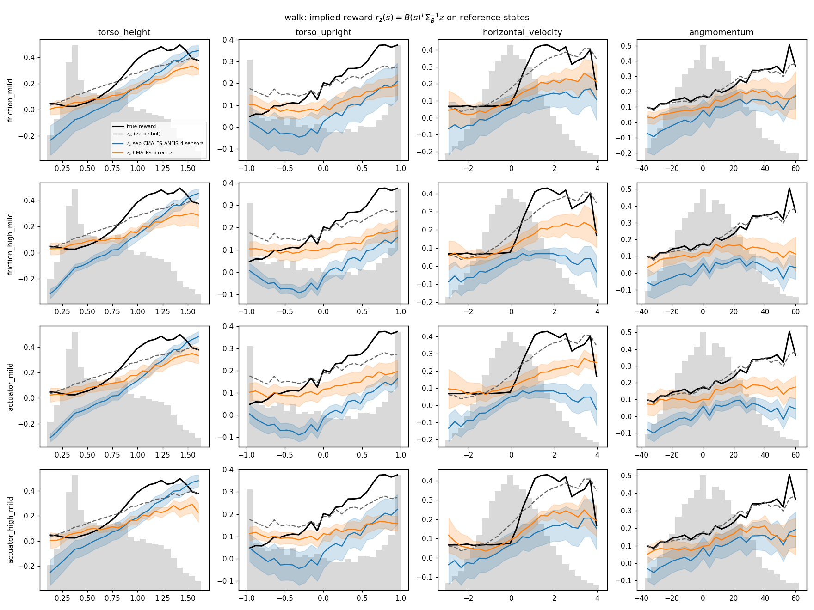

# T6.3-sensors：ANFIS 規則字典的秩與 sensor 數量

在固定的 FB 模型下，ANFIS 能產生的任務潛向量 $z$ 全部落在一個字典矩陣 $\mathbf{Z}_{\text{dict}}$ 的欄空間裡。本報告比較 4、8、37 個 sensors 時這個欄空間的大小與數值條件，判斷增加 sensors 會不會讓 ANFIS 表示更多任務，並用一個對照實驗解釋 T6.2 中直接搜 $z$ 優於 ANFIS 的原因。

結論：

- 在 fuzzy 規則結構下，4 個 sensors 已經能表示所有 $z \in \mathbb{R}^{50}$。增加到 8 個 sensors 不擴大表示範圍，只把字典的條件數從 1,982 降到 252。線性 reward 在 4、8、37 個 sensors 下都無法表示任務，四個任務的平均殘差分別為 0.217、0.215、0.111，規則結構比 sensors 數量重要。
- 將 T6.2 直接搜 $z$ 的 full-cov CMA-ES 換成與 ANFIS 相同的 sep-CMA-ES 後，4 環境平均 select IQM 是 652.9，與 full-cov 的 645.3 相當，仍比 ANFIS 高約 95 分。T6.2 中直接搜 $z$ 的領先來自搜尋空間，不是演算法。
- ANFIS 找到的 $z$ 所隱含的 reward 仍可用 Walker reward 公式描述（$R^2 \approx 0.71$，與 zero-shot $z_r$ 的 0.66–0.71 相當），walk 的速度權重從 0.74 降到 0.27–0.47。直接搜 $z$ 的隱含 reward 無法用該公式描述（$R^2 \approx 0.4$）。

## 1. 方法

membership 參數固定、輸出層為 identity 時，first_order ANFIS 的 reward 對 consequent 參數是線性的：

$$r(s) = \sum_{k=1}^{K} \bar{w}_k(s)\,\big(W_k \tilde{x}(s) + b_k\big) = \Psi(s)^\top \theta$$

其中 $\bar{w}_k$ 是正規化後的規則觸發強度，$\tilde{x}$ 是 z-score 後的 sensors。每條規則貢獻 $D+1$ 個基底函數 $\bar{w}_k(s)$ 與 $\bar{w}_k(s)\tilde{x}_i(s)$。FB 的任務潛向量因此是

$$z \propto \mathbb{E}_\rho\big[B(s)\,r(s)\big] = \mathbf{Z}_{\text{dict}}\,\theta, \qquad \mathbf{Z}_{\text{dict}} = \frac{1}{N} B^\top \Psi \in \mathbb{R}^{50 \times K(D+1)}$$

最後的 $\sqrt{50}$ 長度正規化不改變方向，所以 $\mathbf{Z}_{\text{dict}}$ 的欄空間就是 ANFIS 能到達的 $z$ 方向集合。

**設定**

- FB 模型：Walker RND 660k（與 T6.1、T6.2 相同），$d_z = 50$。
- 狀態分布 $\rho$：從 Walker RND 離線資料集抽 100,000 筆 transitions，再取 10,000 個狀態（seed 42），與 T6.2 的 `cmaes_anfis` 設定相同。分析不做 rollout，結果與 OOD 動力學無關。
- membership 參數：`init_from_data` 的分位數初始化，與 T6.2 的 ANFIS 起點相同。
- 數值秩：$\sigma_i > 10^{-3}\,\sigma_1$ 的奇異值個數。
- 任務殘差：stand、walk、run、flip 的 $z_r$ 對 $\mathbf{Z}_{\text{dict}}$ 做最小平方擬合後的相對殘差 $\|\mathbf{Z}_{\text{dict}}\theta^{\ast} - z_r\| / \|z_r\|$。

**Sensor 組合**

| 結構 | Sensors | 每個 sensor 的 terms | 規則數 $K$ | 字典欄數 |
|---|---|---|---:|---:|
| fuzzy | 4：`torso_height`、`torso_upright`、`horizontal_velocity`、`angmomentum` | 3、2、3、2 | 36 | 180 |
| fuzzy | 8：上述 4 個加左右 hip、knee 角速度（T6.1 actuator 組） | 2 | 256 | 2,304 |
| 線性 | 4：同上 | 1 | 1 | 5 |
| 線性 | 8：同上 | 1 | 1 | 9 |
| 線性 | 37：Walker 全部 sensors | 1 | 1 | 38 |

每個 sensor 只用 1 個 term 時只有 1 條規則，ANFIS 退化為 sensors 的線性 reward $r(s) = W\tilde{x}(s) + b$。37 個 sensors 的 fuzzy 版需要至少 $2^{37}$ 條規則，無法建立。

## 2. 結果

資料來源：`data/zdict_rank.csv` 與 `data/zdict_spectra.npz`。

| 結構 | Sensors | 數值秩 | 有效秩 | 條件數 | stand 殘差 | walk 殘差 | run 殘差 | flip 殘差 |
|---|---:|---:|---:|---:|---:|---:|---:|---:|
| fuzzy | 4 | 45 / 50 | 14.3 | 1,982 | 0 | 0 | 0 | 0 |
| fuzzy | 8 | 50 / 50 | 17.4 | 252 | 0 | 0 | 0 | 0 |
| 線性 | 4 | 5 / 5 | 4.7 | 2.7 | 0.057 | 0.318 | 0.204 | 0.290 |
| 線性 | 8 | 9 / 9 | 7.3 | 7.8 | 0.055 | 0.317 | 0.200 | 0.289 |
| 線性 | 37 | 36 / 38 | 20.3 | $3.6 \times 10^{16}$ | 0.019 | 0.178 | 0.099 | 0.148 |

數值秩欄為「秩 / 上限」，上限是 $\min(50, \text{字典欄數})$。殘差為 0 的格子實際值都小於 $10^{-14}$。有效秩是 $\exp(-\sum_i p_i \log p_i)$，其中 $p_i = \sigma_i / \sum_j \sigma_j$。

**四個任務的平均殘差**

| 結構 | 4 sensors | 8 sensors | 37 sensors |
|---|---:|---:|---:|
| fuzzy | 0 | 0 | 無法建立 |
| 線性 | 0.217 | 0.215 | 0.111 |

**fuzzy 4 sensors 最弱的 5 個方向**

| | $\sigma_{46}$ | $\sigma_{47}$ | $\sigma_{48}$ | $\sigma_{49}$ | $\sigma_{50}$ |
|---|---:|---:|---:|---:|---:|
| $\sigma_i / \sigma_1$ | $9.7 \times 10^{-4}$ | $8.0 \times 10^{-4}$ | $6.9 \times 10^{-4}$ | $5.6 \times 10^{-4}$ | $5.0 \times 10^{-4}$ |

## 3. 解讀

- **規則結構比 sensors 數量重要。** 固定 sensors 數量，fuzzy 版的殘差為 0，線性版為 0.21 以上。固定線性結構，sensors 從 4 加到 8 時殘差幾乎不變，加到 37 時降到 0.111，仍無法表示任何一個任務。
- **fuzzy 4 sensors 能表示所有 $z$，但有 5 個方向很難到達。** 要在這 5 個方向上移動相同距離，consequent 參數的變化量是最強方向的約 1,000 到 2,000 倍。
- **fuzzy 8 sensors 只改善數值條件。** 能表示的 $z$ 與 4 sensors 相同，條件數低約 8 倍，參數從約 200 維增為 2,300 維以上。
- **線性 37 sensors 的欄空間只有 36 維。** 有兩個奇異值低於 float32 精度（$1.0 \times 10^{-8}\sigma_1$ 與 0），表示部分 sensors 是其他 sensors 的線性組合。
- **對 sensors 搜尋實驗的意義。** 在 fuzzy 結構下，sensors 數量不影響能表示哪些 $z$，4 與 8 sensors 的差異只來自條件數與搜尋維度。

## 4. 對照實驗：sep-CMA-ES 直接搜 $z$

T6.2 中直接搜 $z$ 用 full-cov CMA-ES，ANFIS 用 sep-CMA-ES（對角共變異數）。為了分開演算法與搜尋空間的影響，本實驗用 sep-CMA-ES 直接搜 $z$。

**設定**

- 設定檔 `configs/sepcmaes_z.yaml` 與 T6.2 的 `cmaes_z.yaml` 只差 `diagonal: true`：`pop_size=16`、$\sigma_0=0.5$、從 $z_r$ 開始、每個任務 800,000 環境步數、每 40,000 步在 20 個評估環境（種子 `5..24`）評估一次。
- 環境與 T6.2 相同：`friction_mild`、`friction_high_mild`、`actuator_mild`、`actuator_high_mild`。
- 只跑 3 個 finetune seeds（1000、1010、1020）。表中 T6.2 的三個條件也只取這 3 個 seeds，所有列的環境與 seeds 完全配對。
- 每個環境以 Table 6（Jeen et al. 2024，`analysis.table6_aggregate`）彙整。`select IQM` 是所有評估點中 all-task IQM 最高者，`final IQM` 是第 800,000 步的 all-task IQM。

**4 環境平均**

資料來源：`data/sep_vs_full.csv`。

| 演算法 | 搜尋空間 | select IQM | final IQM | stand | walk | run | flip |
|---|---|---:|---:|---:|---:|---:|---:|
| sep-CMA-ES | $z$ | 652.9 | 641.2 | 860.1 | 760.9 | 282.9 | 521.5 |
| full-cov CMA-ES（T6.2） | $z$ | 645.3 | 642.7 | 862.4 | 747.4 | 274.6 | 538.0 |
| sep-CMA-ES（T6.2） | ANFIS 4 sensors | 560.1 | 552.0 | 742.9 | 645.1 | 220.5 | 458.9 |
| sep-CMA-ES（T6.2） | ANFIS custom sensors | 554.3 | 538.7 | 756.2 | 629.7 | 232.6 | 447.7 |

各任務欄是第 800,000 步的分數。

**各環境的 select IQM**

| 環境 | sep-CMA-ES $z$ | full-cov CMA-ES $z$ | sep-CMA-ES ANFIS 4 sensors | sep-CMA-ES ANFIS custom sensors |
|---|---:|---:|---:|---:|
| friction_mild | 649.1 | 626.6 | 515.8 | 511.8 |
| friction_high_mild | 650.4 | 642.1 | 581.5 | 580.3 |
| actuator_mild | 546.8 | 556.3 | 497.1 | 479.3 |
| actuator_high_mild | 765.5 | 756.2 | 646.1 | 645.6 |

**解讀**

- **演算法不是主因。** 直接搜 $z$ 時，sep 與 full-cov 在 4 個環境的 select IQM 差距都在 23 分以內，互有勝負。在 50 維的 $z$ 空間裡，學不學共變異數的旋轉幾乎沒有影響。
- **搜尋空間是主因。** 演算法同為 sep-CMA-ES 時，ANFIS 的 4 環境平均 select IQM 比直接搜 $z$ 低 93 到 99 分。4 個環境 × 4 個任務的 16 格中，兩種 ANFIS 的最終分數都低於 sep-CMA-ES 直接搜 $z$。
- **和字典的數值條件一致。** 參數 $\theta$ 的擾動 $\delta\theta \sim \mathcal{N}(0, \sigma^2 I)$ 在 $z$ 空間的共變異數是 $\sigma^2\,\mathbf{Z}_{\text{dict}}\mathbf{Z}_{\text{dict}}^\top$，各方向的變異數正比於 $\sigma_i^2$。依第 2 節的奇異值，4 sensors 時前 10 個方向佔 98% 的變異數，最弱的 25 個方向只佔 0.02%；8 sensors 時是 98% 與 0.17%。以 $\sigma_i^2$ 計算的有效秩分別是 6.4 與 6.1。直接搜 $z$ 時 50 個方向的變異數相同。ANFIS 的探索大多集中在約 6 個 $z$ 方向。
- **參數維度不是主因。** custom sensors 的參數比 4 sensors 多約 10 倍（2,336 對約 200），兩者的分數卻相近。

**評估對數值誤差很敏感**

同一個 $z_r$ 在不同執行設定下的評估分數差很多。以 friction_mild、seed 1000 的 stand 為例，`baseline_table6.csv` 的 $z_r$ 分數在 T6.2 的 CMA-ES 與 CEM 是 161.2，在 T6.2 的 LoLA ANFIS 是 271.3，在本實驗是 127.3。同一個 run 裡，第 0 步評估的 $z$ 與 $z_r$ 的 cosine 為 1.0000，分數却是 178.3。policy 是確定性的，評估環境的種子也固定，比較可能的原因是不同主機與執行緒數造成的微小浮點誤差在 walker 的 rollout 中被放大，但尚未驗證。本實驗在單執行緒下執行，T6.2 的 CMA-ES 為兩個執行緒，因此 sep 與 full-cov 之間幾分的差距在雜訊範圍內。ANFIS 與直接搜 $z$ 的差距遠大於此。

## 5. 找到的 $z$ 隱含的 reward

對一個 $z$，$B$ 張成空間中唯一產生它的 reward 是

$$r_z(s) = B(s)^\top \Sigma_B^{-1} z, \qquad \Sigma_B = \mathbb{E}_\rho[B(s)B(s)^\top]$$

分析對象是 T6.2 第 800,000 步的 $z$（sep-CMA-ES ANFIS 4 sensors 與 full-cov CMA-ES 直接搜 $z$，各 4 個環境 × 10 seeds），在第 1 節的 10,000 個 reference 狀態上計算。所有 $r_z$ 共用同一個仿射尺度（使 $r_{z_r}$ 最接近真實 reward）。資料來源：`data/reward_summary.md`。

**與真實 reward 的相關係數**（4 環境 × 10 seeds 平均）

| 任務 | $r_{z_r}$ 對真實 | ANFIS 對真實 | 直接搜 $z$ 對真實 | ANFIS 對 $r_{z_r}$ | 直接搜 $z$ 對 $r_{z_r}$ |
|---|---:|---:|---:|---:|---:|
| stand | 0.78 | 0.70 | 0.35 | 0.87 | 0.45 |
| walk | 0.71 | 0.56 | 0.35 | 0.77 | 0.50 |
| run | 0.72 | 0.52 | 0.36 | 0.71 | 0.49 |
| flip | 0.75 | 0.61 | 0.39 | 0.80 | 0.51 |

**沿 4 個 sensors 的分箱平均（walk）**

黑線為真實 reward，灰虛線為 $r_{z_r}$，藍線為 ANFIS，橙線為直接搜 $z$（陰影為 10 seeds 的 $\pm 1$ 標準差）。其餘任務見 `figures/z_reward/{stand,run,flip}.png`。

**以 Walker reward 公式配適**

公式為 DMC Walker reward 的推廣（13 個參數），stand、walk、run、flip 皆為其特例：

$$r(s) = a\big[w\,T(h;h_0,\infty,m_h) + (1-w)\tfrac{1+u}{2}\big]\big[(1-b_v) + b_v\,T(v_x;v_{lo},v_{hi},m_v)\big]\big[(1-b_\omega) + b_\omega\,T(\omega;\omega_{lo},\omega_{hi},m_\omega)\big] + c$$

$T$ 為 dm_control 的 Gaussian tolerance（區間內為 1，距區間一個 margin 處為 0.1）；$h$、$u$、$v_x$、$\omega$ 為 torso 高度、upright、水平速度與角動量。

| 任務 | 真實 reward | $r_{z_r}$ | ANFIS（seed 平均） | ANFIS（單一 seed） | 直接搜 $z$（seed 平均） | 直接搜 $z$（單一 seed） |
|---|---:|---:|---:|---:|---:|---:|
| stand | 1.000 | 0.70 | 0.72 | 0.69 | 0.38 | 0.19 |
| walk | 0.999 | 0.67 | 0.71 | 0.68 | 0.37 | 0.21 |
| run | 0.992 | 0.66 | 0.72 | 0.66 | 0.38 | 0.22 |
| flip | 1.000 | 0.71 | 0.71 | 0.67 | 0.43 | 0.26 |

表中為配適的 $R^2$。seed 平均為 10 seeds 平均 reward 的配適，再對 4 個環境取平均。

**walk 的公式對照（friction_mild）**

| 對象 | $R^2$ | 配適結果 |
|---|---:|---|
| 真實 reward | 0.999 | $\big(0.75\,T(h,[1.20,\infty),0.60) + 0.25\tfrac{1+u}{2}\big)\big(0.16 + 0.84\,T(v_x,[1.09,\infty),1.05)\big)$ |
| $r_{z_r}$ | 0.67 | $0.82\,T(h,[1.67,\infty),2.0)\big(0.26 + 0.74\,T(v_x,[2.44,\infty),3.9)\big) - 0.08$ |
| ANFIS | 0.72 | $0.98\,T(h,[1.81,\infty),2.0)\big(0.62 + 0.38\,T(v_x,[2.10,\infty),4.6)\big) - 0.34$ |

省略權重 $b_\omega < 0.25$ 的角動量項。所有配適結果見 `data/reward_template.md`。

**walk 的速度權重 $b_v$**

| 對象 | friction_mild | friction_high_mild | actuator_mild | actuator_high_mild |
|---|---:|---:|---:|---:|
| 真實 reward | 0.84 | 0.84 | 0.84 | 0.84 |
| $r_{z_r}$ | 0.74 | 0.74 | 0.74 | 0.74 |
| ANFIS | 0.38 | 0.27 | 0.37 | 0.47 |
| 直接搜 $z$（$R^2 \le 0.40$，不可解讀） | 0.71 | 0.82 | 0.67 | 0.80 |

## 6. 限制

- membership 參數取初始化值。T6.2 的 CMA-ES 使用 `param_scope: all`，會同時調整 membership，字典在搜尋過程中會改變。本分析只描述搜尋起點。
- 線性關係只在 identity 輸出層下成立。使用 softplus 等輸出層時，可到達的集合不再是欄空間。
- 能表示某個 $z$ 不代表搜尋找得到它。條件數只是搜尋難度的一個指標，實際效果要由 CMA-ES 實驗確認。
- 8 sensors 只測了 T6.1 actuator 組這一種組合，其他 8 個 sensors 的組合可能有不同的條件數。
- 只用了一個 FB 模型與一組 10,000 個狀態，沒有估計抽樣變異。
- 對照實驗只有 3 個 seeds。
- 「ANFIS 的探索集中在少數 $z$ 方向」是由奇異值推得的解釋，尚未直接驗證。直接的驗證是把直接搜 $z$ 得到的 $z - z_r$ 投影到 $\mathbf{Z}_{\text{dict}}$ 的奇異向量上，檢查進步是否落在弱方向。
- ANFIS 與直接搜 $z$ 還有其他設定差異：ANFIS 先用真實 reward warm-start 500 步，`max_sigma` 為 2.0（$z$ 為 5.0），且 membership 參數也在搜尋範圍內。
- 分箱圖為邊際平均，每個點混有其他變數的變化。Walker 每個 episode 固定 1000 步，reward 加常數不改變最佳 policy，因此只比較形狀，不比較高低。
- 公式中部分參數無法確定：$w$ 幾乎都為 1（upright 與高度高度相關），$h_0$ 與 $m_h$ 常停在上界 2.0（資料高度最大約 1.6），部分 $\omega$ 區間寬度為 0。只有各項權重 $b_v$、$b_\omega$ 與整體形狀可解讀。
- 直接搜 $z$ 的隱含 reward 與 4-sensor 公式配適的 $R^2$ 低，只表示它不是「原任務改幾個參數」，尚未確認它的改動來自哪些 sensors。
